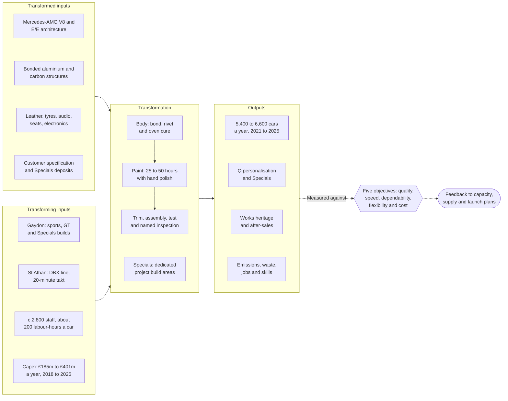
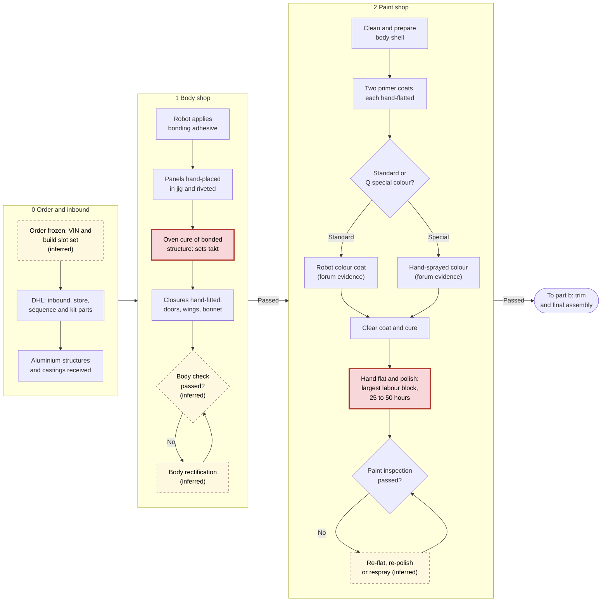
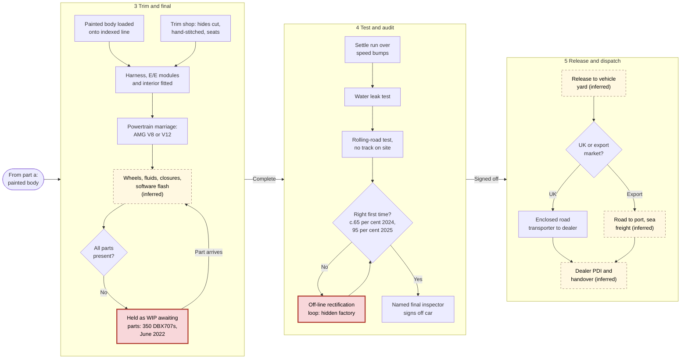
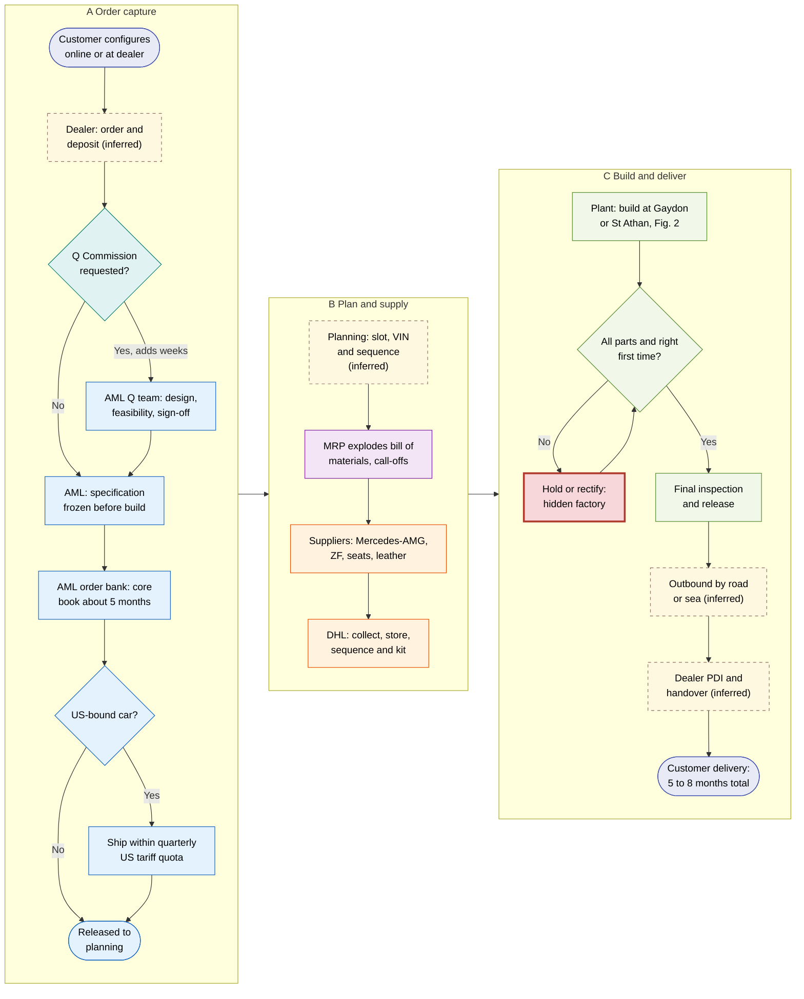
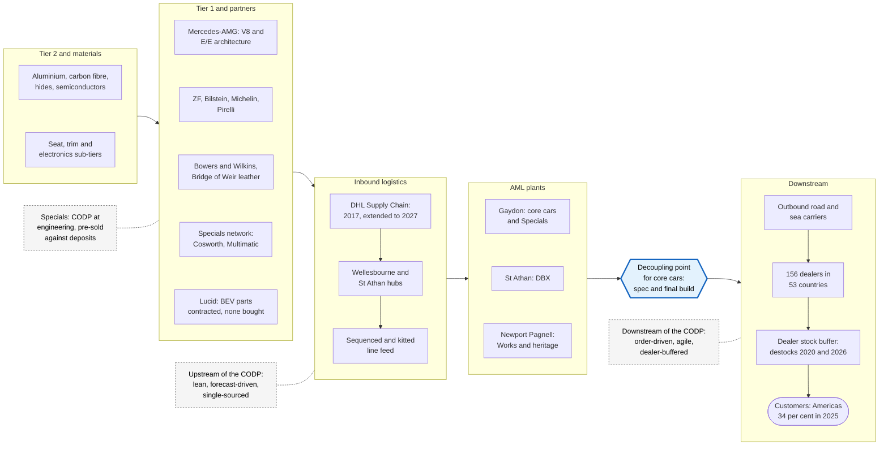
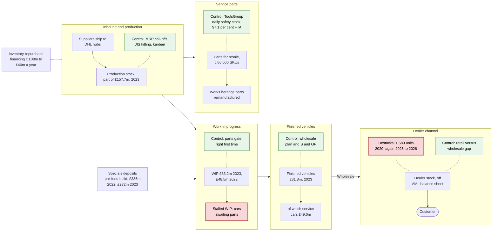
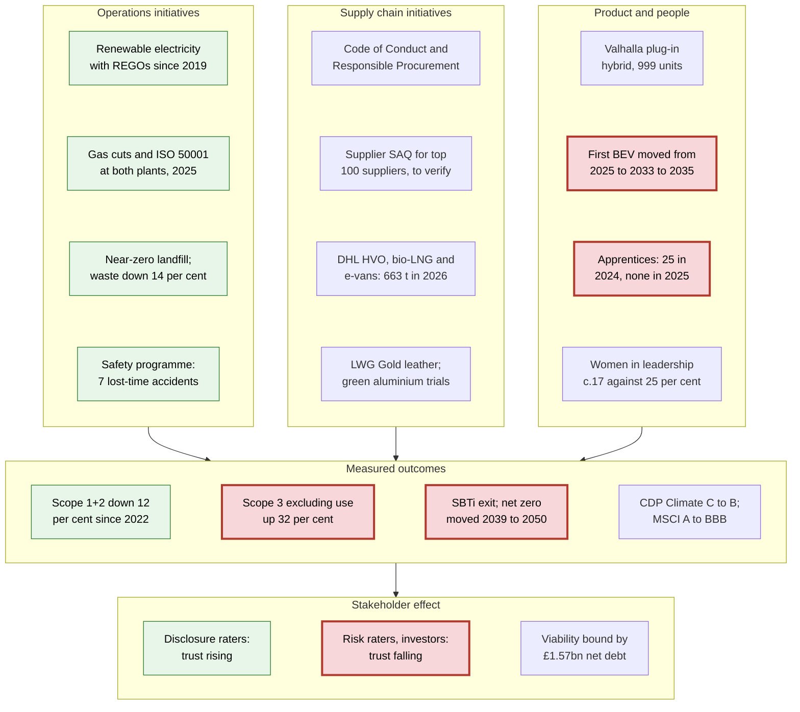

# Operations Dependability Decides Aston Martin's Luxury Future

**An operations and supply chain management assessment of Aston Martin Lagonda Global Holdings plc, 2018 to 9M 2026**

*Evidence cut-off: 6 November 2026. Figures tagged [extract] come from search-engine extracts of the named primary documents; [derived] and [calc] figures are the author's own arithmetic, with formulas shown; [biblio] marks theory sources cited from standard bibliographic knowledge. Appendix B lists what must be checked against which primary document before submission.*

## Executive summary

Aston Martin Lagonda (AML) is a craft-intensive, low-volume assembler whose financial results are governed less by demand for its cars than by the dependability of its own operations and supply chain. Between 2018 and 2025 annual wholesales stayed in a narrow band of roughly **5,400 to 6,600 cars**, apart from the 2020 collapse to 3,394, while gross margin swung from **39.7% (2018) to 18.2% (2020), back to 39.1% (2023) and down to 29.4% (2025)**, before recovering to **35.2% in the nine months to September 2026** ([AML, 2021a](https://www.astonmartin.com/-/media/corporate/corporatearchive/documents/results-centre/2020---results-centre/fy---2020/aston-martin-lagonda-fy-2020-results---press-release.pdf?rev=267148fa0d8647e4bf10524c3405b00e); [AML, 2026f](https://www.investegate.co.uk/announcement/rns/aston-martin-lagonda-global-holdings--aml/results-for-q3-and-9-months-ended-30-sept-2026/9844573)). AML missed its initial annual guidance in four of the seven assessable years, and every miss from 2023 to 2025 traces to new-product introduction, supplier readiness or quality rather than to weak orders. That makes operations the binding constraint on strategy, and it is the single thread running through all five sections of this report.

Section 1 shows that operations management at AML is primarily a capital-allocation and dependability problem: capex of **£30k–£77k per car**, and above £44k in every year except 2021 [calc], makes the business extremely sensitive to lost units, and the Project Horizon target of c.£500m adjusted EBITDA was only 54% met in 2024 and 22% met in 2025 [derived]. Section 2 analyses the Gaydon build and the order-to-delivery process and finds that the factory accounts for only around **5–15% of a five-to-eight-month customer lead time** [calc]; the process failures cluster at interfaces, notably a right-first-time rate of **c.65% in 2024** that created a rectification loop affecting roughly 2,100 cars [calc] before it rose to 95% in 2025 ([AML, 2026a](https://www.astonmartin.com/-/media/corporate/documents/fy-results-2025/aston-martin-lagonda-fy-2025-results.pdf)). Section 3 classifies the supply chain as leagile, with a lean, outsourced inbound chain run by DHL Supply Chain since 2017 and a decoupling point at specification and final assembly, but argues that its buffers sit in the wrong place: aggregate inventory of about 114 days of cost of sales coexists with thin protection for single-source parts. Section 4 shows that AML's inventory days are comparable to Ferrari's but its cash conversion cycle is about four months, so inventory and dealer-stock discipline feed directly into the refinancing chain that culminated in the July 2026 HPS term loan. Section 5 finds AML moderately effective on factory emissions, waste and safety but regressing on the material issues of Scope 3, electrification and workforce development, which weakens stakeholder trust at the moment financial resilience is weakest.

The overall verdict is that AML has the order winners of a luxury maker (design, exclusivity, personalisation) but has repeatedly failed the qualifiers of dependability and conformance quality. The 2026 recovery, built on pre-sold Valhalla deliveries, paced core production and lower manufacturing cost, is the strongest evidence yet that an operations-led, build-to-order model works for AML; whether it is sustained will be decided by Q4 2026 delivery and by cash conversion rather than by margin.

## Introduction: company, method and limits of the evidence

### Company profile

AML designs, engineers and assembles luxury sports cars, grand tourers, an SUV and limited-run "Specials" in the United Kingdom. Its car-making sites are **Gaydon** in Warwickshire (headquarters, engineering, sports and GT cars and Specials), **St Athan** in the Vale of Glamorgan (the DBX SUV, opened December 2019 in three converted Ministry of Defence hangars) and **Newport Pagnell** (Aston Martin Works heritage, restoration and service) ([Aston Martin Media, 2019](https://media.astonmartin.com/aston-martin-lagonda-opens-manufacturing-plant-in-st-athan-wales/); [AML, 2017](https://www.astonmartin.com/en-gb/our-world/news/2017/2/22/gaydon-headquarters)). The Aston Martin Aramco Formula 1 team and its Silverstone campus belong to a separately owned company, AMR GP Ltd, and are excluded from this analysis except where their data have been wrongly attributed to AML. AML sells almost entirely through some **156 third-party dealers in 53 countries** (2025) on a wholesale basis ([AML, 2026c](https://www.astonmartin.com/-/media/corporate/corporatearchive/documents/annual-reports/aston-martin-lagonda-annual-report-2025.pdf?rev=481f11aaed454601b437f2d2730eb377)). Its powertrain and electrical/electronic (E/E) architecture rely on a technical partnership with Mercedes-AMG dating from 2013, and its shareholder register now ties together Yew Tree (Lawrence Stroll's consortium), the Saudi Public Investment Fund, Geely and Mercedes-Benz ([AML, 2023g](https://lse.co.uk/rns/AML/substantial-investment-in-aston-martin-by-geely-q94k6aqturtuixu.html?page=21); [MarketScreener, 2023](https://www.marketscreener.com/quote/stock/ASTON-MARTIN-LAGONDA-GLOB-46472778/news/Aston-Martin-makes-Lucid-deal-alters-Mercedes-Benz-tie-up-44185695/)). The company was listed in October 2018 and has been led since October 2024 by Adrian Hallmark.

### Method

The report synthesises six research note files compiled on 6 November 2026 covering operations strategy, process analysis, supply chain, inventory, sustainability and peer benchmarks and literature, together with earlier background notes. Company evidence comes from AML results announcements, annual and sustainability reports and call transcripts for 2018 to Q3 2026; peer evidence from Ferrari, Volkswagen Group (Bentley and Lamborghini), BMW Group (Rolls-Royce), Porsche AG and McLaren filings and releases; and theory from peer-reviewed operations and supply chain literature, applied explicitly in each section. Each of the five main sections follows the same structure: an empirical table with a multi-year series, peer benchmarks, named frameworks with their empirical findings, one or two editable flowchart diagrams, and a short evaluative conclusion. All derived metrics are calculated by the author and labelled; formulas are given where they are first used. Inventory days and the cash conversion cycle are computed on **reported cost of sales for every year**, not on the narrower "cost of inventories recognised as an expense", so that the series is consistent.

### Data limitations

Three limitations matter. First, the research environment blocked direct downloads from AML, regulator and peer websites, so almost every hard figure was read from search-engine extracts of the primary documents; these are marked [extract] and must be checked against the PDF before submission (Appendix B). Second, AML does not publish several metrics an operations analyst would want, including dealer stock in units after 2020, order-to-delivery lead times, supplier counts, overall equipment effectiveness or the Gaydon/St Athan volume split; where the report estimates these it says so. Third, peer data are not like-for-like: AML reports wholesales and adjusted EBITDA, Ferrari reports shipments and group EBIT, Volkswagen brands report return on sales, and Rolls-Royce publishes no profit figures at all. The research also corrected several claims circulating in secondary sources, for example that a Swiss aluminium flood in 2024 hit AML, that the July 2026 £550m financing was a bond, and that a sea-freight carbon saving belonged to AML; these are resolved in Appendix A.

**Table 1. Cross-cutting key performance indicators, 2018 to 9M 2026**

| KPI | 2018 | 2019 | 2020 | 2021 | 2022 | 2023 | 2024 | 2025 | 9M 2026 |
|---|---|---|---|---|---|---|---|---|---|
| Wholesales (units) | 6,441 | 5,862 | 3,394 | 6,178 | 6,412 | 6,620 | 6,030 | 5,448 | 3,762 |
| Revenue (£m) | 1,096.5 | 980.5 (restated) | 611.8 | 1,095.3 | 1,381.5 | 1,632.8 | 1,583.9 | 1,257.7 | c.1,020 |
| Gross margin (%) | 39.7 [calc] | 34.5 | 18.2 | 31.4 [calc] | 32.6 [calc] | 39.1 | 36.9 | 29.4 | 35.2 (Q3: 37.4) |
| Adjusted EBITDA (£m) | 247.3 | 134 | (71) | 137.9 | 190.2 | 305.9 | 271.0 | 108.1 | 132.6 |
| Capex (£m) | 311 | 310 | 261 | 185 | 287 | 397 | 401 | 341 | n/f (FY guide c.300) |
| Free cash flow (£m) | n/f | (338) | (539) | (123) | (299) | (360) | (392) | (410) | (225.2) |
| Year-end inventory (£m) | 165.3 | 200.7 | 207.4 | 196.8 | 286.2 | 272.7 | 303.0 | 277.7 | 312.9 (30 Jun) |
| Inventory days on cost of sales [calc] | 91.3 | 114.0 | 151.2 | 95.6 | 112.2 | 100.2 | 110.6 | 114.2 | n/a |
| Net debt (£m) | n/f | n/f | n/f | n/f | n/f | 814.3 | 1,162.7 | 1,380.3 | 1,572.3 |
| Scope 1+2 market-based (tCO2e) | n/f | n/f | n/f | n/f | 9,083 | 7,506 | 9,174 | 8,029 | n/f |
| Right-first-time (%) | n/f | n/f | n/f | n/f | n/f | n/f | c.65 | 95 (H2) | n/f |
| Headcount | 650 Gaydon manufacturing | n/f | up to 500 cut | n/f | 2,537 average | 2,740 average | c.3,010 (aggregator) | 2,807 year-end | c.3,000 less up to 20% |

Sources: [AML (2019)](https://amlcorp.blob.core.windows.net/default-storage/docs/default-source/documents/results-centre/2018---results-centre/q4---2018/aston-martin-lagonda-fy-2018-results---press-release.pdf?sfvrsn=dbf7d4d9_2); [AML (2020c)](https://amlcorp.blob.core.windows.net/default-storage/docs/default-source/documents/results-centre/2019---results-centre/fy---2019/aston-martin-lagonda-fy-2019-results---transcript.pdf?sfvrsn=5aec293a_2); [AML (2021a)](https://www.astonmartin.com/-/media/corporate/corporatearchive/documents/results-centre/2020---results-centre/fy---2020/aston-martin-lagonda-fy-2020-results---press-release.pdf?rev=267148fa0d8647e4bf10524c3405b00e); [AML (2022a)](https://www.astonmartin.com/-/media/corporate/corporatearchive/documents/results-centre/2021---results-centre/fy---2021/aston-martin-lagonda-fy-2021-results---press-release.pdf?rev=d1cce4098cab4d5394fa23d2ca90edef); [AML (2023a)](https://www.astonmartin.com/-/media/corporate/corporatearchive/documents/investors---results-and-presentations/aml-fy-2022-results-rns.pdf?rev=f3dc425a39d448d6b54aab84380ef3b3); [AML (2024a)](https://www.astonmartin.com/-/media/corporate/corporatearchive/documents/2023-results/aston-martin-lagonda-fy-2023-results.pdf?rev=1fef788985ef4cd88cb7da5773860a7e); [AML (2025a)](https://www.astonmartin.com/-/media/corporate/corporatearchive/documents/2024-results/aml-fy-2024-results-announcement-vf.pdf?rev=28a5dd01ef6c4f8f893e43f0311650ea); [AML (2026a)](https://www.astonmartin.com/-/media/corporate/documents/fy-results-2025/aston-martin-lagonda-fy-2025-results.pdf); [AML (2026c)](https://www.astonmartin.com/-/media/corporate/corporatearchive/documents/annual-reports/aston-martin-lagonda-annual-report-2025.pdf?rev=481f11aaed454601b437f2d2730eb377); [AML (2026e)](https://www.astonmartin.com/-/media/corporate/documents/2026/aston-martin-lagonda-h1-2026-results.pdf?rev=11d26777670e4ba0a7f353edf59477c0); [AML (2026f)](https://www.investegate.co.uk/announcement/rns/aston-martin-lagonda-global-holdings--aml/results-for-q3-and-9-months-ended-30-sept-2026/9844573). All [extract] unless marked. 2018 inventory is the restated 1 January 2019 balance; 9M 2026 wholesales = H1 2,331 + Q3 1,431 [derived]; gross margin for 2018, 2021 and 2022 = 1 − cost of sales ÷ revenue [calc]. n/f = not found in accessible extracts.

## 1. Company operations: dependability, not demand, sets the ceiling on performance

### 1.1 A low-volume transformation system with very high fixed-asset intensity

Slack, Brandon-Jones and Burgess (2022) define operations management as the activity of managing the resources that transform inputs into goods and services, and they distinguish *transformed* resources (materials, information, customers) from *transforming* resources (facilities and staff) ([Slack et al., 2022](https://eu.pearson.com/operations-management/9781292408224)) [biblio]. Applied to AML, the model reveals an assembler that buys in much of its technical content and adds value through craft finishing and personalisation. The principal transformed inputs are Mercedes-AMG 4.0-litre V8 engines and E/E architecture used across Vantage, DB12 and DBX, bonded aluminium structures, leather, tyres and audio systems; in January 2019 about **3,900 parts** on the line were imported, including engines and gearboxes from Germany ([Motor Authority, 2019](https://www.motorauthority.com/news/1120773_aston-martin-preparing-for-worst-case-scenario-with-no-deal-brexit-looming)). Materials dominate cost: cost of inventories recognised as an expense was about **£652m of £888m cost of sales in FY2025**, roughly 73% [calc], although the column order of that extract must be verified ([AML, 2026d](https://www.investegate.co.uk/announcement/rns/aston-martin-lagonda-global-holdings--aml/preliminary-results-fy2025/9445384)). Customer information is itself a transformed input, because every core car is specified to order and Specials are pre-sold against deposits.

The transforming resources are two focused plants and a skilled workforce. Gaydon assembles sports and GT cars on an indexed line of fixed workstations at about **200 labour-hours per car**, while St Athan builds the DBX at a planned **20-minute takt** ([AML, 2017](https://www.astonmartin.com/en-gb/our-world/news/2017/2/22/gaydon-headquarters); [Autocar, 2018](https://www.autocar.co.uk/car-news/new-cars/aston-martins-st-athan-plant-boost-manufacturing-efficiency)). Headcount was 2,537 on average in 2022, 2,740 in 2023 (of whom 1,238 in production) and **2,807 at the end of 2025**, before a programme announced in February 2026 to cut up to 20% of roles for about £40m of annual savings ([AML, 2024d](https://astonmartin.relayto.com/e/annual-report-and-accounts-qkxf5vg0e1o91); [AML, 2026c](https://www.astonmartin.com/-/media/corporate/corporatearchive/documents/annual-reports/aston-martin-lagonda-annual-report-2025.pdf?rev=481f11aaed454601b437f2d2730eb377); [MarketScreener, 2026](https://www.marketscreener.com/news/aston-martin-cuts-20-of-staff-amid-us-tariffs-weak-china-demand-ce7e5cdbdb80f02d)). The outputs are cars across three distinct product families (core Sport/GT, DBX and Specials), plus personalisation through Q by Aston Martin, heritage and after-sales work at Newport Pagnell, and environmental and social outputs that Section 5 evaluates. Figure 1 summarises the system.

**Figure 1. Aston Martin's operations as an input–transformation–output system**

The quantitative signature of this system is in Table 2. Revenue per car rose from **£170k in 2018 to £263k in 2024** as Specials and derivatives enriched the mix, but cost of sales per car rose from £103k to £166k over the same period, and capex has rarely fallen below £45k per car [calc]. At 2024 volumes, capex absorbed about a quarter of revenue. This fixed-asset intensity is the key to why operations matter so much: when a car is not built or not delivered, its contribution is lost but the depreciation of tooling, capitalised R&D and plant overhead is not. Capacity planning has also been reactive rather than planned: headcount moved with each change of volume plan, from up to 500 permanent roles cut in 2020, to more than 400 technicians recruited in 2024, to about 170 roles cut in 2025 and up to a fifth of the workforce in 2026, which suggests that aggregate planning has followed events rather than shaped them ([City AM, 2024](https://www.cityam.com/?p=2122717); [Euronews, 2025](https://www.euronews.com/business/2025/02/26/luxury-car-maker-aston-martin-to-cut-170-jobs-after-another-annual-loss)).

**Table 2. Transformation economics per car, 2018–2025 (all ratios [calc])**

| Year | Wholesales | Revenue per car (£k) | Cost of sales per car (£k) | Gross profit per car (£k) | Capex per car (£k) | Capex as % of revenue | Total R&D per car (£k) | Adj. EBITDA per car (£k) | Cars per working day (240 days) |
|---|---|---|---|---|---|---|---|---|---|
| 2018 | 6,441 | 170.2 | 102.6 | 67.7 | 48.3 | 28.4 | n/f | 38.4 | 26.8 |
| 2019 | 5,862 | 167.3 | 109.6 | 57.6 | 52.9 | 31.6 | n/f | 22.9 | 24.4 |
| 2020 | 3,394 | 180.3 | 147.5 | 32.7 | 76.9 | 42.7 | 53.7 | (20.9) | 14.1 |
| 2021 | 6,178 | 177.3 | 121.7 | 55.6 | 29.9 | 16.9 | 30.9 | 22.3 | 25.7 |
| 2022 | 6,412 | 215.5 | 145.2 | 70.3 | 44.8 | 20.8 | 38.4 | 29.7 | 26.7 |
| 2023 | 6,620 | 246.6 | 150.1 | 96.6 | 60.0 | 24.3 | 45.2 | 46.2 | 27.6 |
| 2024 | 6,030 | 262.7 | 165.8 | 96.8 | 66.5 | 25.3 | 55.3 | 44.9 | 25.1 |
| 2025 | 5,448 | 230.9 | 163.0 | 67.9 | 62.6 | 27.1 | 43.9 | 19.8 | 22.7 |

Formulas: per-car metric = annual £m ÷ wholesales × 1,000; cars per day = wholesales ÷ 240 assumed working days. Inputs from Table 1 and, for capex and R&D, [AML (2021b)](https://www.annualreports.com/HostedData/AnnualReportArchive/a/LSE_AML_2020.pdf), [AML (2023a)](https://www.astonmartin.com/-/media/corporate/corporatearchive/documents/investors---results-and-presentations/aml-fy-2022-results-rns.pdf?rev=f3dc425a39d448d6b54aab84380ef3b3) and [AML (2026a)](https://www.astonmartin.com/-/media/corporate/documents/fy-results-2025/aston-martin-lagonda-fy-2025-results.pdf) [extract].

### 1.2 The four Vs and five performance objectives expose a dependability deficit

The four Vs framework positions AML at the extreme of **very low volume** (about 23–28 cars per working day group-wide), **high variety** (three product families, Roadster and Volante derivatives, Q Commission and Specials), **high visibility** (customers specify cars, visit factories and, for Valhalla, configure on site) and a **variation** profile that is designed to be low under build-to-order but has in practice been extreme, from 3,394 to 6,620 cars a year and a 47% quarter-on-quarter jump in Q4 2025 ([Slack et al., 2022](https://eu.pearson.com/operations-management/9781292408224); [AML, 2026a](https://www.astonmartin.com/-/media/corporate/documents/fy-results-2025/aston-martin-lagonda-fy-2025-results.pdf)). Slack et al. predict that this profile implies high unit cost, flexible skilled labour and low standardisation, which matches the 200-hour labour content and the per-car economics in Table 2.

The five performance objectives sharpen the diagnosis. On **quality of specification**, AML performs strongly: total average selling price rose from £162k (2021) to £231k (2023), the DB12 was sold out into 2025, and the remaining Valhalla coupés are "nearly all" ordered ([AML, 2024a](https://www.astonmartin.com/-/media/corporate/corporatearchive/documents/2023-results/aston-martin-lagonda-fy-2023-results.pdf?rev=1fef788985ef4cd88cb7da5773860a7e); [AML, 2026f](https://www.investegate.co.uk/announcement/rns/aston-martin-lagonda-global-holdings--aml/results-for-q3-and-9-months-ended-30-sept-2026/9844573)). On **conformance quality**, it has been weak: right-first-time was about 65% in 2024, which the chief executive described as "nowhere near industry norms", warranty, dealer-support and quality costs rose by about £65m in FY2025, and three US recalls on the new-generation range in 2024–26 each covered roughly 1,100–1,450 vehicles ([AML, 2025g](https://www.astonmartin.com/-/media/corporate/documents/q3-2025/aston-martin-lagonda-q3-2025-results-transcript.pdf?rev=abf39c56b75a43c0ae6dea8adf2f5ad9); [AML, 2026a](https://www.astonmartin.com/-/media/corporate/documents/fy-results-2025/aston-martin-lagonda-fy-2025-results.pdf); [NHTSA, 2025](https://static.nhtsa.gov/odi/rcl/2025/RCLRPT-25V001-4568.PDF)). **Flexibility** is high for mix (S derivatives in 2025–26, a second product family at St Athan) but low for volume, which has been adjusted through job cuts and line closures rather than through flexible capacity. **Speed** is not a competitive priority. **Dependability** is the weakest objective, and Table 3 measures it directly.

**Table 3. Dependability scorecard: initial guidance against outcome, 2018–2026**

| Year | Initial guidance | Revision | Outcome | Verdict |
|---|---|---|---|---|
| 2018 | 6,200–6,400 wholesales | none | 6,441; adj. EBITDA £247m | Beat |
| 2019 | 7,100–7,300 wholesales | July: 6,300–6,500 | 5,862 | Missed by c.19% on initial midpoint [calc] |
| 2020 | withdrawn (COVID-19) | dealer destock target | destock completed early | Not assessable |
| 2021 | adj. EBITDA margin mid-teens before legal cost | reiterated | 12.6% (c.14% before £15m legal cost) [derived] | Broadly met |
| 2022 | original not found | margin +100–300bps | +c.120bps; 6,412 units | Met revised guidance |
| 2023 | c.7,000; EBITDA margin up to c.20% | c.6,700 (DB12 ramp) | 6,620; 18.7% | Missed |
| 2024 | high single-digit volume growth; gross margin c.40% | c.1,000 fewer cars (late parts) | 6,030; 36.9% | Missed |
| 2025 | gross margin c.40%; positive adj. EBIT | Valhalla to Q4; October warning | 5,448; 29.4%; adj. EBIT −£189m | Missed heavily |
| 2026 | c.5,448 incl. c.500 Valhalla; gross margin high-30s% | held at H1 and Q3 | 9M: c.350 Valhalla; 35.2% | On track |

Sources: [AML (2019)](https://amlcorp.blob.core.windows.net/default-storage/docs/default-source/documents/results-centre/2018---results-centre/q4---2018/aston-martin-lagonda-fy-2018-results---press-release.pdf?sfvrsn=dbf7d4d9_2); [CNBC (2019)](https://www.cnbc.com/2019/07/24/aston-martin-shares-drop-22percent-on-forecast-downgrade-europe-weakness.html); [AML (2021d)](https://www.astonmartin.com/-/media/corporate/corporatearchive/documents/results-centre/2021---results-centre/q3---2021/aston-martin-lagonda-q3-2021-results---press-release.pdf?rev=151fb09f239a4de3a9c4d1e0936ed518); [CNBC (2023a)](https://www.cnbc.com/2023/03/01/aston-martin-shares-surge-on-profitability-forecast-for-2023.html); [AML (2024c)](https://www.astonmartin.com/-/media/corporate/corporatearchive/documents/2023-results/aston-martin-lagonda-fy-2023-results-presentation.pdf?rev=e898bb4b418a4352a4c2362e87fe1a31); [Business Standard (2024)](https://www.business-standard.com/world-news/aston-martin-warns-of-lower-annual-core-profit-on-supply-chain-china-woes-124093000514_1.html); [CNBC (2025)](https://www.cnbc.com/2025/10/06/aston-martin-carmaker-issues-fresh-profit-warning-on-tariff-turmoil.html); [AML (2026f)](https://www.investegate.co.uk/announcement/rns/aston-martin-lagonda-global-holdings--aml/results-for-q3-and-9-months-ended-30-sept-2026/9844573) [extract].

AML met or beat initial guidance in only two of seven assessable years [derived]. Crucially, the 2023, 2024 and 2025 misses were caused by the DB12 E/E platform, late components from suppliers and the Valhalla delay, not by orders ([CNBC, 2023b](https://www.cnbc.com/2023/11/01/aston-martin-shares-plunge-16percent-after-volume-target-cut.html); [Business Standard, 2024](https://www.business-standard.com/world-news/aston-martin-warns-of-lower-annual-core-profit-on-supply-chain-china-woes-124093000514_1.html)). Hill and Hill's (2009) distinction between order winners and order qualifiers explains why this is so damaging [biblio]. Design, performance and exclusivity win orders; conformance quality, delivery dependability and dealer experience are qualifiers, and failing a qualifier loses business however strong the order winners are. The 2024–25 period illustrates exactly that mechanism: price per car held up while volume, margin and cash collapsed.

### 1.3 How operations decisions have driven strategy and financial performance

Hayes and Wheelwright's (1984) four-stage model of manufacturing's strategic role provides a lens for AML's strategic eras [biblio]. Under the Second Century Plan (2015–2019), operations were *externally neutral* (Stage 2): they followed a volume plan that added St Athan and pushed cars into dealers, and the 2019 shortfall against 7,100–7,300 guidance forced a destock ([Krishnan, Lakhani and Migdal, 2017](https://www.hbs.edu/faculty/Pages/item.aspx?num=52073); [AML, 2020c](https://amlcorp.blob.core.windows.net/default-storage/docs/default-source/documents/results-centre/2019---results-centre/fy---2019/aston-martin-lagonda-fy-2019-results---transcript.pdf?sfvrsn=5aec293a_2)). Project Horizon (2020–2022) moved operations towards *internally supportive* (Stage 3) through a 1,580-unit dealer destock, one Gaydon line closed, up to 500 permanent roles cut and a declared shift to "a demand led build to order model" ([AML, 2021a](https://www.astonmartin.com/-/media/corporate/corporatearchive/documents/results-centre/2020---results-centre/fy---2020/aston-martin-lagonda-fy-2020-results---press-release.pdf?rev=267148fa0d8647e4bf10524c3405b00e); [The Fashion Law, n.d.](https://www.thefashionlaw.com/aston-martin-breaking-down-a-post-ipo-odyssey/)). The appointment in 2023 of a Chief Industrial Officer from Ferrari's manufacturing leadership reinforced that direction ([Aston Martin Media, 2023](https://media.astonmartin.com/aston-martin-strengthens-industrial-and-electrification-leadership-with-new-senior-appointments/)). The 2023 gross-margin peak of 39.1% is the high point of this stage. In 2024–25 AML slipped back, as three launches in one year overloaded new-product introduction and supply readiness, and operations became the constraint on strategy rather than its support. AML has never reached Stage 4, in which operations capability itself shapes strategy.

The cleanest empirical test of operations' contribution is the Horizon target of "revenue of c.£2bn and c.£500m of adjusted EBITDA by 2024/25" ([AML, 2021b](https://www.annualreports.com/HostedData/AnnualReportArchive/a/LSE_AML_2020.pdf)). AML delivered **79% of the revenue target and 54% of the EBITDA target in 2024**, and **63% and 22% in 2025** [calc: £1,583.9m ÷ £2,000m; £271.0m ÷ £500m; £1,257.7m ÷ £2,000m; £108.1m ÷ £500m]. Because average selling prices rose throughout, the shortfall is a volume and cost shortfall attributable largely to dependability. Operating leverage makes the effect extreme: between 2024 and 2025 wholesales fell 10% but adjusted EBITDA fell 60%, and the company's own gross-margin bridge assigns 5.5 percentage points of the decline to lower core volume and 2.5 points to fewer Specials ([AML, 2026b](https://www.astonmartin.com/-/media/corporate/documents/fy-results-2025/aston-martin-lagonda-fy-2025-results-presentation.pdf?rev=745245b6412249599a23ac5844889073)). Conversely, from 9M 2025 to 9M 2026 broadly flat volume with a richer mix and lower manufacturing cost lifted adjusted EBITDA from about £8m to **£132.6m** ([AML, 2026f](https://www.investegate.co.uk/announcement/rns/aston-martin-lagonda-global-holdings--aml/results-for-q3-and-9-months-ended-30-sept-2026/9844573)).

Ferdows and De Meyer's (1990) sand-cone model predicts the risk embedded in the 2025–26 cost programme ([Ferdows and De Meyer, 1990](https://core.ac.uk/download/35455324.pdf)). The model argues that lasting capability is built cumulatively in the order quality, dependability, flexibility/speed and then cost, so cost cuts built on an unstable dependability base erode. Schroeder, Shah and Peng's (2011) re-test on 189 plants found that the cumulative sequence is contingent rather than universal ([Schroeder, Shah and Peng, 2011](https://experts.umn.edu/en/publications/the-cumulative-capability-sand-cone-model-revisited-a-new-perspec/)). AML's 2026 data are tentatively consistent with the contingent view, since quality (right-first-time 95%) was fixed first, dependability then improved (guidance held) and cost fell alongside, but one year is a thin basis. Skinner's (1974) focused-factory logic also fits: AML runs three process types, a paced line for core cars at Gaydon, a faster line for DBX at St Athan and project builds for Specials, and its clearest successes come where each is physically separated ([Skinner, 1974](https://hbr.org/1974/05/the-focused-factory)) [biblio].

### 1.4 Peer benchmarks: scale is not the explanation

Table 4 compares AML with its luxury peers. AML's **adjusted EBIT margin of −15.0% in 2025** compares with Ferrari's EBIT margin of 29.5% and Lamborghini's return on sales of 24.0%, while Bentley's return on sales fell to 8.3% as its deliveries declined by a third from 2022 ([Ferrari, 2026a](https://www.ferrari.com/en-EN/corporate/articles/2025-full-year-and-fourth-quarter-financial-results); [Volkswagen Group, 2026](https://www.volkswagen-group.com/en/articles/strong-end-to-the-year-audi-group-closes-2025-with-solid-performance-20229)). Rolls-Royce, at a similar volume of about 5,664 cars, invests more than £300m at Goodwood not to raise daily output but to absorb Bespoke demand ([Motoring Research, 2025](https://www.motoringresearch.com/car-news/rolls-royce-300m-bespoke-investment/)). McLaren, a sub-scale independent with about 2,000 deliveries in 2025, ended up under new ownership after heavy losses ([Automotive World, 2025](https://www.automotiveworld.com/articles/mclaren-merges-with-ev-supercar-startup-forseven/)). Porsche's 2025 collapse to 1.1% return on sales shows that the 2025 shocks of China, US tariffs and an expensive electrification reset hit even the most efficient volume-luxury maker ([Porsche AG, 2026a](https://newsroom.porsche.com/en_US/2026/company/porsche-annual-press-conference-financial-year-2025-annual-and-sustainability-report-41881.html)).

**Table 4. Peer operating benchmarks, 2023–2025**

| Company | Units 2023 / 2024 / 2025 | Revenue per unit 2025 | Margin 2025 (definition) | Capex as % revenue 2025 | Units per employee | Operating model |
|---|---|---|---|---|---|---|
| AML | 6,620 / 6,030 / 5,448 wholesales | £231k | Adj. EBITDA 8.6%; adj. EBIT −15.0% | 27.1% [calc] | c.1.9 [calc] | Independent; two UK plants; dealer wholesale |
| Ferrari | 13,663 / 13,752 / 13,640 shipments | €524k | EBITDA 38.8%; EBIT 29.5% | 14.2% | n/f | In-house powertrains; order book to end-2027 |
| Lamborghini | 10,112 / 10,687 / 10,747 deliveries | €297k | RoS 24.0% | n/f | n/f | VW Group platforms; fully hybrid range |
| Bentley | 13,560 / 10,643 / 10,131 deliveries | €258k | RoS 8.3% | n/f | n/f | VW Group; Crewe single site |
| Rolls-Royce | 6,032 / 5,712 / c.5,664 deliveries | not published | not published | n/f | c.2.3 (Goodwood) | BMW Group; Bespoke-led |
| McLaren | n/f / 3,189 / c.2,000 | n/f | loss-making | n/f | n/f | Independent until 2025 merger |
| Porsche AG | n/f / 310,718 / 279,449 deliveries | €130k | RoS 1.1% | n/f | 6.7 | Volume luxury; group financial services |

Sources: [AML (2026a)](https://www.astonmartin.com/-/media/corporate/documents/fy-results-2025/aston-martin-lagonda-fy-2025-results.pdf); [Ferrari (2025a)](https://www.sec.gov/Archives/edgar/data/1648416/000164841625000016/fnvfy2024resultspr.htm); [Ferrari (2026a)](https://www.ferrari.com/en-EN/corporate/articles/2025-full-year-and-fourth-quarter-financial-results); [Ferrari (2026c)](https://www.sec.gov/Archives/edgar/data/1648416/000164841626000024/race-20251231.htm); [Lamborghini (2024)](https://www.lamborghini.com/en-en/news/automobili-lamborghini-closes-2023-by-setting-unprecedented-records); [Volkswagen Group (2026)](https://www.volkswagen-group.com/en/articles/strong-end-to-the-year-audi-group-closes-2025-with-solid-performance-20229); [BMW Group (2024)](https://www.press.bmwgroup.com/global/article/detail/T0438999EN); [Rolls-Royce Motor Cars (2026)](https://www.press.rolls-roycemotorcars.com/rolls-royce-motor-cars-pressclub/article/detail/T0454857EN/); [Grandprix247 (2026)](https://www.grandprix247.com/formula-1-news/behind-the-papaya-curtain-what-mclarens-2025-accounts-reveal); [Porsche AG (2026a)](https://newsroom.porsche.com/en_US/2026/company/porsche-annual-press-conference-financial-year-2025-annual-and-sustainability-report-41881.html) [extract]. Revenue per unit = revenue ÷ units [derived] and includes non-vehicle revenue; margins are not like-for-like.

The peer evidence refutes the claim that AML's problem is simply scale. Rolls-Royce operates at AML's volume, Lamborghini at less than twice it, and both are profitable. Ferrari's revenue per unit is roughly double AML's in euro terms on about 2.5 times the volume, which points to pricing power, order-book scarcity and dependable launch cadence rather than to scale economies. The empirical luxury literature supports this reading: Caniato et al.'s (2011) study of 15 Italian luxury companies found that firms cluster into distinct supply chain strategies according to brand and product, so that operations choices must be consistent with the value proposition rather than imitate volume practice ([Caniato et al., 2011](https://econpapers.repec.org/RePEc:eee:proeco:v:133:y:2011:i:2:p:622-633)).

### 1.5 Evaluation

Operations contribute to AML's strategy in two opposite ways. As a source of craft, personalisation and Specials capability, they underpin the ultra-luxury positioning and the record average selling prices of 2023–24. As a source of unreliability, they have repeatedly converted a viable demand position into missed guidance, lost operating leverage and negative free cash flow every year from 2019 to 9M 2026. The evidence therefore supports a firm conclusion: AML's competitive problem is a qualifier problem, not an order-winner problem. The most valuable operations objective for the next three years is dependability, measured by on-time launches, right-first-time and delivery against plan, and the 2026 recovery will only become a lasting capability if it is achieved before further cost reduction rather than in place of it.

## 2. Process analysis and design: the factory is fast, the system around it is slow

### 2.1 Choosing the process: the Gaydon core build within the order-to-delivery chain

The key operational process selected for analysis is the build of a core sports or GT car at Gaydon (DB12, Vantage, Vanquish), analysed together with the order-to-delivery process that wraps around it. The choice is justified by materiality and by evidence: Gaydon builds the majority of AML's product range and all Specials, its process is the best documented, and the order-to-delivery chain is where the operational failures of 2022–2025 actually surfaced. Hayes and Wheelwright's (1979) product–process matrix provides the starting point ([Hayes and Wheelwright, 1979](https://hbr.org/1979/01/link-manufacturing-process-and-product-life-cycles)) [biblio]. Core cars at a few thousand units a year with very high option variety sit on the diagonal between batch and line processes, and Gaydon's **indexed line of fixed workstations**, on which bodies are moved to the next station when work is complete, matches that position ([AML, 2017](https://www.astonmartin.com/en-gb/our-world/news/2017/2/22/gaydon-headquarters)). The DBX line at St Athan, with a 20-minute takt and a robotised paint shop, sits further towards line flow, while Valkyrie and Valhalla are built in dedicated areas that behave as project or jobbing processes: Valkyrie took **more than 2,000 labour-hours per car** in a "specially commissioned Valkyrie production area" managed by a dedicated project team, about ten times a core car ([Just Auto, 2021](https://www.just-auto.com/news/first-aston-martin-valkyrie-customer-car-complete/); [66 Magazine, 2021](https://www.66magazine.co.nz/read-all-news/2021/november/first-aston-martin-valkyrie-customer-car-complete)). Running three process types on two sites is defensible only if they are kept physically and managerially separate, which is the plant-within-a-plant principle in Skinner (1974) ([Skinner, 1974](https://hbr.org/1974/05/the-focused-factory)) [biblio].

### 2.2 Mapping the build: four stages, three quality gates and one hidden factory

Figures 2a and 2b map the Gaydon build from frozen order to dispatch, synthesised from company, trade-press and tour evidence; steps that are inferred rather than directly evidenced are shown with dashed borders, and bottlenecks in red. The body shop bonds and rivets aluminium structures, with a robot applying adhesive, panels placed by hand in jigs and the structure **oven-cured**, before doors, wings, bonnet and boot lid are hand-fitted ([Speedhunters, 2013](https://www.speedhunters.com/2013/08/aston-martin-at-gaydon-the-dream-factory/); [AstonMartins.com, c.2004](https://astonmartins.com/db9-production-at-am-gaydon-20034/)). The paint shop applies two hand-flatted primer coats, colour and clear coats and a hand polish; paint has been quoted at **25 hours for a normal finish and up to 50 hours or more**, the largest single labour block ([SlashGear, n.d.](https://www.slashgear.com/1759441/aston-martin-who-owns-where-built/)). Trim and final assembly marry the bought-in powertrain to the painted body at successive stations, fed by an in-house trim shop that cuts and hand-stitches leather. End-of-line checks comprise a settle run, a water-leak test, a rolling-road test (there is no test track at Gaydon) and sign-off by a named final inspector ([Trade Unique Cars, n.d.](https://tradeuniquecars.com.au/features/1710/aston-martin-factory-tour)). Shop-floor equipment from the production line to the paint shop has been controlled through a Siemens SIMATIC WinCC SCADA system ([The Manufacturer, n.d.](https://www.themanufacturer.com/articles/driving-total-control-with-aston-martin/)).

**Figure 2a. Gaydon core-car build process, part a: order release, body shop and paint shop**

**Figure 2b. Gaydon core-car build process, part b: trim and final assembly, test and audit, release**

St Athan applies the lessons of Gaydon to the same sequence. Its three hangars house body-in-white, paint and final assembly; three separate cure ovens were installed "because of lessons learned from Gaydon"; robots apply primer, base and clear coats; and the slow adhesive cure runs at **40 minutes in body and tub against 20 minutes downstream, hence two shift patterns** in the body shop ([AMS, c.2019a](https://www.automotivemanufacturingsolutions.com/made-in-wales/38745.article); [AMS, c.2019b](https://www.automotivemanufacturingsolutions.com/oems/scott-ward-director-of-manufacturing-aston-martin-st-athan/544684)). This is a textbook application of the Theory of Constraints (Goldratt and Cox, 1984) [biblio]: the cure is identified as the constraint, exploited through separate ovens so that it never waits, and the rest of the line is subordinated to it by giving the body shop extra shift time.

### 2.3 Quantifying the process: takt, Little's Law and labour content

Table 5 applies standard process-design arithmetic to the published parameters. Takt time is available production time divided by the demand rate. At the 2024 reported Gaydon rate of **about 20 cars a day** ([Fellowship of the Motor Industry, 2024](https://motorfellowship.com/event/tour-of-aston-martin-factory/)), two 450-minute shifts give a takt of 900 ÷ 20 = **45 minutes**, and one shift 22.5 minutes [calc]; the 39-minute takt reported in 2018 lies between these. Dividing work content by takt gives the minimum number of direct operators: 200 hours (12,000 minutes) ÷ 39 minutes ≈ **308 operators per line-shift** [calc]. A cross-check against headcount is instructive. In 2018 AML wholesaled 6,441 cars, all built at Gaydon; at 200 hours each this is about 1.29m direct hours, or about **780 full-time equivalents at 1,650 productive hours**, against the 650 Gaydon manufacturing staff reported in November 2018 ([AMS, 2018](https://www.automotivemanufacturingsolutions.com/press-and-body/lap-of-luxury/534709)) [calc]. The gap implies overtime, agency labour or that the 200-hour figure includes bought-in sub-assembly work; either way, the published labour content is broadly credible.

Little's Law states that average work-in-process equals throughput multiplied by flow time, L = λW ([Little, 1961](https://doi.org/10.1287/opre.9.3.383)) [biblio]. At St Athan, a 20-minute takt gives λ = 3 cars per operating hour; with the reported **85-hour flow time** "if it all comes through without stopping", L ≈ **255 units in process** if the 85 hours are operating hours, or about 60–90 if they are calendar hours [calc] ([AMS, c.2019a](https://www.automotivemanufacturingsolutions.com/made-in-wales/38745.article)). At group level, the 2023 balance sheet carried **£33.2m of work-in-process** ([AML, 2024b](https://www.astonmartin.com/-/media/corporate/documents/2023-results/aston-martin-lagonda-fy-2023-financial-statements.pdf?rev=916c9a9ccdae439b9cc0b3afb337211e)). Valuing an average car in process at 50–100% of the £150.1k cost of sales per car gives L ≈ 221–442 cars; with λ = 6,620 ÷ 240 = 27.6 cars a day, W = L ÷ λ ≈ **8–16 working days** of factory flow time [calc].

**Table 5. Process parameters and derived process metrics**

| Parameter | Value | Basis | Source or formula |
|---|---|---|---|
| Labour content, Gaydon core car | c.200 labour-hours, of which paint 25–50 h | [extract] | AML (2017); SlashGear (n.d.) |
| Gaydon takt | 39 min (2018); 25-min "heartbeat" (2015) | [extract] | Autocar (2018) |
| Gaydon rate | c.20 cars a day (2024) | [extract] | Fellowship of the Motor Industry (2024) |
| Gaydon lines | two (2018), one closed under Horizon (2020; single secondary source) | [extract] | Autocar (2018); The Fashion Law (n.d.) |
| St Athan takt and flow time | 20 min (40 min body); 85 h flow | [extract] | AMS (c.2019a) |
| Valkyrie labour content | >2,000 labour-hours per car | [extract] | Just Auto (2021) |
| Gaydon takt at 20 cars a day | 45 min (two shifts) or 22.5 min (one) | [calc] | 900 or 450 min ÷ 20 |
| Minimum direct operators per line-shift | c.308 | [calc] | 12,000 min ÷ 39 min |
| Implied direct FTE, 2018 | c.780 vs 650 reported | [calc] | 200 h × 6,441 ÷ 1,650 h |
| St Athan units in process | c.255 (operating-hour basis) | [calc] | L = 3 per h × 85 h |
| Group factory flow time, 2023 | 8–16 working days | [calc] | W = (£33.2m ÷ £75–150k) ÷ 27.6 per day |
| Valhalla build rate, 2026 | c.1.8 cars a day | [calc] | c.350 deliveries ÷ c.190 working days |
| Rectified cars, 2024 and 2025 | c.2,110 and c.270 | [calc] | (1 − RFT) × wholesales |
| Stranded DBX707s, June 2022 | c.16 working days of group output | [calc] | 350 ÷ (2,676 ÷ 125 days) |

Sources as cited in the text; all [extract] values to be verified (Appendix B).

### 2.4 Process performance: failures cluster at interfaces, not in the craft core

The empirical record shows that the craft operations of body, paint and trim have rarely been the binding constraint since 2020. Instead the constraint has migrated outward, exactly as Goldratt's fifth focusing step warns. In H1 2022 **more than 350 DBX707s** planned for Q2 delivery were still awaiting final parts at the end of June, worth about £80m of delayed revenue, while H1 wholesales were 2,676 and the pre-tax loss £285m ([Autocar, 2022](https://zephr.autocar.co.uk/node/119340); [The Daily Telegraph, 2022](https://www.pressreader.com/uk/the-daily-telegraph/20220730/282406993102794)). Those cars represented about 16 working days of group output parked as near-finished WIP, a "kitted but incomplete" failure in which one missing dependent-demand part blocks completion and, by Little's Law, lengthens lead time one-for-one [calc]. In 2023 the DB12 ramp-up was delayed by supplier readiness and the integration of a new E/E platform, cutting guidance from about 7,000 to 6,700 ([Automotive News, 2023](https://www.autonews.com/automakers/aston-martin-reports-quarterly-loss-db12-output-hits-snags/)). In 2024 late component arrivals from several suppliers cost about 1,000 cars ([Business Standard, 2024](https://www.business-standard.com/world-news/aston-martin-warns-of-lower-annual-core-profit-on-supply-chain-china-woes-124093000514_1.html)).

The most telling process metric is right-first-time (RFT). AML reports that it rose **from 65% in the middle of 2024 to 95% by the second half of 2025**, with a second wave of the quality programme beginning at Gaydon and St Athan in Q4 2025 ([AML, 2026a](https://www.astonmartin.com/-/media/corporate/documents/fy-results-2025/aston-martin-lagonda-fy-2025-results.pdf); [AML, 2026c](https://www.astonmartin.com/-/media/corporate/corporatearchive/documents/annual-reports/aston-martin-lagonda-annual-report-2025.pdf?rev=481f11aaed454601b437f2d2730eb377)). At 65% on 6,030 cars, about **2,110 cars needed off-line rectification in 2024**, against about 270 in 2025 [calc]; the rectification loop in Figure 2b was in effect an unplanned process stage handling a third of output, and in TOC terms probably the system constraint in 2024. AML's definition of RFT was not captured, and weekly factory figures of 96–98% quoted by the chief executive are a different measure ([AML, 2025g](https://www.astonmartin.com/-/media/corporate/documents/q3-2025/aston-martin-lagonda-q3-2025-results-transcript.pdf?rev=abf39c56b75a43c0ae6dea8adf2f5ad9)). The MIT International Motor Vehicle Programme found that lean assembly plants achieved roughly 17 hours per vehicle against about 25 for Western volume plants, and singled out luxury European plants whose rework areas consumed more hours than entire Japanese builds ([Krafcik, 1988](https://sloanreview.mit.edu/article/triumph-of-the-lean-production-system/); [Womack, Jones and Roos, 1990](https://www.lean.org/store/book/the-machine-that-changed-the-world/)) [biblio; figures to verify]. AML in 2024 was a modern instance of that anti-pattern; the 2025 improvement shows it is correctable.

### 2.5 The order-to-delivery process: most of the lead time is waiting

Figure 3 maps the cross-functional order-to-delivery process, with functions distinguished by colour. Customers configure a car online or at a dealer; Q Collection options "don't require an additional build lead time", whereas Q Commission projects are "agreed prior to production" and add weeks to several months ([Aston Martin Magazine, n.d.](https://magazine.astonmartin.com/design/special-request-q-aston-martins-tailor-made-enhancements); [Galpin Aston Martin, n.d.](https://www.galpinastonmartin.com/q-by-aston-martin-customization-guide-los-angeles/)). The core order book stood at about five months in Q3 2026 ([Investing.com, 2026d](https://www.investing.com/news/transcripts/earnings-call-transcript-aston-martin-lagonda-lifts-margins-in-q3-2026-93CH-4977860)), and owners report five to eight months from order to delivery for DB12 and Vantage ([AstonMartinLife, 2025](https://www.astonmartinlife.com/threads/2025-db12-volante-delivery.15119/); [PistonHeads, 2026](https://www.pistonheads.com/gassing/topic.asp?h=0&f=70&t=2128763)), although forum evidence is anecdotal.

**Figure 3. Cross-functional order-to-delivery process for a core car**

*Colour key for Figure 3: lilac = customer; teal = dealer; blue = AML commercial; purple = planning; orange = suppliers and DHL; green = plant; red = bottleneck or stall; dashed amber = inferred step.*

Combining these figures with the Little's Law estimate yields a lead-time decomposition. If factory flow is 8–16 working days and customer lead time is five to eight months (about 105–168 working days), **the factory accounts for roughly 5–15% of what the customer waits** [calc]. The remainder is queue time in the order bank, specification freeze, parts lead time and outbound shipping. This is precisely the pattern found by the UK 3DayCar programme, which measured an average order-to-delivery time of 39.8 days in volume car supply and identified order processing and scheduling, not manufacturing, as the main source of delay ([Lean Competency System, n.d.](https://www.leancompetency.org/video/the-3daycar-programme/3daycar-project-report/); [Holweg and Pil, 2004](https://direct.mit.edu/books/book/1965/chapter/53740/Islands-of-Excellence)). Value-stream mapping (Rother and Shook, 1999) would therefore show a lead-time ladder dominated by non-value-adding waiting [biblio]. For a luxury maker some waiting is deliberate scarcity; Lawson, Pil and Holweg (2018) found, on 48,534 vehicle sales, that build-to-order cars earn higher unit margins than stock sales ([Lawson, Pil and Holweg, 2018](https://econpapers.repec.org/RePEc:bla:popmgt:v:27:y:2018:i:2:p:269-284)). The design issue is that the queue should be a managed order book, not cars waiting for parts or rectification.

### 2.6 Peer process benchmarks

**Table 6. Peer process benchmarks**

| Plant | Rate | Station or cycle time | Labour or elapsed time | Date and reliability |
|---|---|---|---|---|
| AML Gaydon | c.20 cars a day | indexed stations; 39-min takt | c.200 labour-h per car | 2017–2024; company and visit reports |
| AML St Athan | planned c.4,000 a year | 20 min (40 min body) | 85 h flow time | c.2019–20; trade press |
| Ferrari Maranello | 13,752 shipped (2024); capacity raised by e-building | V12 line about 1 h per station, three workers | up to four days end-to-end | 2013 line data; 2024 volume |
| McLaren Woking | designed for 20 a day | one car every 45 min at full capacity (2011) | 16–25 working days elapsed | 2011–c.2022; conflicting |
| Bentley Crewe | n/f | n/f | Mulsanne c.400 h, of which 136 h trim | to 2020; tertiary source |
| Rolls-Royce Goodwood | record 15 a day (2010) | Phantom 11 stations × 2 h | at least 45 days elapsed | 2010–2020 |

Sources: [Fellowship of the Motor Industry (2024)](https://motorfellowship.com/event/tour-of-aston-martin-factory/); [AMS (c.2019a)](https://www.automotivemanufacturingsolutions.com/made-in-wales/38745.article); [Designboom (2013)](https://www.designboom.com/technology/ferrari-ff-production-line-manufacturing-facilities-10-13-2013/); [Carscoops (2024)](https://www.carscoops.com/2024/06/ferraris-new-production-facility-will-add-new-models-but-keep-annual-volumes-capped/); [Autocar (2011)](https://www.autocar.co.uk/car-news/industry/mclaren-s-new-woking-factory-open); [Stuff.tv (n.d.)](https://www.stuff.tv/features/a-track-drive-showed-me-how-mclaren-made-a-hybrid-engine-exciting-enough-for-a-supercar/); [Wikipedia (n.d.)](https://en.wikipedia.org/wiki/Bentley_Mulsanne_(2010)); [Automotive Rhythms (c.2020)](https://www.automotiverhythms.com/rolls-royce-factory-tour-a-jolly-good-day-in-goodwood/); [BMWBlog (2016)](https://www.bmwblog.com/2016/06/23/day-goodwood-visit-rolls-royce-factory/) [extract].

The benchmarks place AML's 200 hours per car in the same order as Rolls-Royce and below Bentley's former flagship, and about eight to twelve times the IMVP volume-plant figures, which is consistent with craft paint and trim. Ferrari's hour-long V12 stations and Rolls-Royce's two-hour Phantom stations confirm that long-cycle indexed lines are normal at the top of the market. AML's weakness relative to peers is not labour content but dependability and first-time quality; the sources for Ferrari report no stranded-WIP or right-first-time crisis comparable to AML's 2022 and 2024 episodes. Ferrari's 2024 e-building, which builds combustion, hybrid and electric cars on one flexible site, also shows a design choice AML has not yet made ([Il Sole 24 Ore, 2024](https://en.ilsole24ore.com/art/ferrari-new-maranello-l-e-building-plant-invested-200-million-AG9Uslh)).

### 2.7 Evaluation

The process analysis yields a clear redesign agenda. The internal process is well matched to the product–process matrix and its designed-in constraint, the adhesive cure, is managed in the way TOC recommends. The performance failures sit at two interfaces: supplier to line, where missing parts and late E/E software starve completion, and line to customer, where rework once consumed a third of output. Improvement therefore lies less in faster assembly than in three design changes: a formal parts-availability gate before a car is released to the body shop, so that incomplete kits do not enter the line; software flashing and validation treated as a distinct, capacity-planned process step on new-architecture cars; and order-bank sequencing that turns waiting time into a transparent, committed delivery date. The 2025 RFT gain shows that AML can redesign its processes when management attention is focused on them.

## 3. Supply chain management strategies: a leagile chain with its buffers in the wrong place

### 3.1 Structure and key partners: one strategic module supplier, one lead logistics provider, 156 dealers

AML's supply chain has four layers. Upstream, a concentrated tier-1 base supplies modules and systems to two UK assembly plants. The most important partner is **Mercedes-Benz/Mercedes-AMG**, which since a 2013 agreement has supplied the 4.0-litre V8 and E/E architecture used across Vantage, DB12 and DBX ([Behind the Balance Sheet, 2021](https://behindthebalancesheet.com/accounting-issues/aston-martins-142-million-hangover/)). In October 2020 a Strategic Cooperation Agreement extended access to hybrid and electric powertrain and E/E technology in exchange for AML shares worth up to **£286m**, raising Mercedes' stake towards a 20% cap; in June 2023 this was restated so that future technology would be bought for cash, leaving Mercedes a 9.4% shareholder ([AML, 2020d](https://www.astonmartin.com/en/our-world/news/2020/10/27/mercedes-benz-ag-strategic-technology-agreement-new-financing-and-q3-results); [MarketScreener, 2023](https://www.marketscreener.com/quote/stock/ASTON-MARTIN-LAGONDA-GLOB-46472778/news/Aston-Martin-makes-Lucid-deal-alters-Mercedes-Benz-tie-up-44185695/)). Other verified tier-1s include ZF (eight-speed gearbox), Bilstein (dampers), Michelin (a bespoke Pilot Sport S 5 for DB12 and Vantage), Pirelli (DBX707 tyres), Bowers & Wilkins (audio) and Bridge of Weir (leather) ([Top Gear, 2024](https://www.topgear.com/long-term-car-reviews/aston-martin/db12/v8-2dr-auto/report-4); [Michelin UK, n.d.](https://www.michelin.co.uk/why-michelin/partnership/aston-martin); [The Auto Channel, 2022](https://www2020.theautochannel.com/news/2022/07/11/1165865-pirelli-equips-aston-martin-dbx707.html); [audioXpress, 2023](https://audioxpress.com/news/aston-martin-announces-bowers-wilkins-as-official-audio-partner)). Specials use a separate project network; Valkyrie drew on Red Bull Advanced Technologies, Cosworth, Rimac and Multimatic. AML's own risk disclosure names "reliance on single source vendors" as a driver of supply disruption cost ([AML, 2026c](https://www.astonmartin.com/-/media/corporate/corporatearchive/documents/annual-reports/aston-martin-lagonda-annual-report-2025.pdf?rev=481f11aaed454601b437f2d2730eb377)).

The second layer is logistics. **DHL Supply Chain** was appointed in August 2017 to run inbound transportation, inventory management, warehousing and in-plant logistics at Gaydon, and in February 2020, "following a successful two-year implementation", the contract was extended to the **end of 2027** and expanded to the full inbound chain for St Athan, including sequencing, kitting and line feed ([CILT UK, 2020](https://ciltuk.org.uk/News/Latest-News/ArtMID/6887/ArticleID/25348/DHL-expands-contract-with-Aston-Martin-to-2027-to-include-new-manufacturing-plant-in-St-Athan); [DHL, 2020](https://www.dhl.com/gb-en/home/press/press-archive/2020/dhl-expands-contract-with-aston-martin-to-2027-to-include-new-manufacturing-plant-in-st-athan.html)). AML's Jeremy Scoones cited DHL's "ability to provide an agile and cost effective solution across multiple sites". CEVA Logistics held the inbound contract from 2009 ([Logistics Handling, 2009](https://www.logisticshandling.com/articles/2009/04/28/489-ceva-logistics-wins-contract-with-aston)). Outbound logistics are less documented: enclosed road transporters move cars to UK dealers, ports and air terminals, and a North American carrier describes itself as authorised, but no ocean carrier or port contract could be verified ([Russells Transport, n.d.](https://www.russellstransport.co.uk/case-studies/enclosed-transport-for-aston-martin-lagonda/)).

The third layer is distribution: AML wholesales to **156 dealer locations in 53 countries**, all third-party except one UK dealer, down from 168 in 54 countries in 2019 ([AML, 2026c](https://www.astonmartin.com/-/media/corporate/corporatearchive/documents/annual-reports/aston-martin-lagonda-annual-report-2025.pdf?rev=481f11aaed454601b437f2d2730eb377); [AML, 2021b](https://www.annualreports.com/HostedData/AnnualReportArchive/a/LSE_AML_2020.pdf)). The fourth layer, the customer base, has shifted sharply in geography, as Table 7 shows: APAC fell from 29% of volume in 2021 to 18% in 2025 as China collapsed, while the Americas rose to **34% in 2025 and 36% in H1 2026**, increasing exposure to US tariff policy just as China weakened.

**Table 7. Regional wholesale mix, 2018 to H1 2026 (units; share [calc])**

| Year | UK | Americas | EMEA ex-UK | APAC | Total | APAC share | Americas share |
|---|---|---|---|---|---|---|---|
| 2018 | 1,798 | 1,761 | 1,489 | 1,393 | 6,441 | 21.6% | 27.3% |
| 2019 | 1,429 | 2,050 | 1,074 | 1,309 | 5,862 | 22.3% | 35.0% |
| 2021 | 1,109 | 1,984 | 1,270 | 1,815 | 6,178 | 29.4% | 32.1% |
| 2022 | 1,110 | 1,980 | 1,508 | 1,814 | 6,412 | 28.3% | 30.9% |
| 2023 | 1,141 | 2,037 | 1,994 | 1,448 | 6,620 | 21.9% | 30.8% |
| 2024 | 1,086 | 1,928 | 1,796 | 1,220 | 6,030 | 20.2% | 32.0% |
| 2025 | 1,032 | 1,868 | 1,580 | 968 | 5,448 | 17.8% | 34.3% |
| H1 2026 | 422 | 837 | 691 | 381 | 2,331 | 16.3% | 35.9% |

Sources: [AML (2020b)](https://www.annualreports.com/HostedData/AnnualReportArchive/a/LSE_AML_2019.pdf); [AML (2023a)](https://www.astonmartin.com/-/media/corporate/corporatearchive/documents/investors---results-and-presentations/aml-fy-2022-results-rns.pdf?rev=f3dc425a39d448d6b54aab84380ef3b3); [AML (2025a)](https://www.astonmartin.com/-/media/corporate/corporatearchive/documents/2024-results/aml-fy-2024-results-announcement-vf.pdf?rev=28a5dd01ef6c4f8f893e43f0311650ea); [AML (2026c)](https://www.astonmartin.com/-/media/corporate/corporatearchive/documents/annual-reports/aston-martin-lagonda-annual-report-2025.pdf?rev=481f11aaed454601b437f2d2730eb377); [AML (2026e)](https://www.astonmartin.com/-/media/corporate/documents/2026/aston-martin-lagonda-h1-2026-results.pdf?rev=11d26777670e4ba0a7f353edf59477c0) [extract]. Regions sum exactly to totals in every year; 2020 split not found; H1 2026 UK includes South Africa.

Figure 4 maps this structure and marks the customer order decoupling point (CODP), the point at which a product becomes linked to a specific customer order.

**Figure 4. Aston Martin supply chain map with the customer order decoupling point**

### 3.2 Lean, agile or leagile? Classifying the strategy

Fisher (1997) argues that functional products with stable demand need physically efficient supply chains, whereas innovative products with high margins, short life cycles and unpredictable demand need market-responsive chains, and that a mismatch is costly ([Fisher, 1997](https://hbr.org/1997/03/what-is-the-right-supply-chain-for-your-product)). AML's cars satisfy every innovative-product criterion: high margin, short runs, extreme variety and volatile regional demand (APAC swung from 1,815 to 968 units in four years). Naylor, Naim and Berry (1999) show that the two paradigms can be combined in a "leagile" chain that is lean upstream and agile downstream of a decoupling point, and Mason-Jones, Naylor and Towill (2000) add that lean wins where cost is the market winner and agile where availability and service are ([Naylor et al., 1999](https://doi.org/10.1016/S0925-5273(98)00223-0); [Mason-Jones et al., 2000](https://doi.org/10.1080/00207540050204920)). Christopher and Towill (2000; 2001) identify three hybrid designs: decoupling with postponement, a Pareto split between high-runners and low-runners, and separation of base from surge demand ([Christopher and Towill, 2001](https://doi.org/10.1108/09600030110394914)).

Against these frameworks AML is clearly **leagile**. Upstream it is lean and efficiency-driven: DHL runs sequenced just-in-time line feed from consolidation hubs, line-side stock was **3 days, raised to 5 days for Brexit**, and powertrain modules come from a single high-volume partner ([The Truth About Cars, 2019](https://thetruthaboutcars.com/2019/01/brexit-aston-martin/)). The CODP for core cars sits at specification and final assembly, so the chain is assemble-to-order; for Q Commission it moves upstream into design, and for Specials it moves to engineering, with cars pre-sold years ahead against deposits, which is Christopher and Towill's Pareto split in practice. AML has also adopted sales and operations planning and is standardising non-essential components to reduce complexity ([Automotive Logistics, n.d.](https://www.automotivelogistics.media/supply-chain-planning/red-sofa-balancing-luxury-design-with-supply-chain-efficiency-at-aston-martin/46950.article)). The luxury-specific literature fits this hybrid: Brun et al. (2008) show that luxury firms must align logistics with quality, exclusivity and service, and Caniato et al. (2011) separate craft-based "exclusive" luxury from industrialised "accessible" luxury, a split that maps onto AML's Specials and its DBX and core lines respectively ([Brun et al., 2008](https://www.sciencedirect.com/science/article/abs/pii/S0925527308000455); [Caniato et al., 2011](https://econpapers.repec.org/RePEc:eee:proeco:v:133:y:2011:i:2:p:622-633)).

Yet the classification conceals a flaw. The repeated dealer destocks of 2019, 2020 and 2025–26, the latter requiring "targeted dealer support to reduce aged stock" that cut H1 2026 core ASP by 5%, show that part of core volume is still built to plan and pushed into dealers ([Investing.com, 2026a](https://in.investing.com/news/company-news/aston-martin-h1-2026-slides-valhalla-drives-38-revenue-surge-93CH-5519222)). The effective decoupling buffer for core cars is therefore dealer stock, not the order bank, and that buffer sits in the most expensive place in the chain.

### 3.3 The disruption record: supply shocks became lost units

Table 8 records the shocks of 2019–2025 and their measured effects. The sources of disruption migrated from border friction to plant shutdown, component scarcity, launch readiness, tier-2 failure and finally trade policy and a shared-supplier cyber attack.

**Table 8. Supply chain disruptions and measured impact, 2019–2026**

| Year | Disruption | Measured impact | Source |
|---|---|---|---|
| 2019 | Brexit contingency | £30m contingency; line-side stock 3→5 days; £9m Brexit stock; alternative ports via DHL | Global Times (2019); AML (2020a); RTÉ (2019) |
| 2020 | COVID-19 shutdown from 24–25 March; St Athan reopened 5 May | Wholesales −42% to 3,394 (including destock) | AML (2021a); AM Online (2020) |
| 2021–22 | Semiconductors and supply constraints | >350 DBX707s awaiting parts, c.£80m delayed revenue (H1 2022) | AML (2022a); Autocar (2022) |
| 2023 | DB12 supplier readiness and E/E integration | Guidance c.7,000 → c.6,700; shares −16% | Automotive News (2023); CNBC (2023b) |
| 2024 | Late components from several suppliers; fires, floods and insolvencies reported | c.1,000 fewer cars; wholesales 6,030 (−9%) | Business Standard (2024); AML (2025a) |
| 2025 | US tariffs; China luxury-tax threshold cut to RMB 900,000; JLR cyber incident | US shipments paused April–May; Q3 wholesales 1,430 vs 1,641; gross margin 29.4% | AML (2025f); CnEVPost (2025); Yahoo Finance (2025) |
| 2026 | Destock and Valhalla ramp | Q3 gross margin 37.4%; guidance held | AML (2026f) |

All [extract]; full references in the reference list. The 2024 Swiss aluminium flood at Novelis Sierre is confirmed for Porsche and JLR but **not** for AML (Appendix A).

Christopher and Peck (2004) argue that resilience depends on supply chain re-engineering, collaboration, agility through visibility and velocity, and a risk-management culture, while Sheffi (2005) distinguishes resilience through redundancy (inventory, spare capacity, dual sources) from resilience through flexibility ([Christopher and Peck, 2004](https://doi.org/10.1108/09574090410700275); [Sheffi, 2005](https://mitpress.mit.edu/9780262693493/the-resilient-enterprise/)). The empirical literature on the 2020–23 semiconductor crisis shows why AML is structurally exposed: Ramani, Ghosh and Sodhi (2022) model how OEM forecast cuts, long fab lead times and weak automotive bargaining power turned a demand shock into a multi-year systemic shortage, and Frieske and Stieler (2022) document coping strategies of direct chipmaker relationships, stockpiling and redesign that favour large buyers ([Ramani et al., 2022](https://ebusca.uv.mx/Record/pubmed-9363154); [Frieske and Stieler, 2022](https://mdpi.com/2032-6653/13/10/189)). A buyer of 6,000 cars a year is a price-taker in allocation. The peer contrast is sharp: when the Novelis Sierre flood cut aluminium supply in 2024, Porsche lost an estimated 17,400 cars, but BMW and Mercedes found alternative supply within their networks ([Automotive News Europe, 2024](https://europe.autonews.com/automakers/porsche-gives-profit-warning-after-aluminum-alloy-supply-shortage)), while Bentley and Lamborghini can draw on Volkswagen Group purchasing. AML has neither group scale nor, on the evidence found, a dual-sourcing policy; its Annual Report 2024 describes only a "risk-based approach" to supply risk ([AML, 2025b](https://www.astonmartin.com/-/media/corporate/corporatearchive/documents/2025-gm/2024-annual-report-and-accounts.pdf?rev=00b852f574ee48e68cb46391657ed430)).

The partnership structure compounds this. AML pays partners in equity as much as cash, which conserves cash but ties the shareholder register to the supply base. The Lucid deal of June 2023 committed a **US$232m technology access fee** (US$100m in shares plus US$132m cash) and an effective minimum spend of US$225m on drive units, batteries and charging hardware ([Lucid Group, 2023](https://ir.lucidmotors.com/news-releases/news-release-details/lucids-world-leading-electric-powertrain-technology-propels/)). At the end of 2025 AML had **bought no Lucid components**, still owed £73.3m in cash and faced about £177m of remaining minimum spend, while its first battery-electric car slipped to 2033–35 ([AML, 2026a](https://www.astonmartin.com/-/media/corporate/documents/fy-results-2025/aston-martin-lagonda-fy-2025-results.pdf); [Electric-Vehicles.com, 2026a](https://eletric-vehicles.com/aston-martin/lucids-aston-martin-supply-deal-waits-as-first-ev-slips-to-2033-2035/)). AML's circular describes the minimum spend as a liquidated-damages cap rather than a purchase obligation ([AML, 2023c](https://www.astonmartin.com/-/media/corporate/corporatearchive/documents/share-holders/lucid-shareholder-circular-29-aug-2023-final.pdf?rev=ff0b07e8b707488494b888c4fd8c36a0)), but either way it is a stranded commitment rather than an option-preserving agile partnership.

### 3.4 Evaluation against responsiveness, cost-efficiency and competitiveness

**Table 9. Supply chain evaluation scorecard with peer comparators**

| Criterion | AML evidence | Peer comparator | Assessment |
|---|---|---|---|
| Responsiveness (commercial) | 2020 destock of 1,580 units; US shipments paused April–May 2025 with dealer drawdown; duty shared with customers | Ferrari holds shipments flat through changeovers | Moderate |
| Responsiveness (physical and engineering) | DB12 readiness 2023; Valhalla c.4 years late; BEV to 2033–35; core order-to-delivery 5–8 months | Ferrari order book to end-2027; 3DayCar volume benchmark c.40 days | Weak |
| Cost-efficiency | Cost of sales per car £166k (2024) and £163k (2025): no scale benefit as volume fell 10%; materials c.73–83% of cost of sales [calc]; inventory financing c.£39m a year | Ferrari gross margin c.48–52%; Bentley RoS 8.3% | Weak, improving in 2026 |
| Resilience | Single-source vendors acknowledged; no dual-sourcing policy found; c.1,000 units lost in 2024 | BMW and Mercedes re-sourced aluminium in 2024; VW Group purchasing for Bentley and Lamborghini | Weak |
| Competitiveness | 11.9% of the five-brand luxury volume of 45,630 in 2025 [calc]; adj. EBIT −15% | Ferrari 29.9% of that volume; EBIT 29.5% | Weak in aggregate; strong in Specials |

Sources: Tables 1, 4, 7 and 8; [AML (2026d)](https://www.investegate.co.uk/announcement/rns/aston-martin-lagonda-global-holdings--aml/preliminary-results-fy2025/9445384); [Ferrari (2026b)](https://cdn.ferrari.com/cms/network/media/pdf/2026_02_10%20-%20Ferrari%20-%20FY%202025%20Results%20Presentation.pdf); [Finviz/Reuters (2026)](https://www.finviz.com/news/306034/ferrari-says-demand-is-solid-order-book-runs-to-end-2027) [extract]. Five-brand volume = Ferrari 13,640 + Lamborghini 10,747 + Bentley 10,131 + Rolls-Royce 5,664 + AML 5,448 [calc].

On **responsiveness**, AML is commercially agile but physically slow. It can redirect and withhold cars, as during the 2025 US tariff pause, but it cannot quickly bring new products or alternative parts into production. On **cost-efficiency**, cost of sales per car stayed at about £163–166k between 2024 and 2025 even as volume fell 10% [calc], so the margin decline came from mix, warranty and tariffs rather than rising unit cost, and the outsourced DHL model has delivered stable logistics cost. The Mercedes partnership clearly lowers development cost; the Lucid deal has so far been pure cost. On **competitiveness**, AML holds about 12% of the volume of the five-brand luxury segment and earns the lowest margin, but its pre-sold Specials chain, where the CODP sits furthest upstream and inventory is financed by deposits, is the part of the network that best matches Fisher's prescription and that drove the Q3 2026 gross margin of 37.4% ([Electric-Vehicles.com, 2026b](https://eletric-vehicles.com/aston-martin/aston-martin-gross-margin-hits-37-4-in-q3-on-valhalla-hybrid-deliveries/)). Ferrari's maxim of delivering "one car less than the market demand", with an order book that absorbs demand shocks and allows level scheduling, is the strategic counterpoint ([The Drive, c.2019](https://www.thedrive.com/news/29768/ferrari-boss-claims-maranello-will-always-deliver-one-car-less-than-market-demand)).

The US tariff regime adds a new operational dimension. The UK–US deal in force from 30 June 2025 allows 100,000 UK cars a year at 10%, allocated as 25,000 a quarter on a first-come, first-served basis, with 27.5% above the quota ([Hargreaves Lansdown, 2025](https://www.hl.co.uk/news/aston-martin-set-to-slump-to-a-loss-as-us-tariff-impact-bites)). For a low-volume exporter that ships in small batches, outbound timing within each quarter becomes a cost lever, which rewards a sales and operations planning process synchronised with the quota calendar.

Lee's (2004) "Triple-A" test adds a final perspective: a good supply chain must be agile, adaptable and aligned, not merely fast or cheap ([Lee, 2004](https://hbr.org/2004/10/the-triple-a-supply-chain)). AML's chain is partly **aligned**, because its key partners are also shareholders and DHL's multi-site contract gives the logistics provider a stake in AML's volume. It is weakly **agile** in the physical sense shown above. It has struggled to be **adaptable**, the capacity to restructure the network as markets and technologies change: the Lucid commitment was made for a BEV programme that has since moved by about a decade, and the regional mix moved from China to the United States faster than the outbound network and tariff planning adjusted. Holweg and Miemczyk's (2002) analysis of UK vehicle distribution logistics warned that outbound responsiveness, not assembly, would limit build-to-order ambitions ([Holweg and Miemczyk, 2002](https://doi.org/10.1108/09600030210455438)); for AML the absence of any verified outbound carrier, port or transit-time data suggests that this part of the chain is also the least managed.

### 3.5 Evaluation

AML's supply chain strategy is correctly conceived but poorly calibrated. Leagility is the right architecture for a maker of innovative luxury products, and the DHL partnership has given AML a competent lean inbound chain across two plants. The calibration problem is that the chain buffers demand variability with expensive finished cars in dealers while leaving supply variability almost unbuffered at single-source tier-1 and tier-2 nodes, so supply shocks pass straight through to lost units. Rebalancing means moving strategic buffers upstream to long-lead single-source parts, building tier-2 visibility, shifting core cars towards order-backed scheduling and using the 2027 DHL renewal and any Lucid renegotiation to write resilience and flexibility into partner contracts.

## 4. Inventory management and control: sophisticated in parts, brittle in vehicles

### 4.1 What AML holds: three balance-sheet categories and one off-balance-sheet buffer

AML reports three inventory categories: **parts for resale, service parts and production stock**, which combines raw materials and bought-in components with aftersales stock; **work in progress**; and **finished vehicles**, which include company-owned service cars. Inventories are held at the lower of cost and net realisable value, raw materials and parts on a first-in, first-out basis, and WIP and finished vehicles at direct materials and labour plus overheads absorbed at a "normalised level of activity" ([AML, 2024b](https://www.astonmartin.com/-/media/corporate/documents/2023-results/aston-martin-lagonda-fy-2023-financial-statements.pdf?rev=916c9a9ccdae439b9cc0b3afb337211e)). The last point has an operational consequence: when output falls below normal, unabsorbed overhead is expensed, so under-utilisation shows up directly in gross margin. At the end of 2023 the split was **£157.7m production and service stock, £33.2m WIP and £81.8m finished vehicles**, of which £49.0m were service cars, so true new-car finished stock at the factory was only about £33m [calc]. AML pushes finished cars to dealers quickly; the largest finished-goods exposure is therefore **dealer stock that sits off AML's balance sheet** but returns as a cost whenever it has to be cleared. A fifth stock, Specials work financed by customer deposits of £335.7m (2022) and £272.1m (2023), behaves as inventory pre-sold before it is built. The work-in-progress line also records process failure: the fall from £48.5m at the end of 2022 to £33.2m at the end of 2023 is consistent with the stranded DBX707s of 2022 working through to completion, as Section 2 described ([AML, 2024b](https://www.astonmartin.com/-/media/corporate/documents/2023-results/aston-martin-lagonda-fy-2023-financial-statements.pdf?rev=916c9a9ccdae439b9cc0b3afb337211e)).

Table 10 sets out the multi-year series. Measured consistently on reported cost of sales, inventory days ran at **91 days in 2018**, spiked to **151 days in the 2020 pandemic and destock year**, recovered to **96 days in 2021** after the build-to-order reset and then drifted back to **111–114 days in 2024–25** as volume fell. Inventory per car wholesaled rose about 60%, from £31.9k in 2021 to £51.0k in 2025 [calc], partly from richer models and Valhalla parts but also from slower throughput. Write-downs to net realisable value peaked at **£24.2m in 2023**, coinciding with the DB11-to-DB12 and Vantage changeovers, which is consistent with obsolescence of outgoing-model stock although no source states the cause.

**Table 10. Inventory by category, turnover and per-car metrics, 2018–2025**

| Item (£m unless stated) | 2018 | 2019 | 2020 | 2021 | 2022 | 2023 | 2024 | 2025 |
|---|---|---|---|---|---|---|---|---|
| Production, service and resale parts | n/f | n/f | n/f | n/f | 152.2 | 157.7 | n/f | n/f |
| Work in progress | n/f | n/f | n/f | n/f | 48.5 | 33.2 | n/f | n/f |
| Finished vehicles (of which service cars) | n/f | n/f | n/f | n/f | 85.5 (44.4) | 81.8 (49.0) | n/f | n/f |
| Total inventories | 165.3 | 200.7 | 207.4 | 196.8 | 286.2 | 272.7 | 303.0 | 277.7 |
| Cost of sales | 660.7 | 642.7 | 500.7 | 751.6 | 930.8 | 993.6 | 1,000.0 | 887.9 |
| Inventory days, year-end [calc] | 91.3 | 114.0 | 151.2 | 95.6 | 112.2 | 100.2 | 110.6 | 114.2 |
| Inventory turnover (×) [calc] | 4.00 | 3.20 | 2.41 | 3.82 | 3.25 | 3.64 | 3.30 | 3.20 |
| Inventory ÷ revenue [calc] | 15.1% | 20.5% | 33.9% | 18.0% | 20.7% | 16.7% | 19.1% | 22.1% |
| Inventory per car (£k) [calc] | 25.7 | 34.2 | 61.1 | 31.9 | 44.6 | 41.2 | 50.2 | 51.0 |
| Write-down to NRV | 1.1? | 2.5? | 13.5? | 0.2 | 8.9 | 24.2 | 4.2 | 9.8 |
| Inventory cash-flow movement | (37.5) | (33) | (5) | n/f | (78) | +12 | (13) | +15 |

Sources: [AML (2019)](https://amlcorp.blob.core.windows.net/default-storage/docs/default-source/documents/results-centre/2018---results-centre/q4---2018/aston-martin-lagonda-fy-2018-results---press-release.pdf?sfvrsn=dbf7d4d9_2); [AML (2021a)](https://www.astonmartin.com/-/media/corporate/corporatearchive/documents/results-centre/2020---results-centre/fy---2020/aston-martin-lagonda-fy-2020-results---press-release.pdf?rev=267148fa0d8647e4bf10524c3405b00e); [AML (2023a)](https://www.astonmartin.com/-/media/corporate/corporatearchive/documents/investors---results-and-presentations/aml-fy-2022-results-rns.pdf?rev=f3dc425a39d448d6b54aab84380ef3b3); [AML (2024a)](https://www.astonmartin.com/-/media/corporate/corporatearchive/documents/2023-results/aston-martin-lagonda-fy-2023-results.pdf?rev=1fef788985ef4cd88cb7da5773860a7e); [AML (2024b)](https://www.astonmartin.com/-/media/corporate/documents/2023-results/aston-martin-lagonda-fy-2023-financial-statements.pdf?rev=916c9a9ccdae439b9cc0b3afb337211e); [AML (2025a)](https://www.astonmartin.com/-/media/corporate/corporatearchive/documents/2024-results/aml-fy-2024-results-announcement-vf.pdf?rev=28a5dd01ef6c4f8f893e43f0311650ea); [AML (2026a)](https://www.astonmartin.com/-/media/corporate/documents/fy-results-2025/aston-martin-lagonda-fy-2025-results.pdf) [extract]. Formulas: inventory days = year-end inventory ÷ cost of sales × 365; turnover = cost of sales ÷ inventory; cost of sales 2021–2023 = revenue − gross profit. "?" = column order in extract not confirmed. Brackets in the cash-flow row denote an inventory build (cash outflow). At 30 June 2026 inventories were £312.9m (30 June 2025: £353.7m).

Inventory is also seasonal. Balances peak mid-year (about £337m in June 2024, £354m in June 2025 and £313m in June 2026) and fall at year-end as Q4 wholesales are pushed out, so year-end ratios flatter the capital actually tied up; on the June 2025 peak, inventory days would be about **145** [calc] ([AML, 2026e](https://www.astonmartin.com/-/media/corporate/documents/2026/aston-martin-lagonda-h1-2026-results.pdf?rev=11d26777670e4ba0a7f353edf59477c0)).

### 4.2 Control techniques: what is evidenced, what is inferred and what is missing

The textbook toolkit distinguishes dependent-demand items, planned through material requirements planning (MRP) by exploding the bill of materials against the master schedule, from independent-demand items such as spare parts, for which order quantities (for example the economic order quantity, EOQ) and safety stocks are set statistically; ABC analysis ranks items by annual value to focus control effort, and just-in-time (JIT) and kanban synchronise replenishment with consumption ([Slack et al., 2022](https://eu.pearson.com/operations-management/9781292408224); Heizer, Render and Munson, 2020) [biblio]. Table 11 maps the AML evidence onto that toolkit.

**Table 11. Inventory control techniques: evidence at AML**

| Technique | Evidence | Strength of evidence | Source |
|---|---|---|---|
| JIT and just-in-sequence line feed | CEVA contract (2009) "incorporating JIT … KANBAN … LEAN principles"; DHL sequencing, kitting and line feed at both plants to 2027; line-side stock 3 days (2019) | Strong | Logistics Handling (2009); DHL (2020); The Truth About Cars (2019) |
| Kanban | 2009 contract; JIT and kanban required in Supply Chain Manager role | Moderate | AML (n.d.a) |
| MRP and ERP | "JIT, Kanban, and MRP/ERP scheduling systems in a flow process" (job description); Microsoft Dynamics AX selected c.2012–13; Infor cloud ERP from c.2020; £3.6m cloud-ERP cost expensed in H1 2025; MES programme recruiting | Strong for MRP; vendor history conflicting | AML (n.d.a; n.d.b); Manufacturing Management (c.2013); DirectIndustry (2025); AML (2025e) |
| Safety stock and demand segmentation | ToolsGroup SO99+ for c.80,000 service SKUs; safety stock tuned daily; machine learning found 8 demand classes; safety-stock value on clustered items cut 18%; first-time availability 97.1% | Strong (vendor case study) | ToolsGroup (2020) |
| ABC analysis | Not named in any source; demand-class segmentation is an advanced ABC/XYZ equivalent | Inferred | — |
| EOQ | Not named; relevant only to independent-demand service parts and consumables | Inferred | — |
| Inventory financing | Repurchase arrangement: £31.4m of parts sold for £38.0m and repurchased (2023); liability £38.9m (2019) to £39.7m (2023) | Strong | AML (2024b) |

Sources: [Logistics Handling (2009)](https://www.logisticshandling.com/articles/2009/04/28/489-ceva-logistics-wins-contract-with-aston); [DHL (2020)](https://www.dhl.com/gb-en/home/press/press-archive/2020/dhl-expands-contract-with-aston-martin-to-2027-to-include-new-manufacturing-plant-in-st-athan.html); [AML (n.d.a)](https://astonmartin.blob.core.windows.net/sitefinity/recruitment-from-am-/Supply%20Chain%20Manager.pdf); [AML (n.d.b)](https://careers.astonmartin.com/en/job/512247/head-of-manufacturing-execution-system-programme); [Manufacturing Management (c.2013)](https://www.manufacturingmanagement.co.uk/content/news/aston-martin-extends-ebecs-ax-implementation-with-crm); [DirectIndustry (2025)](https://emag.directindustry.com/2025/11/04/aston-martin-ai-luxury-car-brand-automotive/); [AML (2025e)](https://www.astonmartin.com/-/media/corporate/documents/h1-results-2025/aston-martin-lagonda-h1-2025-results.pdf?rev=c4b0893484344eae8bf41d2022d1d3a9); [ToolsGroup (2020)](https://www.toolsgroup.com/wp-content/uploads/2020/08/CS_EN_AstonMartin.pdf); [AML (2024b)](https://www.astonmartin.com/-/media/corporate/documents/2023-results/aston-martin-lagonda-fy-2023-financial-statements.pdf?rev=916c9a9ccdae439b9cc0b3afb337211e).

Three observations follow. First, **JIT is genuinely practised but through a third-party consolidation centre** rather than supplier-direct delivery, the usual compromise for an OEM of 5,000–7,000 cars a year with little leverage over suppliers; the cost of that design is that thin line-side buffers meet single-source parts, which is exactly the failure mode of 2022 and 2024. Second, **the most advanced control practice is in service parts**, where ToolsGroup's statistical safety stocks and demand segmentation let the board raise first-time availability by two points without adding inventory. The safety-stock logic is SS = z × σ(LT), where z is the standard normal value for the target service level; a 97.1% level implies z ≈ 1.90 [calc]. Third, **EOQ has only a narrow role**. For an illustrative service part with hypothetical annual demand of 1,200 units, ordering cost £60 and holding cost £125 a unit a year, EOQ = √(2 × 1,200 × 60 ÷ 125) ≈ **34 units**, or about 35 orders a year [calc; hypothetical inputs, not AML data]; production parts follow MRP schedules and DHL sequencing instead. The conspicuous gap is the absence of any published criticality-based classification of production parts, an ABC analysis weighted by supply risk, which would identify the single-source, long-lead items that most need strategic buffers.

Figure 5 shows where each control technique acts on the inventory flow.

**Figure 5. Inventory flow and control points from supplier to customer**

### 4.3 Peer benchmarks: inventory days are normal, cash conversion is not

Table 12 compares AML's working-capital cycle with Ferrari, Porsche and McLaren; Volkswagen Group does not publish brand-level inventory for Bentley or Lamborghini, and BMW does not for Rolls-Royce.

**Table 12. Inventory and cash conversion benchmarks, 2022–2025 [calc]**

| Company and year | Inventory days | Turnover | Receivable days | Payable days | Cash conversion cycle (days) | Gross margin | Inventory ÷ revenue |
|---|---|---|---|---|---|---|---|
| AML 2022 | 112.2 | 3.25× | 64.9 | 59.3 | 117.9 | 32.6% | 20.7% |
| AML 2023 | 100.2 | 3.64× | 72.0 | 52.6 | 119.6 | 39.1% | 16.7% |
| AML 2024 | 110.6 | 3.30× | 48.3 | n/f | n/f | 36.9% | 19.1% |
| AML 2025 | 114.2 | 3.20× | 58.5 | n/f | n/f | 29.4% | 22.1% |
| Ferrari 2022 | 93.0 | 3.93× | 16.6 | 124.4 | −14.8 | 48.0% | 13.2% |
| Ferrari 2023 | 115.6 | 3.16× | 16.0 | 113.4 | 18.2 | 49.8% | 15.9% |
| Ferrari 2024 | 119.3 | 3.06× | 19.1 | 103.7 | 34.7 | 50.1% | 16.3% |
| Ferrari 2025 | 117.7 | 3.10× | 18.4 | 88.9 | 47.2 | 51.7% | 15.6% |
| Porsche AG 2024 | 75.2 | 4.85× | 12.2 | 41.4 | 46.0 | 25.8% | 15.3% |
| Porsche AG 2025 | 70.2 | 5.20× | n/f | 37.9 | n/f | 13.9% | 16.6% |
| McLaren 2022 | c.121 | c.3.0× | n/f | n/f | n/f | n/f | n/f |

Formulas: receivable days = trade and other receivables ÷ revenue × 365; payable days = trade payables (excluding deposits and accruals) ÷ cost of sales × 365; cash conversion cycle = inventory days + receivable days − payable days. Inputs: Table 10; [Ferrari (2023)](https://www.sec.gov/Archives/edgar/data/1648416/000164841623000043/race-20221231.htm), [Ferrari (2024)](https://www.sec.gov/Archives/edgar/data/1648416/000164841624000032/race-20231231.htm), [Ferrari (2025b)](https://www.sec.gov/Archives/edgar/data/1648416/000164841625000027/race-20241231.htm), [Ferrari (2026c)](https://www.sec.gov/Archives/edgar/data/1648416/000164841626000024/race-20251231.htm); [Porsche AG (2025)](https://newsroom.porsche.com/files/Consolidated_Financial_Statements_2024_Porsche_AG.pdf), [Porsche AG (2026b)](https://newsroom.porsche.com/assets/uploads/documents/Consolidated_Financial_Statements_2025_Porsche_AG.pdf); [McLaren Holdings (2024)](https://investors.mclaren.com/~/media/Files/M/McLaren-Services/results-centre/2024/2023-mclaren-holdings-limited-annual-report.pdf), [McLaren Group (2023)](https://investors.mclaren.com/~/media/Files/M/McLaren-Services/results-centre/2023/mgl-annual-report-2022.pdf) [extract]. AML receivables include "other" receivables, which overstates receivable days.

On inventory days alone AML is **comparable to Ferrari** (about 116–119 days in 2023–25) and to McLaren, and worse than Porsche (about 70–75 days). Low-volume, high-personalisation luxury makers structurally carry far more stock than volume manufacturers. At Ferrari's 2025 level AML would hold about £286m against its actual £277.7m; at Porsche's it would hold about £171m, releasing roughly **£107m** [calc]. The real gap lies elsewhere in the cycle. Ferrari collects in 16–19 days and takes 89–124 days of supplier credit, giving a cash cycle between minus 15 and plus 47 days; AML collects more slowly and pays faster, giving a cycle of **about 118–120 days** in 2022–23. Direction matters too: Ferrari's inventory rose with revenue growth of about 40% between 2022 and 2025, whereas AML's inventory days rose while revenue fell 21% in 2025.

### 4.4 Impact on operational and financial performance

The empirical literature gives a clear prior. Chen, Frank and Wu (2005) found that median inventory holding periods in US manufacturing fell from 96 to 81 days between 1981 and 2000, and that firms with abnormally high inventory earned abnormally poor long-run stock returns ([Chen et al., 2005](https://ideas.repec.org/a/inm/ormnsc/v51y2005i7p1015-1031.html)). Capkun, Hameri and Weiss (2009) found a significant positive correlation between inventory performance and gross and operating profit across US manufacturers in 1980–2005 ([Capkun et al., 2009](https://ideas.repec.org/p/hal/journl/hal-00493163.html)), and Eroglu and Hofer (2011) found the leanness–performance relationship significant in about two-thirds of 54 industries but usually concave, so that firms can be "too lean" ([Eroglu and Hofer, 2011](https://www.industryweek.com/operations/continuous-improvement/article/21965509/does-inventory-leanness-impact-performance)). Holweg and Pil (2004) estimate that forecast-driven car supply holds around 60 days of finished stock and relies on discounting to clear it ([Holweg and Pil, 2004](https://direct.mit.edu/books/book/1965/chapter/53740/Islands-of-Excellence)).

AML's record fits these findings closely. The 2019–20 dealer overstock forced destocks that coincided with free cash outflows of £338m and £539m and the 18.2% gross margin of 2020. The 2021 build-to-order reset left dealer stock "at optimum levels", produced "stronger pricing with significantly reduced customer and retail financing support" and delivered the best cash year of the period, with a £56m working-capital inflow ([AML, 2022a](https://www.astonmartin.com/-/media/corporate/corporatearchive/documents/results-centre/2021---results-centre/fy---2021/aston-martin-lagonda-fy-2021-results---press-release.pdf?rev=d1cce4098cab4d5394fa23d2ca90edef)). In 2024–25 a £178m unwinding of Specials deposits, slower inventory turns and a tariff-driven US dealer overhang coincided with gross margin falling to 29.4%, with increased dealer support named as a driver ([AML, 2026a](https://www.astonmartin.com/-/media/corporate/documents/fy-results-2025/aston-martin-lagonda-fy-2025-results.pdf)). The cash sensitivity is material: each 10 days of inventory at 2025 cost of sales is about **£24m** [calc], and the 9M 2025 inventory build of £78m equalled about 19% of that period's £415m free cash outflow, against £25m and 11% in 9M 2026 [calc] ([AML, 2026f](https://www.investegate.co.uk/announcement/rns/aston-martin-lagonda-global-holdings--aml/results-for-q3-and-9-months-ended-30-sept-2026/9844573)). Deposits matter even more: the 2024 deposit unwind was about 14 times that year's inventory movement [calc], so Specials timing is the dominant working-capital swing.

These flows link inventory practice to the refinancing chain. Persistent negative free cash flow, with £270–350m tied up in inventory and a four-month cash cycle, contributed to the March 2024 issue of 10.0% and 10.375% senior secured notes and, in July 2026, a **£550m term-loan package from HPS** (a £450m term loan plus a £100m delayed-draw loan at SONIA plus 6.75%, maturing 2031) that repaid the revolving credit facility and led Fitch to downgrade the senior secured notes on subordination ([AML, 2024e](https://www.investegate.co.uk/announcement/rns/aston-martin-lagonda-global-holdings--aml/successful-pricing-of-1-15-billion-refinancing/8086508); [Investing.com, 2026b](https://www.investing.com/news/company-news/aston-martin-secures-550m-debt-financing-to-strengthen-balance-sheet-93CH-4806550); [Investing.com, 2026c](https://ca.investing.com/news/stock-market-news/fitch-downgrades-aston-martin-debt-on-new-loan-structure-concerns-93CH-4768946)). Liquidity was only £145.2m at 30 June 2026 before that facility, so a Porsche-like reduction of £100m or so in inventory would have been significant. By Q3 2026 management said destocking was "largely complete", core retail was running more than 20% ahead of wholesale year to date, and the target is to align wholesale and retail quarterly ([Investing.com, 2026d](https://www.investing.com/news/transcripts/earnings-call-transcript-aston-martin-lagonda-lifts-margins-in-q3-2026-93CH-4977860)). Causality cannot be isolated, because tariffs, Specials mix and warranty moved at the same time, but the direction of every episode is consistent with the literature.

The dealer channel deserves separate treatment because it is where AML's finished-goods risk actually sits. AML has published no dealer-stock units or weeks of cover since 2020, so the sign of the retail-minus-wholesale gap is the best available proxy: positive (destocking) in 2019, 2020, 2021, H1 2026 and 9M 2026, and implicitly negative in 2018 and 2024–25, when dealers accumulated cars that later had to be cleared. In H1 2026 dealer stock was still **about 70–80 vehicles above the mid-year target**, mostly DBX in the United States after shipments ahead of tariffs ([MarketBeat, 2026](https://www.marketbeat.com/instant-alerts/aston-martin-lagonda-global-q2-earnings-call-highlights-2026-07-29/)). The certified pre-owned "Timeless" programme, with typically 250–300 cars for sale in the United States at any time, is a second channel buffer that supports residual values and therefore new-car pricing ([Kelley Blue Book, 2024](https://www.kbb.com/cpo/aston-martin-certified-pre-owned-program/)). Volling and Spengler's (2011) simulation of order-driven planning in build-to-order car production shows that the allocation rules linking orders to production slots, rather than stock policy alone, determine how much finished inventory such a system needs ([Volling and Spengler, 2011](https://ideas.repec.org/a/eee/proeco/v131y2011i1p183-193.html)), which reinforces the case for treating dealer stock as a planning output rather than a residual.

### 4.5 Evaluation

AML's inventory management is strong where demand is independent and statistically tractable (service parts), adequate where demand is dependent and sequenced (production parts through DHL), and weak where it matters most financially, in finished vehicles and the dealer channel, which have needed three destocks in seven years. The inventory days figure is not the problem; the cash conversion cycle and the location of stock are. The priorities are to treat the retail–wholesale gap as a controlled KPI, to classify production parts by value and supply risk so that buffers are placed on critical single-source items, and to keep core production paced to retail so that inventory supports pricing rather than requiring dealer support to clear it.

## 5. Sustainability in operations and supply chain: real factory gains, receding headline ambition

### 5.1 Operations initiatives: measurable, mostly in the right direction, partly certificate-based

AML launched its "Racing. Green." strategy in April 2022 with targets for net-zero manufacturing facilities by 2030, net zero across the value chain by 2039, an electrified option on every line by 2026 and a first battery-electric vehicle (BEV) in 2025 ([Just Auto, 2022](https://www.just-auto.com/features/aston-martin-goes-green-with-new-sustainability-strategy/); [AML, 2023b](https://www.responsibilityreports.com/HostedData/ResponsibilityReportArchive/a/LSE_AML_2022.pdf)). Inside the factories, its initiatives have been concrete. UK manufacturing sites have used **100% renewable electricity since 2019**, backed by renewable energy guarantee of origin certificates (REGOs); natural gas for heating and paint processes is the main Scope 1 source, and its use fell at both plants; Gaydon and St Athan gained **ISO 50001** energy-management certification in 2025; no waste went to landfill from UK manufacturing sites in 2024 apart from a small volume at Newport Pagnell; and total waste fell 14% in 2025 ([Green Car Congress, 2022](https://www.greencarcongress.com/2022/04/20220423-astonmartin.html); [AML, 2025d](https://www.astonmartin.com/-/media/corporate/corporatearchive/documents/sustainability/sustainability-reports/aston-martin-sustainability-performance-data-2024.pdf?rev=cf8811a6c4a845ee90ca788cff9b60a4); [AML, 2026c](https://www.astonmartin.com/-/media/corporate/corporatearchive/documents/annual-reports/aston-martin-lagonda-annual-report-2025.pdf?rev=481f11aaed454601b437f2d2730eb377)). Water use was about 50,400 m³ in 2025, or **8.69 m³ per car**, against a target of a 30% reduction per car by 2030.

Table 13 sets out the emissions record. Market-based Scope 1+2 fell **12% between 2022 and 2025**, to 8,029 tCO2e, and AML attributes the 98% fall in market-based Scope 2 to "renewable electricity purchases and verified carbon credits". Location-based Scope 2, which reflects physical grid electricity use, fell only 4%, so most of the Scope 2 improvement is contractual rather than physical. Scope 1, which requires physical change such as electrifying paint ovens or heat pumps, fell 9%. In April 2023 AML declared "carbon neutral manufacturing" and sought PAS 2060 certification, but it later stopped pursuing certification when the Carbon Trust withdrew that service, while continuing to buy carbon credits ([AML, 2023e](https://www.astonmartin.com/en/our-world/news/2023/4/27/aston-martin-intensifies-racing-green-sustainability-strategy-achieving-carbon-neutral-manufacturing); [AML, 2025c](https://www.astonmartin.com/-/media/corporate/corporatearchive/documents/sustainability/sustainability-reports/aston-martin-sustainability-report-2024.pdf?rev=e656094a69384ca3b748f0d3d133fc8c)).

**Table 13. Greenhouse gas emissions and intensity, 2022–2025**

| Metric | 2022 (base) | 2023 | 2024 | 2025 | Change 2022→2025 |
|---|---|---|---|---|---|
| Scope 1 (tCO2e) | 8,831 | 7,328 | 8,575 | 8,023 | −9.1% |
| Scope 2 location-based (tCO2e) | 6,012 | 6,290 | 7,160 | 5,777 | −3.9% |
| Scope 2 market-based (tCO2e) | 252 | 178 | 599 | 6 | −97.7% |
| Scope 1+2 market-based (tCO2e) | 9,083 | 7,506 | 9,174 | 8,029 | −11.6% |
| Scope 3 total (tCO2e) | 1,089,327 | 1,107,038 (restated) | 1,185,473 | 1,076,848 | −1.1% |
| Scope 1 per manufactured unit (t) | 1.38 | 1.11 | 1.33 | 1.53 | +11% |
| Scope 1+2 per wholesale (t) [calc] | 1.42 | 1.13 | 1.52 | 1.47 | +4% |
| Scope 3 per wholesale (t) [calc] | 169.9 | 167.2 | 196.6 | 197.7 | +16% |
| Implied manufactured units [calc] | c.6,400 | c.6,600 | c.6,450 | c.5,240 | −18% |

Sources: [AML (2026c)](https://www.astonmartin.com/-/media/corporate/corporatearchive/documents/annual-reports/aston-martin-lagonda-annual-report-2025.pdf?rev=481f11aaed454601b437f2d2730eb377); [AML (2025d)](https://www.astonmartin.com/-/media/corporate/corporatearchive/documents/sustainability/sustainability-reports/aston-martin-sustainability-performance-data-2024.pdf?rev=cf8811a6c4a845ee90ca788cff9b60a4); [Tracenable (n.d.)](https://tracenable.com/company/aston-martin/ghg-emissions) [extract]. 2023 Scope 3 is the restated figure of 1,107,037.67 t in the Annual Report 2025, replacing 1,145,621 t in the Sustainability Report 2024; 2022 and 2024 Scope 3 are also marked as restated. Per-wholesale intensity = emissions ÷ wholesales; implied manufactured units = Scope 1 ÷ Scope 1 per unit.

The intensity rows reveal an operations-management point that headline figures conceal. Because gas for heating and paint is largely a fixed load, falling output in 2025 pushed **Scope 1 per manufactured unit up to 1.53 t**, the worst in the series, even as absolute emissions fell. Under-utilised capacity therefore worsens environmental efficiency per car in exactly the way it worsens overhead absorption per car in Section 4.

### 5.2 Supply chain initiatives: a conventional policy stack against a growing Scope 3

Scope 3 is about **99% of AML's footprint**. In 2025 roughly half came from use of sold products and about 44% from purchased goods and capital goods, with logistics about 2% ([AML, n.d.d](https://www.astonmartin.com/en/corporate/sustainability/tackling-climate-change/net-zero)). Excluding use of sold products, Scope 3 **rose 32% between 2022 and 2025** according to AML's own statement, so the supply-chain portion of the footprint grew strongly while the total fell only because fewer cars were sold [derived]. Purchased and capital goods, at about 474,000 t, are about 59 times AML's Scope 1+2 [calc].

Against that scale AML's supply-chain initiatives are real but modest. Its Code of Conduct (November 2023) requires suppliers to commit to a Responsible Procurement Policy; its Human Rights Policy applies OECD due-diligence guidance to tin, tantalum, tungsten and gold; and its Modern Slavery Act statement acknowledges greater exposure "when dealing with its suppliers" ([AML, 2023d](https://www.astonmartinlagonda.com/-/media/0fb21d5b62eb4b42a299ba8981f5b5fd.ashx); [AML, n.d.c](https://www.astonmartin.com/-/media/corporate/corporatearchive/sustainabilitypage/policies/human-rights-policy-statement.pdf?rev=7f017959d7c844c78611a54270177c66); [AML, 2024g](https://www.astonmartin.com/-/media/corporate/documents/modern-slavery-statement-2024.pdf?rev=875ceabc383c4f34b29c58d0abe2db5a)). Extracts of the Sustainability Report 2024 indicate that AML used the Drive Sustainability Supplier Assessment Questionnaire to assess its largest 100 suppliers, although a separate search found no confirming evidence and this must be checked in the report ([AML, 2025c](https://www.astonmartin.com/-/media/corporate/corporatearchive/documents/sustainability/sustainability-reports/aston-martin-sustainability-report-2024.pdf?rev=e656094a69384ca3b748f0d3d133fc8c)). The most tangible project is in logistics, where the DHL partnership again matters. DHL first introduced eight bio-LNG trucks to the AML operation from its Wellesbourne and St Athan sites, saving about 800 tCO2 a year, and in 2025 moved UK inbound logistics to a "fossil-free" fleet of 18 HVO trucks, 16 bio-LNG trucks and five electric vans, saving 148 tCO2e so far with a projected 663 tCO2e in 2026 ([Parcel and Postal Technology International, n.d.](https://www.parcelandpostaltechnologyinternational.com/news/sustainability/dhl-supply-chain-introduces-8-bio-lng-trucks-into-aston-martin-fleet.html); [SMMT, 2025](https://www.smmt.co.uk/automotive-and-environmental-sustainability/sustainability-report-case-studies-2025/)). The 2026 HVO saving is about **3% of logistics emissions but only 0.06% of Scope 3** [calc]. Leather comes from Bridge of Weir, which claims full UK traceability and a Leather Working Group Gold rating, but these are supplier self-claims linked to AML only through a dealer source, and AML's own CDP Forests score is only C ([Bridge of Weir Leather, 2025](https://www.bridgeofweirleather.com/media/2dmnaryq/slg-2025-esg-report-digital.pdf); [HWM Aston Martin, n.d.](https://www.hwmastonmartin.co.uk/blog/aston-martin-leather/)). Low-carbon aluminium remains exploratory. The policy stack also has scope gaps that matter operationally: the conflict-minerals policy is scoped to tin, tantalum, tungsten and gold, and the extracts found do not extend it explicitly to the cobalt, lithium, nickel and graphite in hybrid and future battery-electric drivetrains, which EU battery due-diligence rules will require if AML sells BEVs in Europe. No supplier-assessment results, audit counts or non-conformance data were found in any document, so the supply-chain programme can be described but not yet measured. Two figures that circulate as AML achievements, a sea-freight shift saving 214.58 tCO2e and "70% of key suppliers engaged", belong to the Aston Martin Aramco F1 team and are excluded here ([Aston Martin Aramco F1 Team, 2025](https://downloads.astonmartinf1.com/MakeAMark_ESG_Report_2024.pdf)).

### 5.3 Product and people: the decisive levers are moving backwards

With use-phase emissions about half of Scope 3, the electrification roadmap is the decisive sustainability lever. It has slipped repeatedly: a first BEV in 2025 (2022 plan), then 2026, then "by 2030", and in October 2026 the chief executive said it "could be 2035, it might be 2033", describing AML as "BEV delayers" rather than deniers ([Autocar, 2024](https://www.autocar.co.uk/car-news/new-cars/aston-martin-delays-first-electric-car-2026-favour-phevs); [Autocar, 2026](https://www.autocar.co.uk/car-news/new-cars/aston-wont-launch-ev-until-least-2033-will-keep-v8-and-v12)). Regulation permits this. The UK's 2025 amendment to the zero-emission vehicle mandate offers a derogation to manufacturers registering fewer than 2,500 cars, and EU Regulation 2019/631 gives small-volume makers bespoke targets to the end of 2035 ([UK Government, 2025](https://www.legislation.gov.uk/uksi/2025/1101/pdfs/uksiem_20251101_en_001.pdf); [Automotive News Europe, 2023](https://www.autonews.com/environmentemissions/mclaren-aston-martin-get-more-time-reach-co2-goal/)). The only electrified product is the 999-unit Valhalla plug-in hybrid. The five-year capex plan was cut from about £2.0bn to £1.7bn partly by rephasing BEV investment ([AML, 2026c](https://www.astonmartin.com/-/media/corporate/corporatearchive/documents/annual-reports/aston-martin-lagonda-annual-report-2025.pdf?rev=481f11aaed454601b437f2d2730eb377)).

**Table 14. Social indicators and sustainability targets, 2022–2025**

| Indicator or target | 2022 | 2023 | 2024 | 2025 | Status |
|---|---|---|---|---|---|
| Lost-time accidents (days lost) | 9 (185) | 10 (292) | 13 (133) | 7 (21) | Improving; 2024 frequency rate 0.35 |
| Women in leadership (target 25% by 2025) | 15% | n/f | n/f | c.17% | Missed; reset to 30% by 2030 |
| New apprentices recruited | 20 | 19 | 25 | 0 | Pipeline paused |
| Median / mean gender pay gap (Aston Martin Lagonda Ltd) | — | 5.2% / 10.3% | 4.8% / 12.0% (mean bonus gap 38.0%) | n/f | Low median, widening mean |
| Workforce reductions | — | — | — | c.170 roles (Feb 2025); up to 20% (Feb 2026) | Cost-driven |
| Net-zero manufacturing by 2030 | set | — | replaced by −42% all scopes by 2030 vs 2022 | — | Re-based |
| Net zero across value chain | 2039 | — | — | 2050 | Delayed |
| Science Based Targets initiative | committed | — | — | withdrew from validation | Abandoned |
| First BEV | 2025 | — | 2026 | 2033–35 (Oct 2026) | Delayed by about a decade |

Sources: [AML (2025d)](https://www.astonmartin.com/-/media/corporate/corporatearchive/documents/sustainability/sustainability-reports/aston-martin-sustainability-performance-data-2024.pdf?rev=cf8811a6c4a845ee90ca788cff9b60a4); [AML (2026c)](https://www.astonmartin.com/-/media/corporate/corporatearchive/documents/annual-reports/aston-martin-lagonda-annual-report-2025.pdf?rev=481f11aaed454601b437f2d2730eb377); [AML (2023f)](https://www.astonmartin.com/-/media/corporate/documents/sustainability/gender-pay-gap-reports/65805-aston-martin-lagonda---gender-pay-gap-report-2023.pdf?rev=814a74704a3749b88490187750fff5cb); [AML (2024f)](https://www.astonmartin.com/-/media/corporate/corporate---archive/documents/sustainability/gender-pay-gap-reports/am-gender-pay-gap-report-2024.pdf?rev=ce314f89aff743e3b0d1d6481386b728); [AML (2025c)](https://www.astonmartin.com/-/media/corporate/corporatearchive/documents/sustainability/sustainability-reports/aston-martin-sustainability-report-2024.pdf?rev=e656094a69384ca3b748f0d3d133fc8c); [Euronews (2025)](https://www.euronews.com/business/2025/02/26/luxury-car-maker-aston-martin-to-cut-170-jobs-after-another-annual-loss); [WardsAuto (2026a)](https://www.wardsauto.com/news/aston-martin-one-in-five-job-cuts/813044/) [extract]. Year columns for accidents were inferred from the extract and the 2024 frequency-rate statement conflicts with the rise in lost-time accidents; verify.

The social record is mixed. Safety improved markedly in 2025, and a median hourly gender pay gap of about 5% is low, but the women-in-leadership target was missed, the mean bonus gap of 38% shows men concentrated in senior bonus-eligible roles, **no apprentices were recruited in 2025**, and two rounds of job cuts reduced the workforce. For an operation that depends on craft skills, a paused apprentice pipeline is an operational risk as well as a social one.

### 5.4 Effectiveness: transparency earns some trust, receding targets erode more

Figure 6 links the initiatives to measured outcomes and their effect on stakeholders.

**Figure 6. Sustainability initiatives, outcomes and stakeholder effects**

ESG ratings capture the split. In the FY2025 results AML reported **MSCI downgraded from A to BBB**, Sustainalytics risk improved from 28.8 to 27.3, CDP Climate up from C to B, CDP Water unchanged at B-, CDP Forests C, and the S&P Corporate Sustainability Assessment up from 37 to 40 (45 on S&P's own site, "under review") ([AML, 2026b](https://www.astonmartin.com/-/media/corporate/documents/fy-results-2025/aston-martin-lagonda-fy-2025-results-presentation.pdf?rev=745245b6412249599a23ac5844889073); [S&P Global, 2026](https://www.spglobal.com/sustainable1/en/scores/results?cid=6631303)). Disclosure-based raters reward AML's transparency, including candid admissions in the 2025 Annual Report; risk-management raters penalise its handling of the material issues. Stakeholder theory (Freeman, 1984) and the salience model of Mitchell, Agle and Wood (1997) explain why environmental ambition has yielded [biblio]: creditors and controlling shareholders hold the greatest power and urgency, and in 2025–26 their priority was liquidity. Legitimacy theory (Suchman, 1995; Deegan, 2002) offers a sharper reading [biblio]. "Racing. Green." and the 2023 carbon-neutral claim were legitimation moves; the quiet re-basing of targets, withdrawal from SBTi validation, the dropped certification and the decade-long BEV delay test whether that legitimacy was substantive. Elkington's (1997) triple bottom line shows the dependency [biblio]: failure on the profit leg directly cut the planet leg (BEV capex rephased) and the people leg (job cuts and no apprentices).

**Table 15. Peer sustainability commitments, 2024–2026**

| Company | Operational target or practice | Electrification status | Source |
|---|---|---|---|
| AML | Scope 1+2 −12% (2022–25); certificate-based Scope 2; net zero 2050 | First BEV 2033–35 | AML (2026c); Autocar (2026) |
| Ferrari | Scope 1+2 at least −90% absolute by 2030 vs 2021, c.−30% by 2024; Scope 3 −25% by 2030 vs 2024; e-building with 1.3 MW solar | 2030 mix 40% ICE, 40% hybrid, 20% BEV; first BEV built from 2026 | Ferrari (2025c; 2025d); The EV Report (n.d.) |
| Bentley | Crewe on 100% renewable electricity since 2017; carbon-neutral site | First BEV reveal late 2026, deliveries 2027; all-electric date moved to 2033 or 2035 | Bentley Motors (n.d.; 2024; 2026); WardsAuto (2026b) |
| Lamborghini | Factory emissions −9% and fleet CO2 −40% claimed for 2025 (secondary) | Fully hybrid range; first BEV moved to 2029 | Euronews (2024b) |
| Rolls-Royce | Goodwood extension for Bespoke | 2030 all-electric goal scrapped in March 2026; Spectre volumes fell sharply in 2025 | Autocar India (2026) |
| Porsche | Group results hit by costly BEV strategy reset (RoS 1.1% in 2025) | Strategy reset 2025 | Porsche AG (2026a) |
| McLaren | Current targets not verified | 2022 plan for first EV in 2028 | Appendix A |

Sources as listed; full references in the reference list [extract].

Peer evidence both defends and indicts AML. Electrification retreat is industry-wide: Bentley, Lamborghini and Rolls-Royce all deferred EV plans in 2024–26, which supports AML's argument that it is following demand ([Autocar India, 2026](https://www.autocarindia.com/car-news/rolls-royce-scraps-plan-to-go-all-electric-by-2030-439273); [WardsAuto, 2026b](https://www.wardsauto.com/news/bentleys-first-ev-remains-on-for-2027-though-several-others-are-canceled/815373/)). But Ferrari, which is also combustion-heavy, keeps a hard absolute target of at least a 90% cut in Scope 1+2 by 2030 and builds electrified powertrains in-house in a flexible e-building, funded by a profitable balance sheet ([Ferrari, 2025c](https://www.ferrari.com/en-EN/corporate/articles/ferrari-capital-markets-day-2030-strategic-plan)). The empirical literature suggests why this matters for viability. Friede, Busch and Bassen's (2015) second-order meta-analysis of about 2,200 primary studies found that roughly 90% report a non-negative relationship between ESG and financial performance ([Friede et al., 2015](https://papers.ssrn.com/abstract=2699610)); Eccles, Ioannou and Serafeim (2014) found that 180 "high sustainability" US firms significantly outperformed matched peers over the long term ([Eccles et al., 2014](https://lbsresearch.london.edu/id/eprint/10)). Automotive-specific panels qualify this. Dincergok and Pirgaip (2025) found that higher ESG scores improve automakers' financial performance but that financial constraints moderate the effect, which describes AML's position, and Glova and Panko (2025), studying 60 European automotive firms between 2011 and 2022, found that the social pillar raised return on assets while environmental performance slightly lowered it ([Dincergok and Pirgaip, 2025](https://ada.atilim.edu.tr/entities/publication/31ab1652-64ce-4603-bc7c-cbdbae4998fc); [Glova and Panko, 2025](https://econpapers.repec.org/RePEc:gam:jijfss:v:13:y:2025:i:2:p:82-:d:1651952)). AML itself listed "restricted access to affordable capital due to not meeting ESG criteria" among its risks in 2022 ([AML, 2023b](https://www.responsibilityreports.com/HostedData/ResponsibilityReportArchive/a/LSE_AML_2022.pdf)), but with adjusted leverage of 12.8 times at end-2025, its cost of capital is currently driven far more by debt than by ESG. Bancu, Cunea and Dragomir (2025) similarly found, for 75 automakers in 2020–2022, that overall ESG scores were positively associated with financial performance, so the automotive evidence is supportive, though not unanimous ([Bancu et al., 2025](https://jamis.ase.ro/?p=394)).

Measurement quality is itself a trust issue. AML has reported in line with the Task Force on Climate-related Financial Disclosures since its first scenario analysis in 2021 and claims full or partial disclosure against all eleven recommendations ([AML, 2025f](https://www.astonmartin.com/-/media/corporate/documents/h1-results-2025/aston-martin-lagonda-h1-2025-results-presentation.pdf?rev=262b14e7c90f4d7c8f9a300a39a8e2e3)). Yet its Scope 3 baseline has been restated for 2022, 2023 and 2024, the 2023 figure falling from 1,145,621 t to 1,107,038 t between reports, and AML itself names the collection of product-specific carbon data from suppliers as a lever still to be pulled ([AML, 2026c](https://www.astonmartin.com/-/media/corporate/corporatearchive/documents/annual-reports/aston-martin-lagonda-annual-report-2025.pdf?rev=481f11aaed454601b437f2d2730eb377)). Restatement is good practice, but a moving baseline makes it harder for investors to judge progress against the −42% target.

### 5.5 Evaluation

AML's sustainability effort is effective where operations management controls the outcome directly and ineffective where it depends on suppliers, product strategy or capital. Factory emissions, waste and safety show measurable progress and enhance trust with disclosure-focused stakeholders. Scope 3, the electrification roadmap and the skills pipeline are moving backwards, and these are the issues that determine long-term viability and investor trust. The most credible near-term contributions would be physical rather than certificate-based: electrifying paint-shop heat, using the 2027 DHL renewal to extend low-carbon logistics, setting supplier carbon targets for purchased aluminium and leather with published assessment results, and restarting apprentice intake, since skilled craft labour is the core of AML's operations.

## Conclusion

Read together, the five analyses describe a single operations problem rather than five separate ones: AML absorbs variability in the most expensive places available to it. Demand variability is buffered with finished cars in dealers, which must later be cleared with dealer support; supply variability is barely buffered at single-source tier-1 and tier-2 nodes, so it surfaces as stranded work-in-progress and lost units; process variability was absorbed in 2024 by a rectification loop handling a third of output; and even sustainability commitments have absorbed financial pressure by being re-based. Each of these mechanisms converts variability into cost, and the very high fixed-asset intensity documented in Section 1 then multiplies that cost. The corollary is that the most valuable operations improvements are not faster lines or cheaper parts but relocating buffers: committed order books in place of dealer stock, strategic stock or second sources in place of thin single-source supply, a parts-availability gate in place of incomplete kits on the line, and physical decarbonisation in place of certificates.

The Valhalla programme offers AML its own proof of concept. It is pre-sold, financed by deposits, built at a steady rate of under two cars a day in a dedicated area, and its decoupling point sits furthest upstream of any part of the business; it is also the main reason gross margin reached 37.4% in Q3 2026 while core wholesale was deliberately cut to match retail. Extending that logic to core cars, with production paced to a visible order bank, is the strategic choice that ties the five sections together. The sand-cone evidence suggests that the sequence matters: the 2026 cost programme will hold only if right-first-time and launch dependability are protected first. Three near-term events will test this reading: whether Q4 2026 delivers the remaining Valhalla volume and full-year guidance; how the DHL contract is renewed or re-tendered for 2028 onwards; and whether the Lucid minimum-spend exposure is renegotiated before it becomes a liability without a product.

## Recommendations

**Table 16. Recommendations mapped to the five brief questions, each with a measurable KPI**

| Brief section | Recommended action | Theoretical basis | KPI and target | Timeframe |
|---|---|---|---|---|
| 1 Operations and strategy | Make dependability the governing operations objective: stage-gated launch-readiness reviews covering supplier, E/E software and homologation status before any launch date is published | Sand cone (Ferdows and De Meyer, 1990); order qualifiers (Hill and Hill, 2009) | Annual wholesales within ±5% of initial guidance; every 2027–28 launch delivered within one quarter of its announced date | Guidance cycle FY2027 onwards |
| 1 Operations and strategy | Run monthly integrated S&OP linking wholesale plans to retail demand, regional mix and the US quota calendar | Hayes and Wheelwright (1984) Stage 3 to 4 | Quarterly gap between retail and wholesale within ±5%; no destock programme required | From Q1 2027 |
| 2 Process analysis and design | Introduce a full-kit parts-availability gate before body-shop release, so cars enter the line only with confirmed critical parts | Theory of Constraints; Little's Law | Cars held awaiting parts at month-end below 12 (about half a day's output); factory flow time at or below 10 working days [calc basis: Table 5] | Pilot at Gaydon 2027 |
| 2 Process analysis and design | Treat E/E software flashing and validation as a capacity-planned process step; sustain the quality "second wave" | IMVP rework evidence (Womack et al., 1990) | Right-first-time ≥95% every month; warranty provision per car wholesaled falling year on year; zero repeat US recalls on the same system | Ongoing, reported half-yearly |
| 2 Process analysis and design | Give every core order a committed delivery week at VIN assignment and manage the order bank against it | Build-to-order (Holweg and Pil, 2004; Lawson et al., 2018) | ≥90% of core cars delivered in the committed week; published core order-book cover in months | From 2027 order intake |
| 3 Supply chain strategy | Classify production parts by value, supply risk and lead time; hold strategic buffers or qualify second sources for critical single-source items | Leagility and decoupling (Naylor et al., 1999); redundancy (Sheffi, 2005) | ≥80% of critical single-source parts covered by a qualified second source or at least four weeks' strategic stock | By end-2027 |
| 3 Supply chain strategy | Use the end-2027 DHL renewal to add inbound on-time-in-full, tier-2 visibility and low-carbon fleet clauses | Resilience culture and visibility (Christopher and Peck, 2004) | Inbound OTIF ≥98%; mapped tier-2 suppliers for 100% of critical parts; HVO or electric share of inbound kilometres reported | Contract from 2028 |
| 3 Supply chain strategy | Renegotiate the Lucid minimum-spend arrangement to match the 2033–35 BEV timetable | Adaptability (Lee, 2004) | Remaining exposure of c.£177m reduced or converted into an option with no liquidated damages before 2028 | 2027 |
| 4 Inventory management | Pace core production to retail and publish dealer stock in weeks of cover | Inventory–performance evidence (Chen et al., 2005; Eroglu and Hofer, 2011) | Year-end inventory days on cost of sales ≤100 (2023 level); inventory per car ≤£45k; dealer stock ≤3 months' retail | FY2027 |
| 4 Inventory management | Target the cash conversion cycle, not only inventory days, through supplier terms and collection | Cash-cycle benchmark (Ferrari) | Cash conversion cycle ≤90 days from about 118–120 days in 2022–23 | FY2028 |
| 5 Sustainability | Prioritise physical decarbonisation: electrify paint-shop and space heating at Gaydon and St Athan | Legitimacy (Suchman, 1995); triple bottom line (Elkington, 1997) | Location-based Scope 1+2 per manufactured unit −30% by 2030 against the 2022 level of c.2.3 t [calc: 14,843 t ÷ c.6,400 units] | 2030 |
| 5 Sustainability | Launch a supplier carbon programme for aluminium, leather and purchased components, with published assessment results | Stakeholder salience (Mitchell et al., 1997); ESG–performance evidence (Friede et al., 2015) | Share of purchased-goods emissions based on supplier-specific data ≥50%; Scope 3 excluding use of sold products back to the 2022 level | 2028 |
| 5 Sustainability | Restart apprentice recruitment and hold the women-in-leadership trajectory | Social pillar and ROA (Glova and Panko, 2025) | ≥20 apprentices recruited a year (2022–24 average c.21); women in leadership 30% by 2030 | From 2027 |

## Appendix A. Conflicting evidence and how it was resolved

| # | Issue | Conflicting evidence | Resolution adopted in this report |
|---|---|---|---|
| A1 | 2019 wholesales | 5,809 in one operations note versus 5,862 in the FY2019 transcript and the 2019 Annual Report regional table | **5,862** used: the regional table sums exactly to it and it reconciles with the reported −9% on 6,441 [calc] |
| A2 | Inbound logistics provider | Earlier notes said no provider could be verified | **DHL Supply Chain**, appointed August 2017 for Gaydon, extended in February 2020 to end-2027 and expanded to the full St Athan inbound chain (CILT UK, 2020; DHL, 2020); CEVA held the contract from 2009 |
| A3 | 2024 Swiss aluminium flood | Secondary sources linked the Novelis Sierre flood to AML's 2024 shortfall | **Not confirmed for AML**. Confirmed only for Porsche and JLR (Automotive News Europe, 2024; Euronews, 2024a); used as industry context only. AML cited "late component arrivals" from several suppliers |
| A4 | July 2026 £550m financing | Described as a bond in earlier notes | **HPS term-loan package**: £450m term loan plus £100m delayed-draw, SONIA + 6.75%, maturing July 2031 (Investing.com, 2026b; AML, 2026f) |
| A5 | Sea-freight saving (−214.58 tCO2e) and "70% of key suppliers engaged" | Circulated as AML achievements | **Belong to the Aston Martin Aramco F1 team** (AMR GP Ltd), not AML; excluded (Aston Martin Aramco F1 Team, 2025) |
| A6 | Inventory days 2024–25 | c.134–155 days in earlier notes using "cost of inventories expensed" | **Reported cost of sales used consistently**: 110.6 days (2024), 114.2 days (2025); alternative basis shown only for reference |
| A7 | 2023 Scope 3 | 1,145,621 t (Sustainability Report 2024) versus 1,107,037.67 t (Annual Report 2025) | **Restated 1,107,037.67 t** used; later document and marked as restated |
| A8 | Q3 2026 wholesales | One extract described 1,431 as "nine-month" wholesales | **1,431 is Q3 only**; 9M 2026 = H1 2,331 + Q3 1,431 = 3,762, matching the RNS figure of +12% on 3,352 |
| A9 | FY2022 adjusted EBITDA | £191.6m in some secondary sources | **£190.2m** per the FY2022 RNS |
| A10 | FY2019 adjusted EBITDA | £136m in secondary sources; FY2021 text implies a restated c.£119m | **£134m** as originally reported; possible restatement flagged for checking |
| A11 | ERP system | Microsoft Dynamics AX selected c.2012–13; Infor cloud ERP from c.2020 (IT director, 2025); unnamed cloud ERP expensed in H1 2025 | Treated as a sequence: AX historically, Infor currently; Microsoft Dynamics **not** confirmed as the current ERP |
| A12 | Drive Sustainability SAQ | Supply-chain notes cite SR 2024 for assessment of the largest 100 suppliers; sustainability notes found no confirming evidence | Reported with an explicit caveat; must be verified in SR 2024 |
| A13 | DHL low-carbon fleet | 8 bio-LNG trucks saving c.800 t a year (undated) versus 18 HVO, 16 bio-LNG and 5 electric vehicles (SMMT, 2025) | Treated as successive stages of the same programme |
| A14 | St Athan capacity | c.7,000 a year (Autocar, 2018) versus c.4,000 (paultan.org, 2020) | Planned c.4,000 used for calculations; 7,000 treated as theoretical capacity |
| A15 | Gaydon takt | 39 min (2018), 25-min "heartbeat" (2015); 39–40 min also quoted for St Athan body shop | 39 min used for 2018 Gaydon; 40 min for St Athan body; 20 min downstream |
| A16 | Gaydon line closure under Horizon | Single secondary source | Reported as such; not relied on for calculations |
| A17 | Gaydon COVID restart | May 2020 (Evo, 2020) versus August 2020 (AML, n.d.e) | St Athan reopened 5 May 2020; Gaydon date left open |
| A18 | 2026 job cuts | "Up to 20%, c.600" versus "around 500" | "Up to 20%" used, as stated by the company |
| A19 | Headcount 2025 | 2,807 year-end (Annual Report) versus "about 3,000"; an "average 996 employees" figure | 2,807 used for ratios; 996 excluded as a subsidiary figure |
| A20 | Right-first-time baseline | 65% "in the middle of 2024" (FY2025 results) versus c.65% "during H2 2024" (H1 2025 presentation); weekly factory KPIs of 96–98% | Used 65% for 2024 and 95% for H2 2025; weekly KPIs treated as a different measure |
| A21 | Lucid commitment | "Over $450m" (press) versus $232m access fee plus $225m effective minimum spend, described by AML as a liquidated-damages cap | Both components reported separately with AML's characterisation |
| A22 | Health and safety 2024 | Lost-time accidents rose 10 → 13 while the frequency rate "improved" | Reported with a verification flag |
| A23 | ESG ratings | S&P CSA 40 (AML) versus 45 (S&P site, "under review"); older MSCI BB on aggregator | AML-reported values used, S&P site value noted |
| A24 | McLaren losses and volumes | 2023 loss £873m versus £924m; 2024 figures conflicting; 2025 deliveries c.2,000 from one secondary source | Treated as indicative only; McLaren not used for quantitative conclusions |
| A25 | Total ASP growth 2026 | +25% year to date (RNS) versus +39% in Q3 (press) | Different periods; neither used for calculations |
| A26 | UK ZEV derogation | Exempt "until 2029", or for 2030–35 hybrid rules, or bespoke targets after 2030 | Described only as a derogation route for makers under 2,500 registrations; operative text of SI 2025/1101 to be checked |
| A27 | Bentley all-electric date | 2033 versus 2035 | Both shown |
| A28 | ToolsGroup result wording | "Clustered items" versus "high-demand items" | Case-study PDF wording ("clustered items") used |
| A29 | Inventory cash-flow 2024–25 | Management commentary (+£13m, −£15m) versus conflicting extracted table values | Commentary figures used |

## Appendix B. Data verification notes for the student

The research notes tag every figure. **[extract]** means the figure was read from a search-engine extract of the named primary document because the document host could not be fetched; it is very probably correct but the page number has not been seen. **[derived]** means a simple arithmetic combination of extracted figures by the researchers. **[calc]** means a calculation made for this report, with its formula stated in the text or table notes. **[biblio]** means a theory source cited from standard bibliographic knowledge without being fetched; edition, pages and DOI must be checked in the library. Before submission, the following checks should be made.

| Figure or group of figures | Tag | Used in | Primary document to check | What to check |
|---|---|---|---|---|
| Wholesales, revenue, gross margin, adj. EBITDA 2018–2025 | [extract] | Table 1, Sections 1–4 | FY results announcements 2018–2025 (AML 2019; 2020c; 2021a; 2022a; 2023a; 2024a; 2025a; 2026a) | Headline tables; note 2019 revenue restatement and any restatement of 2019 adj. EBITDA |
| 9M 2026 wholesales, gross margin, adj. EBITDA, FCF, net debt | [extract]/[derived] | Table 1, Sections 1, 3, 4 | Q3 2026 RNS (AML, 2026f) | Confirm 3,762 units, 35.2%, £132.6m, £(225.2)m, £1,572.3m |
| Capex and total R&D series | [extract] | Table 2 | Annual Reports 2019–2025 cash-flow and R&D notes | Definitions (capitalised versus expensed R&D); 2018–19 R&D not found |
| Per-car metrics, Horizon gap, operating leverage | [calc] | Tables 2 and 3, Section 1.3 | Inputs as above | Re-run arithmetic if any input changes |
| Horizon targets (c.£2bn revenue, c.£500m adj. EBITDA) | [extract] | Section 1.3 | Annual Report 2020 strategic report; FY2020 factsheet (AML, 2021b; 2021c) | Exact wording and target year |
| Labour hours (200 h), paint hours, takt times, 85 h flow | [extract] | Section 2, Table 5 | AML (2017); Autocar (2018); AMS (c.2019a; c.2019b) | Dates; whether figures apply to current models |
| Takt, operators, Little's Law, lead-time share, rectified cars | [calc] | Section 2, Table 5 | Inputs as cited | Assumptions: 240 working days, 450-minute shifts, WIP valued at 50–100% of cost |
| Right-first-time 65% and 95%; £65m quality cost | [extract] | Sections 1, 2 | FY2025 results and Annual Report 2025 (AML, 2026a; 2026c); Q3 2025 transcript (AML, 2025g) | RFT definition; baseline date |
| 350 stranded DBX707s, £80m | [extract] | Sections 2, 3 | H1 2022 transcript (AML, 2022b) | Exact wording; whether £80m is revenue or cost |
| Regional wholesales 2018–H1 2026 | [extract] | Table 7 | Annual Reports 2019 and 2025; FY2022 RNS; FY2024 results; H1 2026 results | Check that the 2021 comparatives were not restated |
| DHL contract dates and scope | [extract] | Section 3 | CILT UK (2020); DHL (2020) press release | Whether the contract was renewed beyond 2027 |
| Mercedes (2020, 2023) and Lucid terms; £73.3m and £177m | [extract] | Section 3 | AML (2020d); AML (2023c) circular; FY2025 results commitments note (AML, 2026a); Lucid 10-K FY2025 | Any 2026 renegotiation or impairment |
| Inventory categories, totals, write-downs, cost of inventories | [extract] | Table 10 | Inventories note in each Annual Report (2019–2025), FY2023 financial statements (AML, 2024b) | Category split for 2019–21 and 2024–25; column order of 2018–20 write-downs |
| Inventory days, turnover, DSO, DPO, CCC | [calc] | Tables 1, 10, 12 | Inputs as cited; payables note (Note 21 in 2023) | Narrow trade payables for 2024–25; composition of "other" receivables |
| Customer deposits £335.7m and £272.1m; 2024 unwind £178m | [extract] | Section 4 | FY2023 financial statements; FY2024 and FY2025 cash-flow statements | 2024–25 deposit balances (only inferred here) |
| ToolsGroup 18% and 97.1% | [extract] | Section 4 | ToolsGroup (2020) case-study PDF | Date of results; "clustered" versus "high-demand" items |
| Ferrari, Porsche and McLaren inventory and payables | [extract]/[calc] | Table 12 | Ferrari 20-F filings FY2022–FY2025; Porsche consolidated statements 2024–25; McLaren annual reports | Cost-of-sales definitions; FX not needed as ratios are currency-neutral |
| Peer volumes and margins | [extract] | Table 4, Table 9 | Ferrari FY2025 release; VW Group 2025 Audi Group release; BMW and Rolls-Royce releases; Porsche annual press conference 2026 | Like-for-like margin definitions |
| GHG emissions 2022–2025 and intensities | [extract]/[calc] | Table 13 | Annual Report 2025 KPI table; Sustainability Performance Data 2024 | Year-column alignment; units (tCO2e); restatement notes |
| Scope 3 composition (c.50% use phase, c.44% purchased and capital goods, c.2% logistics; +32% excluding use) | [extract]/[derived] | Section 5.2 | AML Net Zero web page; Annual Report 2025 | Category values in tonnes |
| HVO and bio-LNG savings | [extract] | Section 5.2 | SMMT (2025) case study; Parcel and Postal Technology International (n.d.) | Dates; whether savings are lifecycle or tailpipe |
| Social KPIs (accidents, apprentices, women in leadership, gender pay gap) | [extract] | Table 14 | Annual Report 2025; Performance Data 2024; GPG reports 2023 and 2024; GOV.UK service | Year columns; 2024 frequency-rate inconsistency |
| ESG ratings | [extract] | Section 5.4 | FY2025 results presentation (AML, 2026b); S&P Global site | Rating dates |
| Theory sources (Slack et al.; Hayes and Wheelwright; Hill and Hill; Skinner; Goldratt and Cox; Rother and Shook; Little; Heizer et al.; Freeman; Mitchell et al.; Suchman; Deegan; Elkington) | [biblio] | All sections | Library copies | Editions and page numbers for quotations |
| DOIs marked "recalled – verify" in the reference list | [biblio] | Reference list | Crossref or publisher pages | DOI resolves to the cited article |

## References

All online sources were accessed on 6 November 2026 unless another date is shown. "AML" denotes Aston Martin Lagonda Global Holdings plc (Aston Martin Lagonda Ltd where stated). Entries marked **[DOI/details recalled – verify]** have bibliographic details (DOI, volume or pages) that the research notes record as recalled from memory or inferred rather than confirmed in-session; check them in Crossref or the publisher's page before submission. Entries marked [extract] were read only through search-engine extracts.

66 Magazine (2021) *First Aston Martin Valkyrie customer car complete*. November. Available at: https://www.66magazine.co.nz/read-all-news/2021/november/first-aston-martin-valkyrie-customer-car-complete (Accessed: 6 November 2026).

AM Online (2020) *Aston Martin begins 'phased' return to production at St Athan plant*, 7 May. Available at: https://www.am-online.com/news/manufacturer/2020/05/07/aston-martin-begins-phased-return-to-production-at-st-athan-plant (Accessed: 6 November 2026).

AMS (Automotive Manufacturing Solutions) (2018) *Lap of luxury*. November. Available at: https://www.automotivemanufacturingsolutions.com/press-and-body/lap-of-luxury/534709 (Accessed: 28 October 2026).

AMS (Automotive Manufacturing Solutions) (c.2019a) *Made in Wales*. Available at: https://www.automotivemanufacturingsolutions.com/made-in-wales/38745.article (alternative URL: https://www.automotivemanufacturingsolutions.com/strategy/made-in-wales/532503) (Accessed: 28 October 2026).

AMS (Automotive Manufacturing Solutions) (c.2019b) *Scott Ward, director of manufacturing, Aston Martin St Athan*. Available at: https://www.automotivemanufacturingsolutions.com/oems/scott-ward-director-of-manufacturing-aston-martin-st-athan/544684 (Accessed: 28 October 2026).

Aston Martin Aramco F1 Team (2025) *Make A Mark ESG Report 2024*. Available at: https://downloads.astonmartinf1.com/MakeAMark_ESG_Report_2024.pdf (Accessed: 6 November 2026).

AML (2017) *Gaydon Headquarters*, 22 February. Available at: https://www.astonmartin.com/en-gb/our-world/news/2017/2/22/gaydon-headquarters (Accessed: 6 November 2026).

AML (2019) *FY 2018 results press release*, 28 February. Available at: https://amlcorp.blob.core.windows.net/default-storage/docs/default-source/documents/results-centre/2018---results-centre/q4---2018/aston-martin-lagonda-fy-2018-results---press-release.pdf?sfvrsn=dbf7d4d9_2 (Accessed: 6 November 2026). [extract]

AML (2020a) *Preliminary results 2019: presentation*, 27 February. Available at: https://www.astonmartin.com/-/media/corporate/corporatearchive/documents/results-centre/2019---results-centre/fy---2019/aston-martin-lagonda-fy-results-2019---presentation.pdf?rev=3399ab847fbe4b08b55781e92b1135dc (Accessed: 6 November 2026). [extract]

AML (2020b) *2019 Annual Report*. Available at: https://www.annualreports.com/HostedData/AnnualReportArchive/a/LSE_AML_2019.pdf (also https://www.astonmartin.com/-/media/corporate/corporatearchive/documents/annual-reports/astonmartinlagonda_2019ar_200316.pdf?rev=434251e99b3843948aed77212fe6602f) (Accessed: 6 November 2026). [extract]

AML (2020c) *Full year 2019 results: transcript*, 27 February. Available at: https://amlcorp.blob.core.windows.net/default-storage/docs/default-source/documents/results-centre/2019---results-centre/fy---2019/aston-martin-lagonda-fy-2019-results---transcript.pdf?sfvrsn=5aec293a_2 (Accessed: 6 November 2026). [extract]

AML (2020d) *Mercedes-Benz AG strategic technology agreement, new financing and Q3 results*, 27 October. Available at: https://www.astonmartin.com/en/our-world/news/2020/10/27/mercedes-benz-ag-strategic-technology-agreement-new-financing-and-q3-results (Accessed: 6 November 2026). [extract]

AML (2021a) *FY 2020 results press release*, 25 February. Available at: https://www.astonmartin.com/-/media/corporate/corporatearchive/documents/results-centre/2020---results-centre/fy---2020/aston-martin-lagonda-fy-2020-results---press-release.pdf?rev=267148fa0d8647e4bf10524c3405b00e (Accessed: 6 November 2026). [extract]

AML (2021b) *2020 Annual Report*. Available at: https://www.annualreports.com/HostedData/AnnualReportArchive/a/LSE_AML_2020.pdf (Accessed: 6 November 2026). [extract]

AML (2021c) *FY 2020 results factsheet: creating a world-class luxury automaker*. Available at: https://www.astonmartin.com/-/media/corporate/corporatearchive/documents/results-centre/2020---results-centre/fy---2020/aston-martin-lagonda-fy-2020-results---factsheet.pdf?rev=57a76f3a2f704e57afcf33b0a4ce825d (Accessed: 6 November 2026). [extract]

AML (2021d) *Q3 2021 results press release*, 4 November. Available at: https://www.astonmartin.com/-/media/corporate/corporatearchive/documents/results-centre/2021---results-centre/q3---2021/aston-martin-lagonda-q3-2021-results---press-release.pdf?rev=151fb09f239a4de3a9c4d1e0936ed518 (Accessed: 6 November 2026). [extract]

AML (2022a) *FY 2021 results press release*, 23 February. Available at: https://www.astonmartin.com/-/media/corporate/corporatearchive/documents/results-centre/2021---results-centre/fy---2021/aston-martin-lagonda-fy-2021-results---press-release.pdf?rev=d1cce4098cab4d5394fa23d2ca90edef (Accessed: 6 November 2026). [extract]

AML (2022b) *H1 2022 results: transcript*, 29 July. Available at: https://www.astonmartin.com/-/media/corporate/corporatearchive/documents/investors---results-and-presentations/aston-martin-lagonda-h1-results-2022---transcript.pdf?rev=40699031165c4d13a5c04f80200fa696 (Accessed: 6 November 2026). [extract]

AML (2023a) *Preliminary results for the 12 months to 31 December 2022 (RNS)*, 1 March. Available at: https://www.astonmartin.com/-/media/corporate/corporatearchive/documents/investors---results-and-presentations/aml-fy-2022-results-rns.pdf?rev=f3dc425a39d448d6b54aab84380ef3b3 (Accessed: 6 November 2026). [extract]

AML (2023b) *Racing. Green. Sustainability Report 2022*. Available at: https://www.responsibilityreports.com/HostedData/ResponsibilityReportArchive/a/LSE_AML_2022.pdf (Accessed: 6 November 2026). [extract]

AML (2023c) *Shareholder circular: Lucid strategic supply arrangement*, 29 August. Available at: https://www.astonmartin.com/-/media/corporate/corporatearchive/documents/share-holders/lucid-shareholder-circular-29-aug-2023-final.pdf?rev=ff0b07e8b707488494b888c4fd8c36a0 (Accessed: 6 November 2026). [extract]

AML (2023d) *Our Code of Conduct: High Integrity. High Performance.* November. Available at: https://www.astonmartinlagonda.com/-/media/0fb21d5b62eb4b42a299ba8981f5b5fd.ashx (Accessed: 6 November 2026). [extract]

AML (2023e) *Aston Martin intensifies Racing. Green. sustainability strategy, achieving carbon neutral manufacturing*, 27 April. Available at: https://www.astonmartin.com/en/our-world/news/2023/4/27/aston-martin-intensifies-racing-green-sustainability-strategy-achieving-carbon-neutral-manufacturing (Accessed: 6 November 2026).

AML (Aston Martin Lagonda Ltd) (2023f) *Gender Pay Gap Report 2023*. Available at: https://www.astonmartin.com/-/media/corporate/documents/sustainability/gender-pay-gap-reports/65805-aston-martin-lagonda---gender-pay-gap-report-2023.pdf?rev=814a74704a3749b88490187750fff5cb (Accessed: 6 November 2026). [extract]

AML (2023g) *Substantial investment in Aston Martin by Geely* [RNS], 18 May. LSE.co.uk. Available at: https://lse.co.uk/rns/AML/substantial-investment-in-aston-martin-by-geely-q94k6aqturtuixu.html?page=21 (Accessed: 28 October 2026).

AML (2024a) *FY 2023 results*, February. Available at: https://www.astonmartin.com/-/media/corporate/corporatearchive/documents/2023-results/aston-martin-lagonda-fy-2023-results.pdf?rev=1fef788985ef4cd88cb7da5773860a7e (Accessed: 6 November 2026). [extract]

AML (2024b) *FY 2023 financial statements and independent auditor's report*. Available at: https://www.astonmartin.com/-/media/corporate/documents/2023-results/aston-martin-lagonda-fy-2023-financial-statements.pdf?rev=916c9a9ccdae439b9cc0b3afb337211e (Accessed: 6 November 2026). [extract]

AML (2024c) *FY 2023 results presentation*, February. Available at: https://www.astonmartin.com/-/media/corporate/corporatearchive/documents/2023-results/aston-martin-lagonda-fy-2023-results-presentation.pdf?rev=e898bb4b418a4352a4c2362e87fe1a31 (Accessed: 6 November 2026). [extract]

AML (2024d) *Annual Report and Accounts 2023*. Available at: https://astonmartin.relayto.com/e/annual-report-and-accounts-qkxf5vg0e1o91 (interactive PDF: https://www.astonmartin.com/-/media/corporate/corporatearchive/documents/annual-reports/aston-martin-lagonda-annual-report-2023-interactive.pdf?rev=c186b2beb5614c3287a70399e312074e) (Accessed: 6 November 2026). [extract]

AML (2024e) *Successful pricing of £1.15 billion refinancing* [RNS], 13 March. Investegate. Available at: https://www.investegate.co.uk/announcement/rns/aston-martin-lagonda-global-holdings--aml/successful-pricing-of-1-15-billion-refinancing/8086508 (Accessed: 6 November 2026). [extract]

AML (Aston Martin Lagonda Ltd) (2024f) *Gender Pay Gap Report 2024*. Available at: https://www.astonmartin.com/-/media/corporate/corporate---archive/documents/sustainability/gender-pay-gap-reports/am-gender-pay-gap-report-2024.pdf?rev=ce314f89aff743e3b0d1d6481386b728 (Accessed: 6 November 2026). [extract]

AML (2024g) *Modern Slavery Act Statement 2024*. Available at: https://www.astonmartin.com/-/media/corporate/documents/modern-slavery-statement-2024.pdf?rev=875ceabc383c4f34b29c58d0abe2db5a (Accessed: 6 November 2026). [extract]

AML (2025a) *Preliminary results year ended 31 December 2024*, 26 February. Available at: https://www.astonmartin.com/-/media/corporate/corporatearchive/documents/2024-results/aml-fy-2024-results-announcement-vf.pdf?rev=28a5dd01ef6c4f8f893e43f0311650ea (Accessed: 6 November 2026). [extract]

AML (2025b) *Annual Report and Accounts 2024*. Available at: https://www.astonmartin.com/-/media/corporate/corporatearchive/documents/2025-gm/2024-annual-report-and-accounts.pdf?rev=00b852f574ee48e68cb46391657ed430 (Accessed: 6 November 2026). [extract]

AML (2025c) *Sustainability Report 2024: Sustainability. Driven.* Available at: https://www.astonmartin.com/-/media/corporate/corporatearchive/documents/sustainability/sustainability-reports/aston-martin-sustainability-report-2024.pdf?rev=e656094a69384ca3b748f0d3d133fc8c (Accessed: 6 November 2026). [extract]

AML (2025d) *Sustainability Performance Data Report 2024*. Available at: https://www.astonmartin.com/-/media/corporate/corporatearchive/documents/sustainability/sustainability-reports/aston-martin-sustainability-performance-data-2024.pdf?rev=cf8811a6c4a845ee90ca788cff9b60a4 (Accessed: 6 November 2026). [extract]

AML (2025e) *H1 2025 results*, 30 July. Available at: https://www.astonmartin.com/-/media/corporate/documents/h1-results-2025/aston-martin-lagonda-h1-2025-results.pdf?rev=c4b0893484344eae8bf41d2022d1d3a9 (Accessed: 6 November 2026). [extract]

AML (2025f) *H1 2025 results presentation*, 30 July. Available at: https://www.astonmartin.com/-/media/corporate/documents/h1-results-2025/aston-martin-lagonda-h1-2025-results-presentation.pdf?rev=262b14e7c90f4d7c8f9a300a39a8e2e3 (Accessed: 6 November 2026). [extract]

AML (2025g) *2025 third quarter results: transcript*, 29 October. Available at: https://www.astonmartin.com/-/media/corporate/documents/q3-2025/aston-martin-lagonda-q3-2025-results-transcript.pdf?rev=abf39c56b75a43c0ae6dea8adf2f5ad9 (Accessed: 6 November 2026). [extract]

AML (2026a) *FY 2025 results*, 25 February. Available at: https://www.astonmartin.com/-/media/corporate/documents/fy-results-2025/aston-martin-lagonda-fy-2025-results.pdf (Accessed: 6 November 2026). [extract]

AML (2026b) *FY 2025 results presentation*, 25 February. Available at: https://www.astonmartin.com/-/media/corporate/documents/fy-results-2025/aston-martin-lagonda-fy-2025-results-presentation.pdf?rev=745245b6412249599a23ac5844889073 (Accessed: 6 November 2026). [extract]

AML (2026c) *Annual Report and Accounts 2025*. Available at: https://www.astonmartin.com/-/media/corporate/corporatearchive/documents/annual-reports/aston-martin-lagonda-annual-report-2025.pdf?rev=481f11aaed454601b437f2d2730eb377 (FCA National Storage Mechanism copy: https://data.fca.org.uk/artefacts/NSM/DirectUpload/NI-000141571/NI-000141571.pdf) (Accessed: 6 November 2026). [extract]

AML (2026d) *Preliminary results FY2025* [RNS], 25 February. Investegate. Available at: https://www.investegate.co.uk/announcement/rns/aston-martin-lagonda-global-holdings--aml/preliminary-results-fy2025/9445384 (Accessed: 6 November 2026). [extract]

AML (2026e) *Interim results for the half-year ended 30 June 2026*, 29 July. Available at: https://www.astonmartin.com/-/media/corporate/documents/2026/aston-martin-lagonda-h1-2026-results.pdf?rev=11d26777670e4ba0a7f353edf59477c0 (Accessed: 6 November 2026). [extract]

AML (2026f) *Results for Q3 and 9 months ended 30 Sept 2026* [RNS], 28 October. Investegate. Available at: https://www.investegate.co.uk/announcement/rns/aston-martin-lagonda-global-holdings--aml/results-for-q3-and-9-months-ended-30-sept-2026/9844573 (Accessed: 6 November 2026). [extract]

AML (n.d.a) *Supply Chain Manager: job description* [PDF]. Available at: https://astonmartin.blob.core.windows.net/sitefinity/recruitment-from-am-/Supply%20Chain%20Manager.pdf (Accessed: 6 November 2026). [extract]

AML (n.d.b) *Head of Manufacturing Execution System Programme* [job listing]. Available at: https://careers.astonmartin.com/en/job/512247/head-of-manufacturing-execution-system-programme (Accessed: 6 November 2026).

AML (n.d.c) *Human Rights Policy Statement*. Available at: https://www.astonmartin.com/-/media/corporate/corporatearchive/sustainabilitypage/policies/human-rights-policy-statement.pdf?rev=7f017959d7c844c78611a54270177c66 (Accessed: 6 November 2026). [extract]

AML (n.d.d) *Net Zero* [web page]. Available at: https://www.astonmartin.com/en/corporate/sustainability/tackling-climate-change/net-zero (Accessed: 6 November 2026). [extract]

AML (n.d.e) *COVID-19* [owners' web page]. Available at: https://www.astonmartin.com/en/owners/covid-19 (Accessed: 6 November 2026).

Aston Martin Magazine (n.d.) *By special request: Q by Aston Martin's tailor-made enhancements*. Available at: https://magazine.astonmartin.com/design/special-request-q-aston-martins-tailor-made-enhancements (Accessed: 6 November 2026).

Aston Martin Media (2019) *Aston Martin Lagonda opens manufacturing plant in St Athan, Wales*, December. Available at: https://media.astonmartin.com/aston-martin-lagonda-opens-manufacturing-plant-in-st-athan-wales/ (Accessed: 6 November 2026).

Aston Martin Media (2023) *Aston Martin strengthens industrial and electrification leadership with new senior appointments*. Available at: https://media.astonmartin.com/aston-martin-strengthens-industrial-and-electrification-leadership-with-new-senior-appointments/ (Accessed: 6 November 2026).

AstonMartinLife (2025) *2025 DB12 Volante delivery* [forum thread]. Available at: https://www.astonmartinlife.com/threads/2025-db12-volante-delivery.15119/ (Accessed: 6 November 2026). [extract]

AstonMartins.com (c.2004) *DB9 production at AM Gaydon*. Available at: https://astonmartins.com/db9-production-at-am-gaydon-20034/ (Accessed: 28 October 2026).

audioXpress (2023) *Aston Martin announces Bowers & Wilkins as official audio partner*. Available at: https://audioxpress.com/news/aston-martin-announces-bowers-wilkins-as-official-audio-partner (Accessed: 28 October 2026).

Autocar (2011) *McLaren's new Woking factory open*. Available at: https://www.autocar.co.uk/car-news/industry/mclaren-s-new-woking-factory-open (Accessed: 6 November 2026). [extract]

Autocar (2018) *Aston Martin's St Athan plant to boost manufacturing efficiency*, November. Available at: https://www.autocar.co.uk/car-news/new-cars/aston-martins-st-athan-plant-boost-manufacturing-efficiency (Accessed: 6 November 2026).

Autocar (2022) *Aston Martin losses rise to £285.4m due to supply shortages*, July. Available at: https://zephr.autocar.co.uk/node/119340 (Accessed: 6 November 2026). [extract]

Autocar (2024) *Aston Martin delays first electric car to 2026 in favour of PHEVs*. Available at: https://www.autocar.co.uk/car-news/new-cars/aston-martin-delays-first-electric-car-2026-favour-phevs (Accessed: 6 November 2026).

Autocar (2026) *Aston Martin won't launch EV until at least 2033; will keep V8 and V12*. Available at: https://www.autocar.co.uk/car-news/new-cars/aston-wont-launch-ev-until-least-2033-will-keep-v8-and-v12 (Accessed: 6 November 2026).

Autocar India (2026) *Rolls-Royce scraps plan to go all-electric by 2030*. Available at: https://www.autocarindia.com/car-news/rolls-royce-scraps-plan-to-go-all-electric-by-2030-439273 (Accessed: 6 November 2026).

Automotive Logistics (n.d.) *How Aston Martin overcomes low-volume supply chain hurdles* (Red Sofa interview). Available at: https://www.automotivelogistics.media/supply-chain-planning/red-sofa-balancing-luxury-design-with-supply-chain-efficiency-at-aston-martin/46950.article (Accessed: 6 November 2026).

Automotive News (2023) *Aston Martin reports quarterly loss as DB12 output hits snags*. Available at: https://www.autonews.com/automakers/aston-martin-reports-quarterly-loss-db12-output-hits-snags/ (Accessed: 6 November 2026).

Automotive News Europe (2023) *McLaren, Aston Martin get more time to reach CO2 goal*. Available at: https://www.autonews.com/environmentemissions/mclaren-aston-martin-get-more-time-reach-co2-goal/ (Accessed: 6 November 2026).

Automotive News Europe (2024) *Porsche gives profit warning after aluminum alloy supply shortage*. Available at: https://europe.autonews.com/automakers/porsche-gives-profit-warning-after-aluminum-alloy-supply-shortage (Accessed: 6 November 2026).

Automotive Rhythms (c.2020) *Rolls-Royce factory tour: a jolly good day in Goodwood*. Available at: https://www.automotiverhythms.com/rolls-royce-factory-tour-a-jolly-good-day-in-goodwood/ (Accessed: 6 November 2026). [extract]

Automotive World (2025) *McLaren merges with EV supercar startup Forseven*. Available at: https://www.automotiveworld.com/articles/mclaren-merges-with-ev-supercar-startup-forseven/ (Accessed: 6 November 2026). [extract]

Bancu, Cunea and Dragomir (2025) [article on ESG and financial performance of automakers and semiconductor firms, 2020–2022], *Journal of Accounting and Management Information Systems*. doi:10.24818/jamis.2025.01002. Available at: https://jamis.ase.ro/?p=394 (Accessed: 6 November 2026). [extract; authors' initials and title to be completed from the journal page]

Behind the Balance Sheet (2021) *Aston Martin's £142 million hangover*. Available at: https://behindthebalancesheet.com/accounting-issues/aston-martins-142-million-hangover/ (Accessed: 6 November 2026).

Bentley Motors (2024) *Bentley announces Beyond100+ strategic plan to 2035*. Available at: https://www.bentleymedia.com/en/newsitem/1648 (Accessed: 6 November 2026).

Bentley Motors (2026) *2025 Sustainability Report*. Crewe: Bentley Motors. Available at: https://www.bentleymotors.com/en/about-bentley/beyond-100/sustainability-report.html (Accessed: 6 November 2026).

Bentley Motors (n.d.) *Beyond100*. Available at: https://www.bentleymedia.com/en/beyond100 (Accessed: 6 November 2026).

BMW Group (2024) *A successful 2023: BMW Group posts record sales, meets ambitious e-mobility growth targets*. Available at: https://www.press.bmwgroup.com/global/article/detail/T0438999EN (Accessed: 6 November 2026). [extract]

BMWBlog (2016) *A day in Goodwood: we visit the Rolls-Royce factory*, 23 June. Available at: https://www.bmwblog.com/2016/06/23/day-goodwood-visit-rolls-royce-factory/ (Accessed: 6 November 2026). [extract]

Bridge of Weir Leather (2025) *Environmental, Social & Governance Report 2025*. Available at: https://www.bridgeofweirleather.com/media/2dmnaryq/slg-2025-esg-report-digital.pdf (Accessed: 6 November 2026).

Brun, A., Caniato, F., Caridi, M., Castelli, C., Miragliotta, G., Ronchi, S., Sianesi, A. and Spina, G. (2008) 'Logistics and supply chain management in luxury fashion retail: empirical investigation of Italian firms', *International Journal of Production Economics*, 114(2), pp. 554–570. doi:10.1016/j.ijpe.2008.02.003. Available at: https://www.sciencedirect.com/science/article/abs/pii/S0925527308000455 (Accessed: 6 November 2026).

Business Standard (2024) *Aston Martin warns of lower annual core profit on supply chain, China woes* (Reuters), 30 September. Available at: https://www.business-standard.com/world-news/aston-martin-warns-of-lower-annual-core-profit-on-supply-chain-china-woes-124093000514_1.html (Accessed: 6 November 2026).

Caniato, F., Caridi, M., Castelli, C. and Golini, R. (2011) 'Supply chain management in the luxury industry: a first classification of companies and their strategies', *International Journal of Production Economics*, 133(2), pp. 622–633. doi:10.1016/j.ijpe.2011.05.001 **[DOI/details recalled – verify; ScienceDirect PII S0925527311002118 confirmed]**. Available at: https://econpapers.repec.org/RePEc:eee:proeco:v:133:y:2011:i:2:p:622-633 (Accessed: 6 November 2026).

Capkun, V., Hameri, A.-P. and Weiss, L.A. (2009) 'On the relationship between inventory and financial performance in manufacturing companies', *International Journal of Operations & Production Management*, 29(8), pp. 789–806. doi:10.1108/01443570910977698. Available at: https://ideas.repec.org/p/hal/journl/hal-00493163.html (Accessed: 6 November 2026).

Carscoops (2024) *Ferrari's new production facility will add new models but keep annual volumes capped*, June. Available at: https://www.carscoops.com/2024/06/ferraris-new-production-facility-will-add-new-models-but-keep-annual-volumes-capped/ (Accessed: 6 November 2026). [extract]

Chen, H., Frank, M.Z. and Wu, O.Q. (2005) 'What actually happened to the inventories of American companies between 1981 and 2000?', *Management Science*, 51(7), pp. 1015–1031. doi:10.1287/mnsc.1050.0368 **[DOI/details recalled – verify]**. Available at: https://ideas.repec.org/a/inm/ormnsc/v51y2005i7p1015-1031.html (Accessed: 6 November 2026).

Christopher, M. and Peck, H. (2004) 'Building the resilient supply chain', *International Journal of Logistics Management*, 15(2), pp. 1–14. doi:10.1108/09574090410700275 **[standard citation not re-fetched – verify]**.

Christopher, M. and Towill, D. (2000) 'Supply chain migration from lean and functional to agile and customised', *Supply Chain Management: An International Journal*, 5(4), pp. 206–213. doi:10.1108/13598540010347334 **[standard citation not re-fetched – verify]**.

Christopher, M. and Towill, D. (2001) 'An integrated model for the design of agile supply chains', *International Journal of Physical Distribution & Logistics Management*, 31(4), pp. 235–246. doi:10.1108/09600030110394914 **[DOI/details recalled – verify]**.

CILT UK (2020) *DHL expands contract with Aston Martin to 2027 to include new manufacturing plant in St Athan*, 24 February. Available at: https://ciltuk.org.uk/News/Latest-News/ArtMID/6887/ArticleID/25348/DHL-expands-contract-with-Aston-Martin-to-2027-to-include-new-manufacturing-plant-in-St-Athan (Accessed: 6 November 2026).

City AM (2024) [Aston Martin recruitment of 400+ technicians], February. Available at: https://www.cityam.com/?p=2122717 (Accessed: 28 October 2026).

CNBC (2019) *Aston Martin shares drop 22% on forecast downgrade, Europe weakness*, 24 July. Available at: https://www.cnbc.com/2019/07/24/aston-martin-shares-drop-22percent-on-forecast-downgrade-europe-weakness.html (Accessed: 6 November 2026).

CNBC (2023a) *Aston Martin shares surge on profitability forecast for 2023*, 1 March. Available at: https://www.cnbc.com/2023/03/01/aston-martin-shares-surge-on-profitability-forecast-for-2023.html (Accessed: 6 November 2026). [extract]

CNBC (2023b) *Aston Martin shares plunge 16% after volume target cut*, 1 November. Available at: https://www.cnbc.com/2023/11/01/aston-martin-shares-plunge-16percent-after-volume-target-cut.html (Accessed: 6 November 2026).

CNBC (2025) *Aston Martin shares fall 10% as luxury carmaker issues fresh profit warning on tariff turmoil*, 6 October. Available at: https://www.cnbc.com/2025/10/06/aston-martin-carmaker-issues-fresh-profit-warning-on-tariff-turmoil.html (Accessed: 28 October 2026).

CnEVPost (2025) *China expands luxury car consumption tax coverage*, 18 July. Available at: https://cnevpost.com/2025/07/18/china-expands-luxury-car-consumption-tax-coverage/ (Accessed: 6 November 2026).

Deegan, C. (2002) 'The legitimising effect of social and environmental disclosures – a theoretical foundation', *Accounting, Auditing & Accountability Journal*, 15(3), pp. 282–311. [biblio]

Designboom (2013) *Ferrari FF production line tour*, 13 October. Available at: https://www.designboom.com/technology/ferrari-ff-production-line-manufacturing-facilities-10-13-2013/ (Accessed: 6 November 2026). [extract]

DHL (2020) *DHL expands contract with Aston Martin to 2027 to include new manufacturing plant in St Athan* [press release]. Available at: https://www.dhl.com/gb-en/home/press/press-archive/2020/dhl-expands-contract-with-aston-martin-to-2027-to-include-new-manufacturing-plant-in-st-athan.html (Accessed: 6 November 2026).

Dincergok, B. and Pirgaip, B. (2025) 'Financial constraints and the ESG–firm performance nexus in the automotive industry: evidence from a global panel study', *Sustainability*, 17(15), 6985. doi:10.3390/su17156985. Available at: https://ada.atilim.edu.tr/entities/publication/31ab1652-64ce-4603-bc7c-cbdbae4998fc (Accessed: 6 November 2026). [extract]

DirectIndustry e-Magazine (2025) *Aston Martin's AI strategy: enhancing productivity in luxury car manufacturing*, 4 November. Available at: https://emag.directindustry.com/2025/11/04/aston-martin-ai-luxury-car-brand-automotive/ (Accessed: 6 November 2026). [extract]

Eccles, R.G., Ioannou, I. and Serafeim, G. (2014) 'The impact of corporate sustainability on organizational processes and performance', *Management Science*, 60(11), pp. 2835–2857. doi:10.1287/mnsc.2014.1984. Available at: https://lbsresearch.london.edu/id/eprint/10 (Accessed: 6 November 2026).

Electric-Vehicles.com (2026a) *Lucid's Aston Martin supply deal waits as first EV slips to 2033–2035*. Available at: https://eletric-vehicles.com/aston-martin/lucids-aston-martin-supply-deal-waits-as-first-ev-slips-to-2033-2035/ (Accessed: 6 November 2026).

Electric-Vehicles.com (2026b) *Aston Martin gross margin hits 37.4% in Q3 on Valhalla hybrid deliveries*. Available at: https://eletric-vehicles.com/aston-martin/aston-martin-gross-margin-hits-37-4-in-q3-on-valhalla-hybrid-deliveries/ (Accessed: 6 November 2026).

Elkington, J. (1997) *Cannibals with Forks: The Triple Bottom Line of 21st Century Business*. Oxford: Capstone. [biblio]

Eroglu, C. and Hofer, C. (2011) 'Lean, leaner, too lean? The inventory–performance link revisited', *Journal of Operations Management*, 29(4), pp. 356–369 **[details recalled – verify]**. Summary available at: https://www.industryweek.com/operations/continuous-improvement/article/21965509/does-inventory-leanness-impact-performance (Accessed: 6 November 2026).

Euronews (2024a) *Flooding in Switzerland hits Jaguar Land Rover production*, 2 August. Available at: https://www.euronews.com/2024/08/02/flooding-in-switzerland-hits-jaguar-land-rover-production (Accessed: 6 November 2026).

Euronews (2024b) *Lamborghini delays the launch of its first electric model to 2029*, 17 December. Available at: https://euronews.com/business/2024/12/17/lamborghini-delays-the-launch-of-its-first-electric-model-to-2029 (Accessed: 6 November 2026).

Euronews (2025) *Luxury car maker Aston Martin to cut 170 jobs after another annual loss*, 26 February. Available at: https://www.euronews.com/business/2025/02/26/luxury-car-maker-aston-martin-to-cut-170-jobs-after-another-annual-loss (Accessed: 6 November 2026).

Evo (2020) *Aston Martin to restart production on 5 May*. Available at: https://www.evo.co.uk/aston-martin/202173/aston-martin-to-restart-production-on-5-may (Accessed: 6 November 2026).

Fellowship of the Motor Industry (2024) *Tour of Aston Martin factory*. Available at: https://motorfellowship.com/event/tour-of-aston-martin-factory/ (Accessed: 6 November 2026).

Ferdows, K. and De Meyer, A. (1990) 'Lasting improvements in manufacturing performance: in search of a new theory', *Journal of Operations Management*, 9(2), pp. 168–184. Available at: https://core.ac.uk/download/35455324.pdf (Accessed: 6 November 2026).

Ferrari N.V. (2023) *Annual Report on Form 20-F for FY2022*. US SEC. Available at: https://www.sec.gov/Archives/edgar/data/1648416/000164841623000043/race-20221231.htm (Accessed: 6 November 2026). [extract]

Ferrari N.V. (2024) *Annual Report on Form 20-F for FY2023*. US SEC. Available at: https://www.sec.gov/Archives/edgar/data/1648416/000164841624000032/race-20231231.htm (Accessed: 6 November 2026). [extract]

Ferrari N.V. (2025a) *Form 6-K: FY2024 results press release*. US SEC. Available at: https://www.sec.gov/Archives/edgar/data/1648416/000164841625000016/fnvfy2024resultspr.htm (Accessed: 6 November 2026). [extract]

Ferrari N.V. (2025b) *Annual Report on Form 20-F for FY2024*. US SEC. Available at: https://www.sec.gov/Archives/edgar/data/1648416/000164841625000027/race-20241231.htm (Accessed: 6 November 2026). [extract]

Ferrari N.V. (2025c) *Ferrari Capital Markets Day: 2030 strategic plan*, 9 October. Available at: https://www.ferrari.com/en-EN/corporate/articles/ferrari-capital-markets-day-2030-strategic-plan (Accessed: 6 November 2026).

Ferrari N.V. (2025d) *Capital Markets Day 2025: business part (Form 6-K)*. US SEC. Available at: https://www.sec.gov/Archives/edgar/data/1648416/000164841625000095/fnv_cmd2025xbusinesspart.htm (Accessed: 6 November 2026). [extract]

Ferrari N.V. (2026a) *Strong performance in 2025 sets the foundation for continued growth in 2026*, 10 February. Available at: https://www.ferrari.com/en-EN/corporate/articles/2025-full-year-and-fourth-quarter-financial-results (Accessed: 6 November 2026). [extract]

Ferrari N.V. (2026b) *FY 2025 results presentation*, 10 February. Available at: https://cdn.ferrari.com/cms/network/media/pdf/2026_02_10%20-%20Ferrari%20-%20FY%202025%20Results%20Presentation.pdf (Accessed: 6 November 2026). [extract]

Ferrari N.V. (2026c) *Annual Report on Form 20-F for FY2025*. US SEC. Available at: https://www.sec.gov/Archives/edgar/data/1648416/000164841626000024/race-20251231.htm (Accessed: 6 November 2026). [extract]

Finviz/Reuters (2026) *Ferrari says demand is solid, order book runs to end-2027*, 10 February. Available at: https://www.finviz.com/news/306034/ferrari-says-demand-is-solid-order-book-runs-to-end-2027 (Accessed: 6 November 2026).

Fisher, M.L. (1997) 'What is the right supply chain for your product?', *Harvard Business Review*, 75(2), pp. 105–116. Available at: https://hbr.org/1997/03/what-is-the-right-supply-chain-for-your-product (Accessed: 6 November 2026).

Freeman, R.E. (1984) *Strategic Management: A Stakeholder Approach*. Boston: Pitman. [biblio]

Friede, G., Busch, T. and Bassen, A. (2015) 'ESG and financial performance: aggregated evidence from more than 2000 empirical studies', *Journal of Sustainable Finance & Investment*, 5(4), pp. 210–233. doi:10.1080/20430795.2015.1118917. Available at: https://papers.ssrn.com/abstract=2699610 (Accessed: 6 November 2026).

Frieske, B. and Stieler, S. (2022) 'The "Semiconductor Crisis" as a result of the COVID-19 pandemic and impacts on the automotive industry and its supply chains', *World Electric Vehicle Journal*, 13(10), 189. doi:10.3390/wevj13100189. Available at: https://mdpi.com/2032-6653/13/10/189 (Accessed: 6 November 2026).

Galpin Aston Martin (n.d.) *Q by Aston Martin customization guide*. Available at: https://www.galpinastonmartin.com/q-by-aston-martin-customization-guide-los-angeles/ (Accessed: 6 November 2026).

Global Times (2019) *Aston Martin triggers Brexit contingency plans* (AFP). Available at: https://www.globaltimes.cn/page/201901/1135198.shtml (Accessed: 6 November 2026).

Glova, J. and Panko, M. (2025) [study of ESG pillars and ROA in 60 STOXX Europe 600 automotive firms, 2011–2022], *International Journal of Financial Studies*, 13(2), 82. doi:10.3390/ijfs13020082 **[authors per extract; DOI inferred from RePEc handle – verify]**. Available at: https://econpapers.repec.org/RePEc:gam:jijfss:v:13:y:2025:i:2:p:82-:d:1651952 (Accessed: 6 November 2026).

Goldratt, E.M. and Cox, J. (1984) *The Goal: A Process of Ongoing Improvement*. Great Barrington, MA: North River Press. [biblio]

Grandprix247 (2026) *Behind the papaya curtain: what McLaren's 2025 accounts reveal*. Available at: https://www.grandprix247.com/formula-1-news/behind-the-papaya-curtain-what-mclarens-2025-accounts-reveal (Accessed: 6 November 2026). [extract]

Green Car Congress (2022) *Aston Martin announces Racing.Green. sustainability strategy*, 23 April. Available at: https://www.greencarcongress.com/2022/04/20220423-astonmartin.html (Accessed: 6 November 2026).

Hargreaves Lansdown (2025) *Aston Martin set to slump to a loss as US tariff impact bites*. Available at: https://www.hl.co.uk/news/aston-martin-set-to-slump-to-a-loss-as-us-tariff-impact-bites (Accessed: 6 November 2026).

Hayes, R.H. and Wheelwright, S.C. (1979) 'Link manufacturing process and product life cycles', *Harvard Business Review*, 57(1), pp. 133–140. Available at: https://hbr.org/1979/01/link-manufacturing-process-and-product-life-cycles (Accessed: 6 November 2026). [biblio]

Hayes, R.H. and Wheelwright, S.C. (1984) *Restoring Our Competitive Edge: Competing Through Manufacturing*. New York: Wiley. [biblio]

Heizer, J., Render, B. and Munson, C. (2020) *Operations Management: Sustainability and Supply Chain Management*. 13th edn. Harlow: Pearson. [biblio]

Hill, A. and Hill, T. (2009) *Manufacturing Strategy: Text and Cases*. 3rd edn. Basingstoke: Palgrave Macmillan. [biblio]

Holweg, M. and Miemczyk, J. (2002) 'Logistics in the "three-day car" age: assessing the responsiveness of vehicle distribution logistics in the UK', *International Journal of Physical Distribution & Logistics Management*, 32(10), pp. 829–850. doi:10.1108/09600030210455438 **[standard citation not re-fetched – verify]**.

Holweg, M. and Pil, F.K. (2004) *The Second Century: Reconnecting Customer and Value Chain through Build-to-Order*. Cambridge, MA: MIT Press. ISBN 9780262083287 **[ISBN recalled – verify]**. Available at: https://direct.mit.edu/books/book/1965/chapter/53740/Islands-of-Excellence (Accessed: 6 November 2026).

HWM Aston Martin (n.d.) *Aston Martin's leather interiors*. Available at: https://www.hwmastonmartin.co.uk/blog/aston-martin-leather/ (Accessed: 6 November 2026).

Il Sole 24 Ore (2024) *Ferrari: the new Maranello e-building plant, invested 200 million*. Available at: https://en.ilsole24ore.com/art/ferrari-new-maranello-l-e-building-plant-invested-200-million-AG9Uslh (Accessed: 6 November 2026).

Investing.com (2026a) *Aston Martin H1 2026 slides: Valhalla drives 38% revenue surge*. Available at: https://in.investing.com/news/company-news/aston-martin-h1-2026-slides-valhalla-drives-38-revenue-surge-93CH-5519222 (Accessed: 6 November 2026).

Investing.com (2026b) *Aston Martin secures £550m debt financing to strengthen balance sheet*. Available at: https://www.investing.com/news/company-news/aston-martin-secures-550m-debt-financing-to-strengthen-balance-sheet-93CH-4806550 (Accessed: 6 November 2026).

Investing.com (2026c) *Fitch downgrades Aston Martin debt on new loan structure concerns*. Available at: https://ca.investing.com/news/stock-market-news/fitch-downgrades-aston-martin-debt-on-new-loan-structure-concerns-93CH-4768946 (Accessed: 6 November 2026).

Investing.com (2026d) *Earnings call transcript: Aston Martin Lagonda lifts margins in Q3 2026*. Available at: https://www.investing.com/news/transcripts/earnings-call-transcript-aston-martin-lagonda-lifts-margins-in-q3-2026-93CH-4977860 (Accessed: 6 November 2026). [extract]

Just Auto (2021) *First Aston Martin Valkyrie customer car complete*, November. Available at: https://www.just-auto.com/news/first-aston-martin-valkyrie-customer-car-complete/ (Accessed: 6 November 2026). [extract]

Just Auto (2022) *Aston Martin goes green with new sustainability strategy*. Available at: https://www.just-auto.com/features/aston-martin-goes-green-with-new-sustainability-strategy/ (Accessed: 6 November 2026).

Kelley Blue Book (2024) *Aston Martin certified pre-owned program*. Available at: https://www.kbb.com/cpo/aston-martin-certified-pre-owned-program/ (Accessed: 6 November 2026).

Krafcik, J.F. (1988) 'Triumph of the lean production system', *Sloan Management Review*, 30(1), pp. 41–52 **[details recalled – verify]**. Available at: https://sloanreview.mit.edu/article/triumph-of-the-lean-production-system/ (Accessed: 6 November 2026).

Krishnan, V., Lakhani, K.R. and Migdal, A. (2017) *Aston Martin: A Second Century of Performance and Luxury*. Harvard Business School Case 617-033. Boston: Harvard Business School. Available at: https://www.hbs.edu/faculty/Pages/item.aspx?num=52073 (Accessed: 6 November 2026).

Lamborghini (2024) *Automobili Lamborghini closes 2023 by setting unprecedented records*. Available at: https://www.lamborghini.com/en-en/news/automobili-lamborghini-closes-2023-by-setting-unprecedented-records (Accessed: 6 November 2026). [extract]

Lawson, B., Pil, F.K. and Holweg, M. (2018) 'Multi-modal order fulfillment: concept and application', *Production and Operations Management*, 27(2), pp. 269–284. doi:10.1111/poms.12801. Available at: https://econpapers.repec.org/RePEc:bla:popmgt:v:27:y:2018:i:2:p:269-284 (Accessed: 6 November 2026).

Lean Competency System (n.d.) *3DayCar project report*. Available at: https://www.leancompetency.org/video/the-3daycar-programme/3daycar-project-report/ (Accessed: 6 November 2026).

Lee, H.L. (2004) 'The triple-A supply chain', *Harvard Business Review*, 82(10), pp. 102–112. Available at: https://hbr.org/2004/10/the-triple-a-supply-chain (Accessed: 6 November 2026).

Little, J.D.C. (1961) 'A proof for the queuing formula: L = λW', *Operations Research*, 9(3), pp. 383–387. doi:10.1287/opre.9.3.383 [biblio].

Logistics Handling (2009) *CEVA Logistics wins contract with Aston Martin*, 28 April. Available at: https://www.logisticshandling.com/articles/2009/04/28/489-ceva-logistics-wins-contract-with-aston (Accessed: 6 November 2026).

Lucid Group, Inc. (2023) *Lucid's world-leading electric powertrain technology propels Aston Martin to a bold electric future* [press release], 26 June. Available at: https://ir.lucidmotors.com/news-releases/news-release-details/lucids-world-leading-electric-powertrain-technology-propels/ (Accessed: 6 November 2026). [extract]

Manufacturing Management (c.2013) *Aston Martin extends eBECS AX implementation with CRM*. Available at: https://www.manufacturingmanagement.co.uk/content/news/aston-martin-extends-ebecs-ax-implementation-with-crm (Accessed: 6 November 2026).

MarketBeat (2026) *Aston Martin Lagonda Global Q2 earnings call highlights*, 29 July. Available at: https://www.marketbeat.com/instant-alerts/aston-martin-lagonda-global-q2-earnings-call-highlights-2026-07-29/ (Accessed: 6 November 2026). [extract]

MarketScreener (2023) *Aston Martin makes Lucid deal, alters Mercedes-Benz tie-up* (Alliance News), 26 June. Available at: https://www.marketscreener.com/quote/stock/ASTON-MARTIN-LAGONDA-GLOB-46472778/news/Aston-Martin-makes-Lucid-deal-alters-Mercedes-Benz-tie-up-44185695/ (Accessed: 6 November 2026). [extract]

MarketScreener (2026) *Aston Martin cuts 20% of staff amid US tariffs, weak China demand* (Reuters). Available at: https://www.marketscreener.com/news/aston-martin-cuts-20-of-staff-amid-us-tariffs-weak-china-demand-ce7e5cdbdb80f02d (Accessed: 6 November 2026). [extract]

Mason-Jones, R., Naylor, B. and Towill, D.R. (2000) 'Lean, agile or leagile? Matching your supply chain to the marketplace', *International Journal of Production Research*, 38(17), pp. 4061–4070. doi:10.1080/00207540050204920 **[standard citation not re-fetched – verify]**.

McLaren Group Limited (2023) *Annual Report and Consolidated Financial Statements 2022*. Available at: https://investors.mclaren.com/~/media/Files/M/McLaren-Services/results-centre/2023/mgl-annual-report-2022.pdf (Accessed: 6 November 2026). [extract]

McLaren Holdings Limited (2024) *2023 Annual Report*. Available at: https://investors.mclaren.com/~/media/Files/M/McLaren-Services/results-centre/2024/2023-mclaren-holdings-limited-annual-report.pdf (Accessed: 6 November 2026). [extract]

Michelin UK (n.d.) *Aston Martin partnership*. Available at: https://www.michelin.co.uk/why-michelin/partnership/aston-martin (Accessed: 6 November 2026).

Mitchell, R.K., Agle, B.R. and Wood, D.J. (1997) 'Toward a theory of stakeholder identification and salience', *Academy of Management Review*, 22(4), pp. 853–886. [biblio]

Motor Authority (2019) *Aston Martin preparing for worst-case scenario with no-deal Brexit looming*. Available at: https://www.motorauthority.com/news/1120773_aston-martin-preparing-for-worst-case-scenario-with-no-deal-brexit-looming (Accessed: 28 October 2026).

Motoring Research (2025) *Rolls-Royce £300m Bespoke investment*. Available at: https://www.motoringresearch.com/car-news/rolls-royce-300m-bespoke-investment/ (Accessed: 6 November 2026). [extract]

Naylor, J.B., Naim, M.M. and Berry, D. (1999) 'Leagility: integrating the lean and agile manufacturing paradigms in the total supply chain', *International Journal of Production Economics*, 62(1–2), pp. 107–118. doi:10.1016/S0925-5273(98)00223-0 **[DOI/details recalled – verify]**.

NHTSA (National Highway Traffic Safety Administration) (2025) *Part 573 Safety Recall Report 25V-001 (Aston Martin)*. Washington, DC: NHTSA. Available at: https://static.nhtsa.gov/odi/rcl/2025/RCLRPT-25V001-4568.PDF (Accessed: 6 November 2026).

Parcel and Postal Technology International (n.d.) *DHL Supply Chain introduces 8 bio-LNG trucks into Aston Martin fleet*. Available at: https://www.parcelandpostaltechnologyinternational.com/news/sustainability/dhl-supply-chain-introduces-8-bio-lng-trucks-into-aston-martin-fleet.html (Accessed: 6 November 2026).

paultan.org (2020) *Aston Martin DBX production commences at St Athan*, 10 July. Available at: https://paultan.org/2020/07/10/aston-martin-dbx-production-commences-at-st-athan/ (Accessed: 6 November 2026).

PistonHeads (2026) *DB12 S incoming* [forum thread]. Available at: https://www.pistonheads.com/gassing/topic.asp?h=0&f=70&t=2128763 (Accessed: 6 November 2026). [extract]

Porsche AG (2025) *Consolidated Financial Statements 2024*. Available at: https://newsroom.porsche.com/files/Consolidated_Financial_Statements_2024_Porsche_AG.pdf (Accessed: 6 November 2026). [extract]

Porsche AG (2026a) *Annual Press Conference 2026: financial year 2025*. Available at: https://newsroom.porsche.com/en_US/2026/company/porsche-annual-press-conference-financial-year-2025-annual-and-sustainability-report-41881.html (Accessed: 6 November 2026). [extract]

Porsche AG (2026b) *Consolidated Financial Statements 2025*. Available at: https://newsroom.porsche.com/assets/uploads/documents/Consolidated_Financial_Statements_2025_Porsche_AG.pdf (Accessed: 6 November 2026). [extract]

Ramani, V., Ghosh, D. and Sodhi, M.S. (2022) 'Understanding systemic disruption from the Covid-19-induced semiconductor shortage for the auto industry', *Omega*, 113, 102720. doi:10.1016/j.omega.2022.102720 **[authors and title verified; volume and DOI recalled – verify]**. Available at: https://ebusca.uv.mx/Record/pubmed-9363154 (Accessed: 6 November 2026).

Rolls-Royce Motor Cars (2026) *Spectacular, singular and distinctly successful: Rolls-Royce presents Bespoke trends, innovations and achievements in 2025*. Available at: https://www.press.rolls-roycemotorcars.com/rolls-royce-motor-cars-pressclub/article/detail/T0454857EN/ (Accessed: 6 November 2026). [extract]

Rother, M. and Shook, J. (1999) *Learning to See: Value Stream Mapping to Add Value and Eliminate Muda*. Cambridge, MA: Lean Enterprise Institute. [biblio]

RTÉ (2019) *Aston Martin triggers Brexit contingencies*, 7 January. Available at: https://www.rte.ie/news/business/2019/0107/1021755-aston-martin-brexit/ (Accessed: 6 November 2026).

Russells Transport (n.d.) *Enclosed transport for Aston Martin Lagonda* [case study]. Available at: https://www.russellstransport.co.uk/case-studies/enclosed-transport-for-aston-martin-lagonda/ (Accessed: 6 November 2026).

S&P Global (2026) *Aston Martin Lagonda Glbl Hldg – ESG score*. Available at: https://www.spglobal.com/sustainable1/en/scores/results?cid=6631303 (Accessed: 6 November 2026).

Schroeder, R.G., Shah, R. and Peng, D.X. (2011) 'The cumulative capability "sand cone" model revisited: a new perspective for manufacturing strategy', *International Journal of Production Research*, 49(16), pp. 4879–4901 **[volume and pages recalled – verify]**. Available at: https://experts.umn.edu/en/publications/the-cumulative-capability-sand-cone-model-revisited-a-new-perspec/ (Accessed: 6 November 2026).

Sheffi, Y. (2005) *The Resilient Enterprise: Overcoming Vulnerability for Competitive Advantage*. Cambridge, MA: MIT Press. Available at: https://mitpress.mit.edu/9780262693493/the-resilient-enterprise/ (Accessed: 6 November 2026).

Skinner, W. (1974) 'The focused factory', *Harvard Business Review*, 52(3), pp. 113–121. Available at: https://hbr.org/1974/05/the-focused-factory (Accessed: 6 November 2026). [biblio]

Slack, N., Brandon-Jones, A. and Burgess, N. (2022) *Operations Management*. 10th edn. Harlow: Pearson. Available at: https://eu.pearson.com/operations-management/9781292408224 (Accessed: 6 November 2026). [biblio]

SlashGear (n.d.) *Who owns Aston Martin and where are the cars built?* Available at: https://www.slashgear.com/1759441/aston-martin-who-owns-where-built/ (Accessed: 6 November 2026). [extract]

SMMT (2025) *Sustainability report case studies 2025*. London: Society of Motor Manufacturers and Traders. Available at: https://www.smmt.co.uk/automotive-and-environmental-sustainability/sustainability-report-case-studies-2025/ (Accessed: 6 November 2026). [extract]

Speedhunters (2013) *Aston Martin at Gaydon: the dream factory*, August. Available at: https://www.speedhunters.com/2013/08/aston-martin-at-gaydon-the-dream-factory/ (Accessed: 6 November 2026).

Stuff.tv (n.d.) *A track drive showed me how McLaren made a hybrid engine exciting enough for a supercar*. Available at: https://www.stuff.tv/features/a-track-drive-showed-me-how-mclaren-made-a-hybrid-engine-exciting-enough-for-a-supercar/ (Accessed: 6 November 2026). [extract]

Suchman, M.C. (1995) 'Managing legitimacy: strategic and institutional approaches', *Academy of Management Review*, 20(3), pp. 571–610. [biblio]

The Auto Channel (2022) *Pirelli equips Aston Martin DBX707*, 11 July. Available at: https://www2020.theautochannel.com/news/2022/07/11/1165865-pirelli-equips-aston-martin-dbx707.html (Accessed: 6 November 2026).

The Daily Telegraph (2022) *350 part-built Aston Martins held in factory*, 30 July. Via PressReader. Available at: https://www.pressreader.com/uk/the-daily-telegraph/20220730/282406993102794 (Accessed: 6 November 2026). [extract]

The Drive (c.2019) *Ferrari boss claims Maranello will always deliver one car less than market demand*. Available at: https://www.thedrive.com/news/29768/ferrari-boss-claims-maranello-will-always-deliver-one-car-less-than-market-demand (Accessed: 6 November 2026).

The EV Report (n.d.) *Ferrari inaugurates state-of-the-art e-building*. Available at: https://theevreport.com/ferrari-inaugurates-state-of-the-art-e-building (Accessed: 6 November 2026).

The Fashion Law (n.d.) *Aston Martin: breaking down a post-IPO odyssey*. Available at: https://www.thefashionlaw.com/aston-martin-breaking-down-a-post-ipo-odyssey/ (Accessed: 6 November 2026).

The Manufacturer (n.d.) *Driving total control with Aston Martin*. Available at: https://www.themanufacturer.com/articles/driving-total-control-with-aston-martin/ (Accessed: 6 November 2026). [extract]

The Truth About Cars (2019) *Aston Martin stockpiling cars in Germany*, 9 January. Available at: https://thetruthaboutcars.com/2019/01/brexit-aston-martin/ (Accessed: 28 October 2026).

ToolsGroup (2020) *Aston Martin customer story* [PDF]. Available at: https://www.toolsgroup.com/wp-content/uploads/2020/08/CS_EN_AstonMartin.pdf (Accessed: 6 November 2026).

Top Gear (2024) *Aston Martin DB12 long-term review: report 4*. Available at: https://www.topgear.com/long-term-car-reviews/aston-martin/db12/v8-2dr-auto/report-4 (Accessed: 6 November 2026).

Tracenable (n.d.) *Aston Martin: greenhouse gas emissions*. Available at: https://tracenable.com/company/aston-martin/ghg-emissions (Accessed: 6 November 2026).

Trade Unique Cars (n.d.) *Aston Martin factory tour*. Available at: https://tradeuniquecars.com.au/features/1710/aston-martin-factory-tour (Accessed: 28 October 2026).

UK Government (2025) *Explanatory Memorandum to the Vehicle Emissions Trading Schemes (Amendment) Order 2025*, SI 2025/1101. Available at: https://www.legislation.gov.uk/uksi/2025/1101/pdfs/uksiem_20251101_en_001.pdf (Accessed: 6 November 2026). [extract]

Volkswagen Group (2026) *Strong end to the year: Audi Group closes 2025 with solid performance*. Available at: https://www.volkswagen-group.com/en/articles/strong-end-to-the-year-audi-group-closes-2025-with-solid-performance-20229 (Accessed: 6 November 2026). [extract]

Volling, T. and Spengler, T.S. (2011) 'Modeling and simulation of order-driven planning policies in build-to-order automobile production', *International Journal of Production Economics*, 131(1), pp. 183–193. Available at: https://ideas.repec.org/a/eee/proeco/v131y2011i1p183-193.html (Accessed: 6 November 2026).

WardsAuto (2026a) *Aston Martin plans 20% cut in workforce as losses mount*. Available at: https://www.wardsauto.com/news/aston-martin-one-in-five-job-cuts/813044/ (Accessed: 6 November 2026).

WardsAuto (2026b) *Bentley's first EV remains on for 2027, though several others are canceled*. Available at: https://www.wardsauto.com/news/bentleys-first-ev-remains-on-for-2027-though-several-others-are-canceled/815373/ (Accessed: 6 November 2026).

Wikipedia (n.d.) *Bentley Mulsanne (2010)*. Available at: https://en.wikipedia.org/wiki/Bentley_Mulsanne_(2010) (Accessed: 6 November 2026). [tertiary source; replace with a primary source if possible]

Womack, J.P., Jones, D.T. and Roos, D. (1990) *The Machine That Changed the World*. New York: Rawson Associates **[details recalled – verify; hours-per-vehicle figures to be checked against the book]**. Available at: https://www.lean.org/store/book/the-machine-that-changed-the-world/ (Accessed: 6 November 2026).

Yahoo Finance (2025) *Aston Martin warns of disruption in wake of JLR cyber attack*. Available at: https://finance.yahoo.com/news/aston-martin-warns-disruption-wake-082411841.html (Accessed: 6 November 2026).
