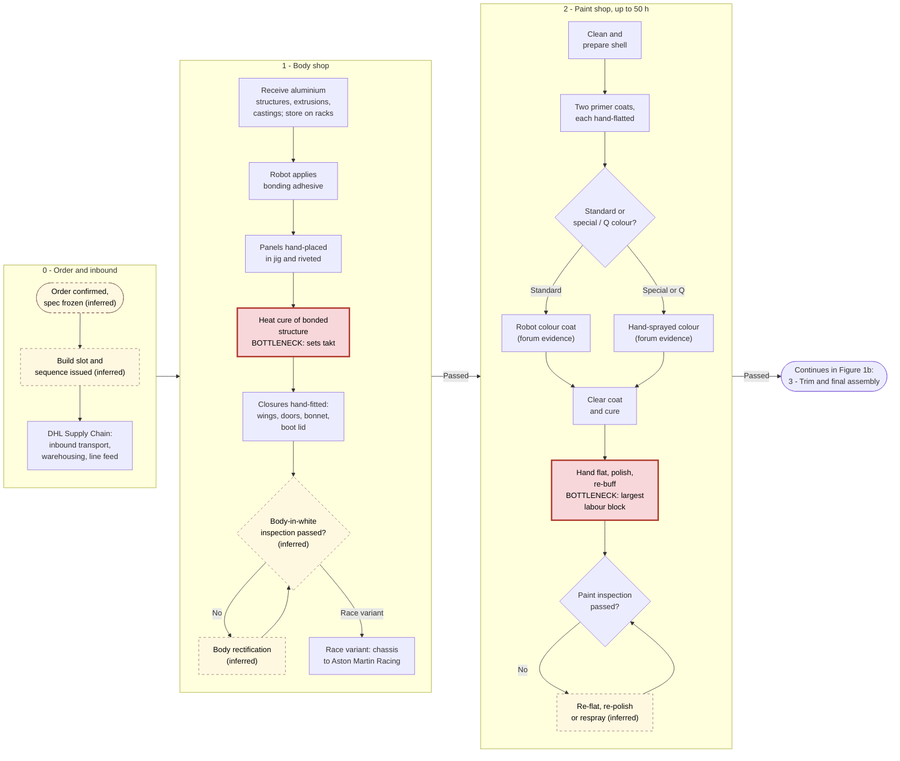
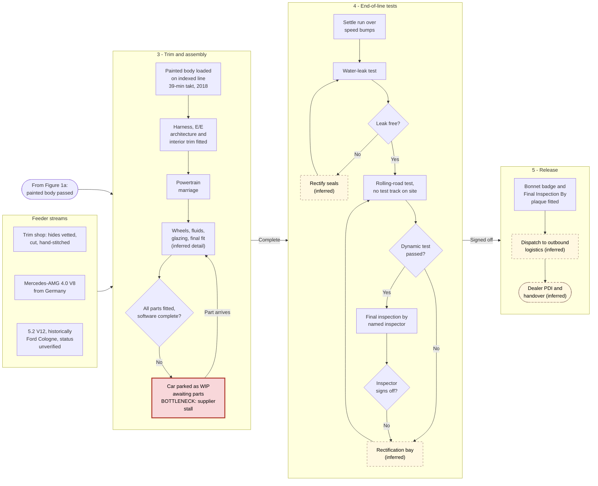
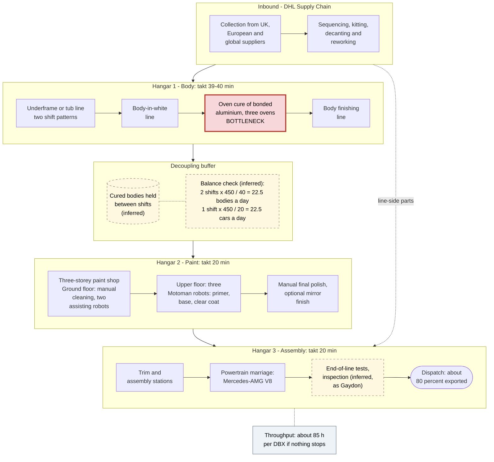
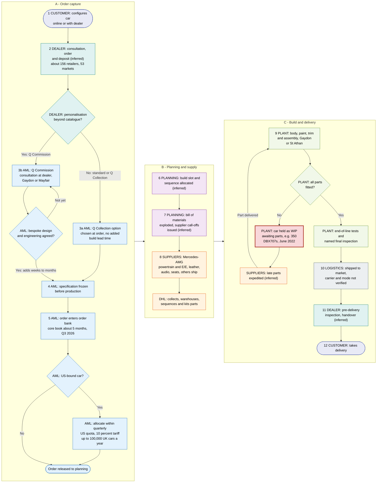
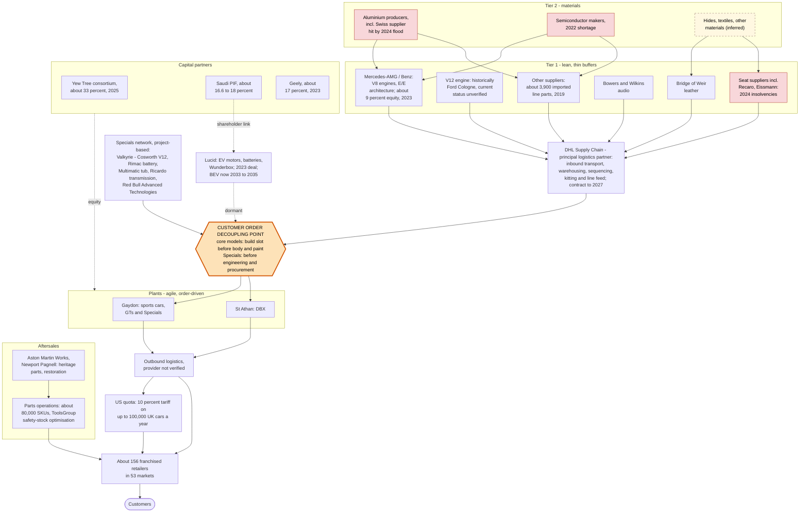
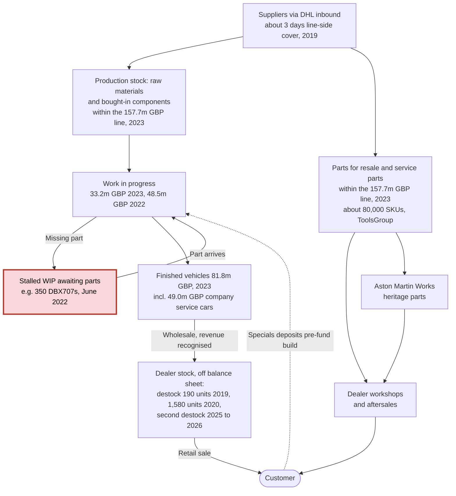
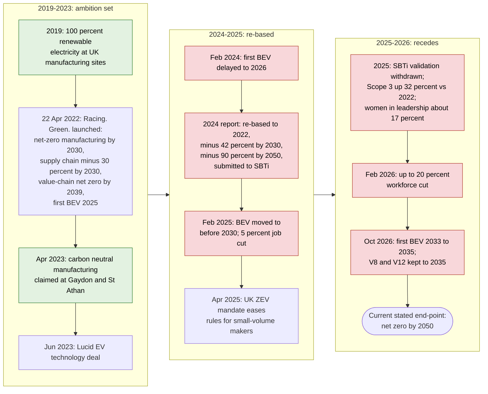

# Aston Martin's Craft Lines Strain Fragile Supply Chains

*An operations-management assessment of Aston Martin Lagonda Global Holdings plc: role of operations, process analysis and design, supply chain strategy, inventory control and sustainability*

*Evidence cut-off: 28 October 2026 (the date of the Q3 2026 results). All web sources accessed 28 October 2026.*

**Executive summary.** Aston Martin Lagonda (AML) builds roughly 5,400 to 6,600 ultra-luxury cars a year on paced, craft-intensive lines at Gaydon (sports and GT cars) and St Athan (the DBX SUV). Its operations system is well designed for its product. It has one known internal constraint, the oven cure of bonded aluminium structures, which sets a 39 to 40-minute body-shop takt against 20 minutes in paint and assembly at St Athan. The paint process is the largest single block of labour, up to 50 of the roughly 200 labour-hours in a Gaydon car ([AML, 2017a](https://www.astonmartin.com/en-gb/our-world/news/2017/2/22/gaydon-headquarters); [AMS, 2019a](https://www.automotivemanufacturingsolutions.com/strategy/made-in-wales/532503)). The decisive weakness is outside the factory walls. A lean, sequenced inbound supply chain run by DHL Supply Chain feeds a highly customised build, and it has repeatedly failed during new-model launches. About 350 DBX707s were left awaiting parts in 2022, the DB12 ramp-up was delayed in 2023, and about 1,000 cars were lost to late components in 2024. Each failure turned into a guidance cut, higher inventory and margin erosion ([Autocar, 2022](https://autocar-prod.codeenigma.net/node/119340); [CNBC, 2023](https://www.cnbc.com/2023/11/01/aston-martin-shares-plunge-16percent-after-volume-target-cut.html); [Express & Star, 2024](https://www.expressandstar.com/news/motors/2024/09/30/aston-martin-warns-over-profits-amid-production-woes/)). Gross margin fell from 39.1% (2023) to 29.4% (2025), and inventory days lengthened from about 100 to about 155 ([AML, 2024a](https://www.astonmartin.com/-/media/corporate/corporatearchive/documents/2023-results/aston-martin-lagonda-fy-2023-results.pdf?rev=1fef788985ef4cd88cb7da5773860a7e); [AML, 2026a](https://www.astonmartin.com/-/media/corporate/documents/fy-results-2025/aston-martin-lagonda-fy-2025-results.pdf)). The supply chain is best classified as leagile, but with a mismatch: it is run lean upstream for an "innovative" product that Fisher's (1997) logic says needs strategic buffers. Sustainability ("Racing. Green.", launched April 2022) has made real but small gains in operational emissions. Scope 3 emissions are rising, however, and the headline targets have been re-based, the SBTi validation abandoned and the first battery-electric car deferred to 2033 to 2035. This weakens trust with ESG-focused stakeholders even as transparency improves. The 2026 recovery (Q3 gross margin 37.4%, destocking "largely complete") rests on delivering about 500 Valhallas, a deposit-funded, build-to-order programme ([AML, 2026g](https://uk.advfn.com/stock-market/london/aston-martin-lagonda-glo-AML/share-news/Aston-Martin-Lagonda-Glob-Hldgs-PLC-Results-for-Q3/99571793)). The report therefore recommends protecting the cure constraint, building a material-availability gate and strategic buffers for single-source parts, segmenting bespoke paint, and sustaining channel discipline.

---

## 1. Introduction: why operations decides Aston Martin's fortunes

Aston Martin is a useful case for operations management because its strategy and its operations are unusually tightly coupled. Since 2020 the company has pursued a demand-led, "value over volume" positioning under Executive Chairman Lawrence Stroll. Under this positioning revenue depends on a small number of very expensive, highly personalised cars arriving on time, rather than on scale ([AML, 2021a](https://www.astonmartin.com/-/media/corporate/corporatearchive/documents/results-centre/2020---results-centre/fy---2020/aston-martin-lagonda-fy-2020-results---press-release.pdf?rev=267148fa0d8647e4bf10524c3405b00e)). In this model a delayed seat, a missing semiconductor or an uncured chassis is not an operational detail. It moves revenue between quarters, triggers profit warnings and, ultimately, determines whether the business can fund itself.

The report follows the five-part brief. Section 2 examines the role of operations in the company and how operations contribute to strategy and performance. Section 3 is the deepest section. It maps and analyses the Gaydon vehicle build, the St Athan DBX line and the order-to-delivery process (including Q by Aston Martin), quantifies takt, capacity and labour content where sources allow, identifies bottlenecks, applies process-design concepts and proposes improvements. Section 4 evaluates the supply chain structure and its lean, agile or leagile character. Section 5 analyses inventory types, control techniques and their performance consequences. Section 6 evaluates sustainability in operations and the supply chain. The report closes with a conclusion, recommendations, an appendix reconciling conflicting evidence, a data-verification appendix and a consolidated Harvard reference list.

**Method and limitations.** The analysis synthesises secondary research gathered on 28 October 2026. The company's investor-relations PDFs (annual reports, results statements, sustainability reports) could not be opened directly in the research environment. Figures attributed to them were therefore taken from search-engine extracts of those documents and, where possible, cross-checked against independent press coverage or arithmetic reconciliation. Most detailed descriptions of the shop-floor process date from 2004 to 2019, and little stage-level detail has been published for the post-2023 DB12, Vantage, Vanquish and Valhalla era. Every figure is therefore dated. Steps and numbers that are the author's inference rather than sourced fact are labelled "(inferred)", both in the text and in every diagram. Appendix B lists the figures a student should verify against primary documents before submission. Theory is drawn principally from Slack, Brandon-Jones and Burgess ([Slack et al., 2022](https://eu.pearson.com/operations-management/9781292408224)), with supply chain theory from Fisher ([1997](https://hbr.org/1997/03/what-is-the-right-supply-chain-for-your-product)), Naylor, Naim and Berry ([1999](https://doi.org/10.1016/S0925-5273%2898%2900223-0)), Mason-Jones, Naylor and Towill ([2000](https://doi.org/10.1080/00207540050204920)) and Christopher and Towill ([2000](https://doi.org/10.1108/13598540010347334); [2001](https://doi.org/10.1108/09600030110394914)).

---

## 2. Company operations: a low-volume craft system whose dependability now drives strategy

### 2.1 The operations system: two focused plants and a heritage works

AML designs, engineers and hand-builds most of its range at **Gaydon, Warwickshire**. Gaydon opened in 2003 on the former RAF airfield as the company's first purpose-built factory. It is home to the front-engined sports and GT cars and to the Specials ([AstonMartins.com, n.d.a](https://astonmartins.com/factory-guide/aston-martin-gaydon-2003-date/); [SlashGear, n.d.](https://www.slashgear.com/1759441/aston-martin-who-owns-where-built/)). **St Athan, Vale of Glamorgan**, is a converted Ministry of Defence site of three "super-hangars". It opened officially on 6 December 2019 and is the sole production site for the DBX ([AML, 2019c](https://www.astonmartin.com/en-us/our-world/news/2019/12/6/aston-martin-lagonda-opens-manufacturing-plant-in-st-athan-wales); [The Manufacturer, 2019a](https://www.themanufacturer.com/articles/aston-martin-second-uk-facility-huge-vote-confidence-bringing-700-jobs/)). **Newport Pagnell**, the historic home, ended series production in 2007. It now houses Aston Martin Works (heritage sales, service, parts and restoration) and, since 2017, low-volume "continuation" builds ([AML, 2017b](https://media.astonmartin.com/production-officially-returns-to-aston-martins-historic-newport-pagnell-site/)). This is a classic **focused-factory** arrangement. Each site is organised around one product family and its process requirements (an inference consistent with Slack et al., 2022). The group employed about 3,000 people in February 2026, before announcing cuts of up to 20% ([MarketScreener, 2026a](https://www.marketscreener.com/news/aston-martin-cuts-20-of-staff-amid-us-tariffs-weak-china-demand-ce7e5cdbdb80f02d)).

The table below summarises the scale of the system and the operational events that shaped each year. Wholesales are sales to dealers, the company's headline volume measure.

| Year | Wholesales (units) | Revenue | Gross margin | Defining operational event | Sources |
|---|---|---|---|---|---|
| 2019 | 5,862 total (core 5,809) | £980.5m | n/a | Two profit warnings; dealer destock of 190 units | [Coventry Telegraph, 2020](https://www.coventrytelegraph.net/news/coventry-news/aston-martin-2019-results-16676539); [AML, 2020a](https://amlcorp.blob.core.windows.net/default-storage/docs/default-source/documents/results-centre/2019---results-centre/fy---2019/aston-martin-lagonda-fy-2019-results---transcript.pdf?sfvrsn=5aec293a_2) |
| 2020 | 3,394 (DBX 1,516) | £611.8m | n/a | COVID-19; Project Horizon; dealer destock of 1,580 GT/Sport units | [AML, 2021a](https://www.astonmartin.com/-/media/corporate/corporatearchive/documents/results-centre/2020---results-centre/fy---2020/aston-martin-lagonda-fy-2020-results---press-release.pdf?rev=267148fa0d8647e4bf10524c3405b00e); [The Business Magazine, 2021](https://thebusinessmagazine.co.uk/manufacturing-engineering/revenues-decline-at-warwicks-aston-martin-but-chairman-upbeat-for-future/) |
| 2021 | 6,178 | £1,095.3m | c.31% | Recovery on DBX volume | [AML, 2023a](https://www.astonmartin.com/-/media/corporate/corporatearchive/documents/investors---results-and-presentations/aml-fy-2022-results-rns.pdf?rev=f3dc425a39d448d6b54aab84380ef3b3) |
| 2022 | 6,412 | £1,381.5m | 32.6% (restated) | About 350 DBX707s awaiting parts; c.£20m supply-chain recovery costs | [AML, 2023a](https://www.astonmartin.com/-/media/corporate/corporatearchive/documents/investors---results-and-presentations/aml-fy-2022-results-rns.pdf?rev=f3dc425a39d448d6b54aab84380ef3b3); [Autocar, 2022](https://autocar-prod.codeenigma.net/node/119340) |
| 2023 | 6,620 | £1,632.8m | 39.1% | DB12 ramp delayed by supplier readiness and E/E integration | [AML, 2024a](https://www.astonmartin.com/-/media/corporate/corporatearchive/documents/2023-results/aston-martin-lagonda-fy-2023-results.pdf?rev=1fef788985ef4cd88cb7da5773860a7e); [CNBC, 2023](https://www.cnbc.com/2023/11/01/aston-martin-shares-plunge-16percent-after-volume-target-cut.html) |
| 2024 | 6,030 | £1,583.9m | 36.9% | About 1,000 fewer cars because of late components | [AML, 2025a](https://www.astonmartin.com/-/media/corporate/corporatearchive/documents/2024-results/aml-fy-2024-results-announcement-vf.pdf?rev=28a5dd01ef6c4f8f893e43f0311650ea); [Express & Star, 2024](https://www.expressandstar.com/news/motors/2024/09/30/aston-martin-warns-over-profits-amid-production-woes/) |
| 2025 | 5,448 | £1,257.7m | 29.4% | US tariffs; slow Valhalla ramp; second destock | [AML, 2026a](https://www.astonmartin.com/-/media/corporate/documents/fy-results-2025/aston-martin-lagonda-fy-2025-results.pdf) |
| H1 2026 | 2,331 | c.£629m | c.34% | Valhalla deliveries (Specials 225 v 18) | [AML, 2026f](https://www.astonmartin.com/-/media/corporate/documents/2026/aston-martin-lagonda-h1-2026-results.pdf?rev=11d26777670e4ba0a7f353edf59477c0); [Pulse 2.0, 2026](https://pulse2.com/aston-martin-h1-2026-revenue-rises-38-to-629-million-as-valhalla-deliveries-lift-gross-profit-68/) |
| Q3 2026 | Core 1,304 in quarter | 9M £1.02bn | Q3 37.4% | Destocking "largely complete"; core order book c.5 months | [AML, 2026g](https://uk.advfn.com/stock-market/london/aston-martin-lagonda-glo-AML/share-news/Aston-Martin-Lagonda-Glob-Hldgs-PLC-Results-for-Q3/99571793); [Investing.com, 2026d](https://www.investing.com/news/earnings/aston-martin-holds-2026-targets-as-q3-revenue-jumps-36-on-valhalla-deliveries-4977790) |

### 2.2 The four Vs place Aston Martin at the high-variety, high-visibility extreme

Slack et al.'s ([2022](https://eu.pearson.com/operations-management/9781292408224)) four Vs (volume, variety, variation and visibility) explain why AML's operations look so different from a mass-market carmaker's. **Volume** is low. At 5,448 to 6,620 wholesales a year and an assumed 230 working days, the whole group builds roughly 24 to 29 cars a day (inferred). **Variety** is extreme: a 2024 visitor was told the factory offers about 60 colour schemes and that "there are rarely two cars leaving the factory that are identical" ([Fellowship of the Motor Industry, 2024](https://motorfellowship.com/event/tour-of-aston-martin-factory/)). **Variation** in demand is severe. Wholesales fell 42% in 2020, tariffs disrupted 2025, and deliveries are heavily concentrated in Q4. **Visibility** is unusually high for a manufacturer. Customers can begin Q Commission projects at Gaydon itself and tour the factory through dealers ([Aston Martin Magazine, n.d.a](https://magazine.astonmartin.com/design/special-request-q-aston-martins-tailor-made-enhancements); [Manufacturing Management, n.d.](https://www.manufacturingmanagement.co.uk/content/news/aston-martin-offers-gaydon-factory-tour/)). The implications are high unit cost, heavy reliance on skilled labour and flexibility, and very high fixed-cost sensitivity to volume. All of these appear in the financial record.

### 2.3 Organisation and leadership: an imported Ferrari model amid constant turnover

AML created the post of **Chief Industrial Officer** "overseeing all manufacturing operations" and appointed Vincenzo Regazzoni, formerly Chief Manufacturing Officer at Ferrari ([AML, n.d.a](https://media.astonmartin.com/aston-martin-strengthens-industrial-and-electrification-leadership-with-new-senior-appointments/)). The appointment is believed to date from 2023, but the date is unconfirmed. Leadership at the top has turned over repeatedly. Andy Palmer (to 2020) was followed by Tobias Moers (ex-Mercedes-AMG, from August 2020), then Amedeo Felisa (ex-Ferrari, 2022), then Adrian Hallmark (announced March 2024) ([AML, 2021a](https://www.astonmartin.com/-/media/corporate/corporatearchive/documents/results-centre/2020---results-centre/fy---2020/aston-martin-lagonda-fy-2020-results---press-release.pdf?rev=267148fa0d8647e4bf10524c3405b00e); [AML, 2024e](https://media.astonmartin.com/appointment-of-new-chief-executive-officer/?lang=eng)). Palmer described himself as "a disciple of Kaizen" from his Nissan years ([Aston Martin Magazine, n.d.b](https://magazine.astonmartin.com/people/keeping-touch-interview-ceo-andy-palmer)). Recruiting manufacturing leadership from Ferrari points to a deliberate attempt to import a low-volume, quality-led industrial model. Four chief executives in about five years have, however, made continuity of operations strategy difficult (inferred). The workforce plan illustrates the volatility. AML recruited **400+ manufacturing technicians** for Gaydon and St Athan in February 2024 ([AML, 2024d](https://www.astonmartin.com/en/our-world/news/2024/2/19/aston-martin-to-create-new-manufacturing-jobs-at-gaydon-and-st-athan-facilities)). It then cut about 5% of staff in 2025 and announced **up to 20% (c.600 roles)** in February 2026, targeting about £40m of annual savings ([AM-Online, 2025](https://www.am-online.com/news/aston-martin-to-cut-5-of-workforce-amid-rising-losses-delays-ev-launch); [MarketScreener, 2026a](https://www.marketscreener.com/news/aston-martin-cuts-20-of-staff-amid-us-tariffs-weak-china-demand-ce7e5cdbdb80f02d)).

### 2.4 Performance objectives: quality and flexibility win orders, dependability now destroys value

The evidence supports a clear ranking of Slack et al.'s ([2022](https://eu.pearson.com/operations-management/9781292408224)) five performance objectives. In Hill and Hill's (2009) terms, AML competes on design, performance, exclusivity and personalisation (order-winners), while build quality and heritage are qualifiers. Price is not an order-winner. Total average selling price (ASP) rose from £162k (2021) to a record £231k (2023) ([AML, 2023a](https://www.astonmartin.com/-/media/corporate/corporatearchive/documents/investors---results-and-presentations/aml-fy-2022-results-rns.pdf?rev=f3dc425a39d448d6b54aab84380ef3b3); [AML, 2024b](https://www.astonmartin.com/-/media/corporate/corporatearchive/documents/2023-results/aston-martin-lagonda-fy-2023-results-presentation.pdf?rev=e898bb4b418a4352a4c2362e87fe1a31)).

| Performance objective | Strategic role (inferred ranking) | Evidence of operations' contribution |
|---|---|---|
| Quality | Order-qualifier at the highest level; brand-critical | Hand finishing, named final-inspector plaque, Palmer personally inspected the first 1,000 DB11s ([Autocar, n.d.b](https://www.autocar.co.uk/car-news/new-cars/inspecting-first-aston-martin-db11s-ceo-andy-palmer)); DB12 owners reported software updates (anecdotal) ([AstonMartinLife, n.d.b](https://www.astonmartinlife.com/threads/db12-software-update.15133/page-4)) |
| Flexibility (mix and product) | Order-winner via personalisation | Q Collection at no extra lead time; Q Commission bespoke builds ([Aston Martin Magazine, n.d.a](https://magazine.astonmartin.com/design/special-request-q-aston-martins-tailor-made-enhancements)) |
| Dependability | Qualifier whose failure now destroys value | Guidance cuts in 2019, 2023, 2024 and 2025; Valhalla deliveries slipped to Q4 2025 ([Autocar, 2025](https://zephr.autocar.co.uk/car-news/business/aston-martin-delays-valhalla-deliveries-warns-%C2%A3110m-2025-loss)) |
| Speed | Secondary; buyers accept waiting lists | Core order book about five months in Q3 2026 ([AML, 2026g](https://uk.advfn.com/stock-market/london/aston-martin-lagonda-glo-AML/share-news/Aston-Martin-Lagonda-Glob-Hldgs-PLC-Results-for-Q3/99571793)) |
| Cost | Profitability enabler, now critical | Gross margin 39.1% (2023) to 29.4% (2025); "higher manufacturing and logistics costs" cited in 2024 ([AML, 2025a](https://www.astonmartin.com/-/media/corporate/corporatearchive/documents/2024-results/aml-fy-2024-results-announcement-vf.pdf?rev=28a5dd01ef6c4f8f893e43f0311650ea)) |

The striking result is that **dependability**, normally treated as a qualifier in luxury goods, has become the objective that most determines financial performance. Buyers will wait for a car, but investors will not tolerate repeatedly broken delivery promises.

### 2.5 How operations contribute to strategy and performance

Hayes and Wheelwright's (1984) four-stage model is a useful diagnostic, though the stage assignments below are the author's assessment ([ProQuest, n.d.](https://www.proquest.com/docview/232356962)). Before 2020, operations were at best **externally neutral**. Production was pushed into a dealer network that had to discount, and in 2019 retail sales rose 12% while wholesales fell 9% as dealers destocked ([Coventry Telegraph, 2020](https://www.coventrytelegraph.net/news/coventry-news/aston-martin-2019-results-16676539); [CNBC, 2019](https://www.cnbc.com/2019/07/24/aston-martin-shares-drop-22percent-on-forecast-downgrade-europe-weakness.html)). Project Horizon (2020) aimed "to drive growth, agility and efficiency". It cut GT/Sport dealer stock by **1,580 units** to move to a "demand led build to order model" and, according to one secondary source, closed one of Gaydon's two lines ([AML, 2021a](https://www.astonmartin.com/-/media/corporate/corporatearchive/documents/results-centre/2020---results-centre/fy---2020/aston-martin-lagonda-fy-2020-results---press-release.pdf?rev=267148fa0d8647e4bf10524c3405b00e); [AML, 2021c](https://www.investegate.info/announcement/rns/aston-martin-lagonda-global-holdings--aml/final-results/6448292); [The Fashion Law, n.d.](https://www.thefashionlaw.com/aston-martin-breaking-down-a-post-ipo-odyssey/)). That was a move toward **internally supportive** operations. Gross margin rose from about 31% in 2021 to 39.1% in 2023 as channel discipline and mix improved ([AML, 2023a](https://www.astonmartin.com/-/media/corporate/corporatearchive/documents/investors---results-and-presentations/aml-fy-2022-results-rns.pdf?rev=f3dc425a39d448d6b54aab84380ef3b3); [AML, 2024a](https://www.astonmartin.com/-/media/corporate/corporatearchive/documents/2023-results/aston-martin-lagonda-fy-2023-results.pdf?rev=1fef788985ef4cd88cb7da5773860a7e)).

Operations did not reach the **externally supportive** stage. Each new-model introduction (DB12 in 2023; the Vantage, DB12 and Vanquish transition in 2024; Valhalla in 2024 and 2025) was disrupted by supply-side failures. The company's very high operating leverage converted those failures straight into losses. In 2025 a 10% fall in volume cut adjusted EBITDA by 60%, from £271.0m to £108.1m. Adjusted EBIT deepened to −£189.2m and net debt rose to £1,380.3m ([AML, 2026a](https://www.astonmartin.com/-/media/corporate/documents/fy-results-2025/aston-martin-lagonda-fy-2025-results.pdf)). The FY2025 bottom line is reported inconsistently in the press, and the figures reconcile as follows. The pre-tax loss was **£363.9m** (the "£364m loss" in [Eastern Eye, 2026](https://www.easterneye.biz/aston-martin-job-cuts-364m-loss)). A £129.1m tax charge then produced a reported net loss of **£493.0m** ([FIRSTonline, 2026](https://www.firstonline.info/en/aston-martin-in-rosso-nel-2025-perdita-a-493-milioni-ricavi-giu-del-21-e-taglio-del-20-della-forza-lavoro/)). The 363.9 + 129.1 = 493.0 arithmetic confirms this. Reuters' **£493.2m** is a minor rounding or measurement variant ([MarketScreener, 2026a](https://www.marketscreener.com/news/aston-martin-cuts-20-of-staff-amid-us-tariffs-weak-china-demand-ce7e5cdbdb80f02d)). An operating loss of £259.2m is a different, pre-finance-cost measure. The 2026 recovery is operations-led but narrow. Gross profit rose 68% in H1 2026 and Q3 gross margin reached 37.4%, driven mainly by Valhalla deliveries, while FY2026 volume guidance stays flat at about 5,450 including about 500 Valhallas ([Pulse 2.0, 2026](https://pulse2.com/aston-martin-h1-2026-revenue-rises-38-to-629-million-as-valhalla-deliveries-lift-gross-profit-68/); [AML, 2026g](https://uk.advfn.com/stock-market/london/aston-martin-lagonda-glo-AML/share-news/Aston-Martin-Lagonda-Glob-Hldgs-PLC-Results-for-Q3/99571793)). The strategy is now one of mix and price rather than volume. Operations' ability to deliver a few hundred complex hypercars on schedule is therefore the single most important determinant of 2026 performance.

---

## 3. Process analysis and design: a paced craft line governed by one cure, one paint shop and many suppliers

### 3.1 Process selection and evidence base

Three linked processes are analysed. The **Gaydon vehicle build** is the core transformation process for sports and GT cars. The **St Athan DBX line** is a newer, more automated design that applies lessons from Gaydon and so allows a before-and-after comparison. The **order-to-delivery process**, including Q by Aston Martin, links the customer to the factory and the supply base. The Gaydon description synthesises company statements (2017), trade press (2013 to 2019) and owner tour accounts. The St Athan description rests on detailed interviews with its manufacturing director, Scott Ward, in *Automotive Manufacturing Solutions* (AMS) ([AMS, 2019a](https://www.automotivemanufacturingsolutions.com/strategy/made-in-wales/532503); [AMS, 2019b](https://www.automotivemanufacturingsolutions.com/oems/scott-ward-director-of-manufacturing-aston-martin-st-athan/544684)). No complete official station list exists for either plant, so the sequence shown in the flowcharts is a synthesis. Each step is supported by a source unless labelled "(inferred)".

### 3.2 Process types and the product-process matrix: a line process at jobbing volumes

Slack et al. ([2022](https://eu.pearson.com/operations-management/9781292408224)) classify manufacturing processes as project, jobbing, batch, mass and continuous, positioned on a product-process matrix that pairs volume and variety with process flow. AML operates several process types at once, each matched to a different product segment.

| Operation | Volume and variety | Process type (Slack et al., 2022) | Matrix position (assessment) |
|---|---|---|---|
| Newport Pagnell continuation and restoration ([AML, 2017b](https://media.astonmartin.com/production-officially-returns-to-aston-martins-historic-newport-pagnell-site/)) | Single units, unique | Project or jobbing | On the diagonal |
| Specials, e.g. Valkyrie and Valhalla (999 units over about 2.5 years) ([AML, 2025g](https://www.astonmartin.com/-/media/corporate/documents/h1-results-2025/aston-martin-lagonda-h1-2025-results-transcript.pdf?rev=d076b37827e247e6bd8b7052db770ffd)) | Very low, engineered to order | Jobbing to small batch | On the diagonal |
| Q Commission work inside series production | One-off specification | Jobbing embedded within a line | Off-diagonal: creates variance on the line |
| Gaydon series build: indexed line, hand work, about 39-min takt ([AML, 2017a](https://www.astonmartin.com/en-gb/our-world/news/2017/2/22/gaydon-headquarters); [Autocar, 2018](https://www.autocar.co.uk/car-news/new-cars/aston-martins-st-athan-plant-boost-manufacturing-efficiency)) | Low volume, high variety | Mass process with craft content, i.e. a paced line used for mass customisation | Below the diagonal: more line-like than volume alone would justify |
| St Athan DBX: 20-min takt, robotic paint ([AMS, 2019a](https://www.automotivemanufacturingsolutions.com/strategy/made-in-wales/532503)) | Low-medium volume, one model family | Mass (line) | Closer to the diagonal than Gaydon |

Gaydon's choice of an **indexed line** rather than a jobbing workshop deserves comment. Bodies are moved from one fixed workstation to the next once work is complete, "instead of a conventional moving assembly line" ([AML, 2017a](https://www.astonmartin.com/en-gb/our-world/news/2017/2/22/gaydon-headquarters)). Operators "typically train up on three stations and rotate" ([Speedhunters, 2013](https://www.speedhunters.com/2013/08/aston-martin-at-gaydon-the-dream-factory/)). This hybrid buys the control benefits of line flow (takt discipline, standardised stations, visible WIP) while keeping craft content. The price is the classic off-diagonal penalty. A line process carries high fixed cost and needs stable volume, which explains why falling wholesales in 2024 and 2025 hit margins so hard: under-absorbed overhead is expensed because inventory is valued on a "normalised level of activity" ([AML, 2024c](https://www.astonmartin.com/-/media/corporate/documents/2023-results/aston-martin-lagonda-fy-2023-financial-statements.pdf?rev=916c9a9ccdae439b9cc0b3afb337211e)). Older accounts also record model-dependent material handling. Vantage and Rapide moved on a **motorised line**, whereas DB9 and Vanquish sat on **cradles pushed by hand** between stations ([The Register, 2015](https://www.theregister.com/2015/05/10/how_is_an_aston_martin_built/); [Speedhunters, 2013](https://www.speedhunters.com/2013/08/aston-martin-at-gaydon-the-dream-factory/)). In other words, the degree of line flow was itself varied with volume.

### 3.3 The Gaydon vehicle build: four stages, three rework loops and a named inspector

**Stage 1, the body shop.** VH-platform cars used **bonded and riveted aluminium monocoques**. In 2013 these were built by a subcontractor, shipped to Gaydon and "stored on racks until slotted into the line". The bonding adhesive was applied by "one of the few robots on the line", and panels were placed by hand in a jig and **cured with heat** ([Speedhunters, 2013](https://www.speedhunters.com/2013/08/aston-martin-at-gaydon-the-dream-factory/)). Front wings, doors, bonnet and boot lid were fitted by hand ([AstonMartins.com, 2004](https://astonmartins.com/db9-production-at-am-gaydon-20034/)). An older Autocar report found Gaydon's alloy-tub assembly working **24 hours a day on three shifts** with no spare capacity ([Autocar, n.d.a](https://images.cdn.autocar.co.uk/car-news/industry/aston-plans-growth-match-bentley)). This is early evidence that the body shop is the capacity constraint. Racing chassis branch off at body-in-white to Aston Martin Racing ([FIA WEC, 2022](https://www.fiawec.com/en/news/the-best-of-british-aston-martin-from-road-to-track/2022)).

**Stage 2, the paint shop.** "The deep lustre of every Aston Martin takes **up to 50 hours** to achieve", and all cars are "polished back once lacquered and re-buffed" ([AML, 2017a](https://www.astonmartin.com/en-gb/our-world/news/2017/2/22/gaydon-headquarters)). A 2013 Vanquish needed **50 to 60 hours** in paint ([Speedhunters, 2013](https://www.speedhunters.com/2013/08/aston-martin-at-gaydon-the-dream-factory/)). In the DB9 era the sequence was two colour-matched primer coats, each hand-flatted, then the colour coat, then the clear coat, then hand polishing and re-inspection, taking up to **25 hours** ([AstonMartins.com, 2004](https://astonmartins.com/db9-production-at-am-gaydon-20034/)). Owner accounts say standard colours are robot-sprayed and special colours hand-sprayed ([6SpeedOnline, n.d.](https://www.6speedonline.com/forums/aston-martin/357785-aston-martin-factory-tour.html)). This is anecdotal, but it identifies a key **variety-driven routing split**. Paint time has roughly doubled since the DB9 era, which reflects rising finish expectations and the growth of bespoke colours.

**Stage 3, trim and final assembly.** The painted shell is placed at the start of the line and passes through stations of **about 39 to 40 minutes** each in 2018-era coverage ([Autocar, 2018](https://www.autocar.co.uk/car-news/new-cars/aston-martins-st-athan-plant-boost-manufacturing-efficiency)). Leather seats are hand-stitched in the factory ([carsales.com.au, n.d.](https://www.carsales.com.au/editorial/details/best-of-british-aston-martin-the-factory-bond-built-104930/)). Engines arrive as complete bought-in sub-assemblies. The Mercedes-AMG 4.0-litre twin-turbo V8 comes from Germany ([Mercedes-AMG, n.d.](https://www.mercedes-amg.com/en/amg-engines-at-other-manufacturers); [Motor Authority, n.d.a](https://www.motorauthority.com/news/1129368_here-s-how-the-aston-martin-vantage-is-made)). The 5.2-litre V12 was historically assembled in a separate Aston Martin-staffed facility at Ford's Cologne engine plant ([Car Throttle, n.d.](https://www.carthrottle.com/news/aston-martin-will-ditch-amg-v8s-self-built-v6s-v12-safe-now)), but whether that is still so in 2026 is unconfirmed. These engines form feeder streams that join at the powertrain-marriage station.

**Stage 4, end-of-line test and inspection.** Finished cars are driven over speed bumps "to settle everything in". A water-leak test follows, reportedly using 2,400 gallons per car ([6SpeedOnline, n.d.](https://www.6speedonline.com/forums/aston-martin/357785-aston-martin-factory-tour.html)), and then a **rolling-road test**, because there is no test track at Gaydon. The car then receives final sign-off by an inspector and the "almost ceremonial" fitting of the bonnet badge ([Trade Unique Cars, n.d.](https://tradeuniquecars.com.au/features/1710/aston-martin-factory-tour)). A plaque under the bonnet reads "Hand built in England – Final inspection by [name]" ([Aston-Martin.com, 2012](https://www.aston-martin.com/2012/07/25/meeting-the-maker-barry-griffin/)). This personal-accountability device acts as a behavioural quality control.

**Figure 1a. Gaydon vehicle build process: order release, body shop and paint shop, with quality gates and rework loops.** Red nodes are bottlenecks; dashed amber nodes are inferred steps.

**Figure 1b. Gaydon vehicle build process (continued): trim and final assembly, end-of-line tests and release.**

### 3.4 The St Athan DBX line: Gaydon's lessons built into three hangars

St Athan was explicitly designed "with the benefit of 15 years of experience of operations at Gaydon" ([Autocar, 2018](https://www.autocar.co.uk/car-news/new-cars/aston-martins-st-athan-plant-boost-manufacturing-efficiency)). Its three converted super-hangars house, in sequence, "a body-in-white plant", "a paint shop" and "a final assembly hall" ([The Manufacturer, 2019a](https://www.themanufacturer.com/articles/aston-martin-second-uk-facility-huge-vote-confidence-bringing-700-jobs/)). The body shop runs three lines (underframe or tub, body-in-white, and finishing). "It is a slow business gluing aluminium parts together, which is why the takt time [in] the bodyshop is **39 minutes** compared to **20 minutes** in the paintshop and final assembly" ([AMS, 2019a](https://www.automotivemanufacturingsolutions.com/strategy/made-in-wales/532503)). The DBX's bonded chassis is oven-cured in **three separate ovens**, which are "separate because of lessons learned from Gaydon". Because of the hangar height, the paint shop was built as a **three-storey** structure. Manual cleaning, assisted by two robots, takes place on the ground floor, and **three Motoman robots** installed by Eisenmann apply primer, base coat and clear coat on an upper floor. Workers then give an optional mirror-finish polish ([AMS, 2019a](https://www.automotivemanufacturingsolutions.com/strategy/made-in-wales/532503)). Ward summarised the flow: a DBX takes "**85 hours, if it all comes through without stopping**. The slowest part is the curing, everything else is around 20 minutes takt time, but it's **40 minutes in body and tub, hence the two shift patterns**" ([AMS, 2019b](https://www.automotivemanufacturingsolutions.com/oems/scott-ward-director-of-manufacturing-aston-martin-st-athan/544684)).

The timeline also needs reconciling, because the notes appear to conflict. Manufacturing trials began on 15 April 2019, and the first pre-production cars were built in June 2019 ([Motor Authority, 2019](https://www.motorauthority.com/news/1120773_aston-martin-preparing-for-worst-case-scenario-with-no-deal-brexit-looming); [AML, 2019b](https://media.astonmartin.com/aston-martin-produces-first-cars-at-st-athan/)). The plant reopened after the COVID-19 shutdown on 5 May 2020 and began making DBX bodies the following day ([AML, 2020b](https://www.lse.co.uk/rns/1st-quarter-results-n597g010rsv4iqq.html)). The first completed production DBX left the line in July 2020 ([paultan.org, 2020](https://paultan.org/2020/07/10/aston-martin-dbx-production-commences-at-st-athan/); [PES Media, 2020](https://www.pesmedia.com/aston-martin-dbx-st-athan-09072020)). These dates describe successive stages of the ramp-up, so they do not contradict one another.

**Figure 2. St Athan DBX process flow across the three super-hangars, with takt times and the curing bottleneck.**

### 3.5 Quantitative analysis: takt, capacity and labour content

The sourced process metrics are collected below before any derived calculations. Several figures conflict, so dates and sources are kept explicit.

| Metric | Value | Date | Source |
|---|---|---|---|
| Labour content, Gaydon sports car | about 200 labour-hours | 2017 | [AML, 2017a](https://www.astonmartin.com/en-gb/our-world/news/2017/2/22/gaydon-headquarters) |
| Paint time | up to 50 h (company); 50 to 60 h (Vanquish); up to 25 h (DB9) | 2017; 2013; c.2004 | [AML, 2017a](https://www.astonmartin.com/en-gb/our-world/news/2017/2/22/gaydon-headquarters); [Speedhunters, 2013](https://www.speedhunters.com/2013/08/aston-martin-at-gaydon-the-dream-factory/); [AstonMartins.com, 2004](https://astonmartins.com/db9-production-at-am-gaydon-20034/) |
| Gaydon takt | 39 min (25-min "heartbeat" in 2015) | 2018; 2015 | [Autocar, 2018](https://www.autocar.co.uk/car-news/new-cars/aston-martins-st-athan-plant-boost-manufacturing-efficiency); [The Register, 2015](https://www.theregister.com/2015/05/10/how_is_an_aston_martin_built/) |
| Gaydon output | 15 to 20 cars/day; about 20/day | 2013; 2024 | [Speedhunters, 2013](https://www.speedhunters.com/2013/08/aston-martin-at-gaydon-the-dream-factory/); [Fellowship of the Motor Industry, 2024](https://motorfellowship.com/event/tour-of-aston-martin-factory/) |
| Gaydon manufacturing staff | 650: 250 trim and final, 260 body and paint, 140 off-track | Nov 2018 | [AMS, 2018](https://www.automotivemanufacturingsolutions.com/press-and-body/lap-of-luxury/534709) |
| Gaydon capacity | 5,000; 7,000; "up to 7,500" a year | 2004 to 2018 | [AstonMartins.com, n.d.a](https://astonmartins.com/factory-guide/aston-martin-gaydon-2003-date/); [Autocar, n.d.a](https://images.cdn.autocar.co.uk/car-news/industry/aston-plans-growth-match-bentley); [Autocar, 2018](https://www.autocar.co.uk/car-news/new-cars/aston-martins-st-athan-plant-boost-manufacturing-efficiency) |
| St Athan takt | 39 to 40 min body and tub; 20 min paint and assembly | c.2019 | [AMS, 2019a](https://www.automotivemanufacturingsolutions.com/strategy/made-in-wales/532503); [AMS, 2019b](https://www.automotivemanufacturingsolutions.com/oems/scott-ward-director-of-manufacturing-aston-martin-st-athan/544684) |
| DBX build | 85 h "if it all comes through without stopping" | c.2019 to 2020 | [AMS, 2019b](https://www.automotivemanufacturingsolutions.com/oems/scott-ward-director-of-manufacturing-aston-martin-st-athan/544684) |
| St Athan volume | 7,000 a year capacity on one line; about 4,000 expected | 2018; 2020 | [Autocar, 2018](https://www.autocar.co.uk/car-news/new-cars/aston-martins-st-athan-plant-boost-manufacturing-efficiency); [paultan.org, 2020](https://paultan.org/2020/07/10/aston-martin-dbx-production-commences-at-st-athan/) |
| St Athan workforce | about 600; about 750 at full production | 2019 | [The Manufacturer, 2019a](https://www.themanufacturer.com/articles/aston-martin-second-uk-facility-huge-vote-confidence-bringing-700-jobs/) |

The conflicting takt figures can be reconciled analytically. Autocar reported Gaydon at 39 minutes against a planned 20 minutes at St Athan, and said St Athan would make 7,000 cars a year, "the same number as Gaydon but on one instead of two lines" ([Autocar, 2018](https://www.autocar.co.uk/car-news/new-cars/aston-martins-st-athan-plant-boost-manufacturing-efficiency)). AMS attributes the 39-minute figure to the **body shop** specifically, where gluing and curing are slow ([AMS, 2019a](https://www.automotivemanufacturingsolutions.com/strategy/made-in-wales/532503)). The most coherent reading is that 39 minutes is the cure-governed body-shop takt common to both plants. Gaydon ran two parallel lines at roughly that rate, whereas St Athan halved the downstream takt by running paint and assembly at 20 minutes on one line and covering the slower body shop with a second shift. The 2015 "heartbeat" of 25 minutes probably measured a different line or model mix ([The Register, 2015](https://www.theregister.com/2015/05/10/how_is_an_aston_martin_built/)). This reconciliation is inferred.

The derived calculations below use stated assumptions: 450 effective minutes per shift and 230 working days a year (both inferred). They are illustrations for analysis, not company data.

| Calculation (all inferred) | Working | Result | Interpretation |
|---|---|---|---|
| Gaydon output per line-shift at 39-min takt | 450 / 39 | 11.5 cars | One line on one shift cannot meet the 15 to 20 cars a day observed |
| Gaydon theoretical daily output (two lines, or one line on two shifts) | 2 × 11.5 | 23 cars | Observed 20 a day implies about 87% achieved against theoretical (20 / 23), a proxy for availability and performance losses |
| Gaydon daily labour demand | 20 cars × 200 h | 4,000 labour-hours | Set against 650 staff × 7.5 h = 4,875 h, this implies about 82% direct-labour utilisation, so the 2018 staffing and the 200-hour figure are mutually consistent |
| Operator positions per Gaydon line at 39-min takt | 200 h × 60 / 39 | about 308 at perfect balance | Close to the 250 trim and 260 body and paint staff in 2018, divided between lines and shifts |
| St Athan body-shop daily output | 2 shifts × 450 / 40 | 22.5 bodies | |
| St Athan paint and assembly daily output | 1 shift × 450 / 20 | 22.5 cars | **Exactly balanced with the body shop.** This quantifies why Ward said "hence the two shift patterns" |
| St Athan annualised at that balance | 22.5 × 230 | about 5,175 a year | Consistent with about 4,000 expected in launch year once ramp-up losses are allowed for |
| St Athan 7,000 capacity check | 7,000 / 230 = 30.4 a day; × 20 min | about 609 min a day | 7,000 implies about 1.35 downstream shifts, which is plausible as a nameplate figure |
| DBX "85 hours" | 85 × 60 / 20 | 255 | If 85 h is **labour content**, about 255 operator positions per takt cycle, consistent with a 600 to 750 workforce. If it is **flow time**, Little's Law (WIP = throughput × flow time) implies about 255 vehicles in process |
| Group daily rate | 5,448 / 230; 6,620 / 230 | 23.7 (2025); 28.8 (2023) cars a day | |
| Nominal capacity utilisation | 5,448 / 14,000; 6,620 / 14,000 | 39% (2025); 47% (2023) | Uses Autocar's 7,000 + 7,000. Even if Horizon's line closure cut capacity to about 10,500, 2025 utilisation was only about 52% |

Two analytical conclusions follow. First, the **85-hour DBX and the 200-hour Gaydon car are not directly comparable**. If both are labour content, the DBX needs about 57% less labour, consistent with robotic paint and a single-model line. If 85 hours is elapsed flow time, it measures something different. Ward's phrase "if it all comes through without stopping" suggests a theoretical flow time, and that reading should be verified (inferred). Second, **AML's plants run at well under half their nominal capacity**. On the product-process matrix logic this is the cost of an off-diagonal line process at falling volumes. It also explains why each lost unit damages margin so heavily.

### 3.6 Bottleneck analysis: one internal constraint, one lead-time driver, one external failure mode

Applying constraint logic ([Slack et al., 2022](https://eu.pearson.com/operations-management/9781292408224)) shows three distinct bottleneck types.

The **internal capacity constraint is the adhesive cure**. It is a fixed chemical process time that cannot be "worked faster". At St Athan it sets a 40-minute takt against 20 minutes elsewhere ([AMS, 2019b](https://www.automotivemanufacturingsolutions.com/oems/scott-ward-director-of-manufacturing-aston-martin-st-athan/544684)). At Gaydon, the tub area at one stage ran around the clock on three shifts ([Autocar, n.d.a](https://images.cdn.autocar.co.uk/car-news/industry/aston-plans-growth-match-bentley)). St Athan's response, with three separate ovens and an extra body-shop shift, is a textbook application of "elevate the constraint" and "subordinate everything else to it". Separate ovens remove a single point of failure, and the second shift lifts the constraint's daily output to match the downstream rate. A buffer of cured bodies in front of paint, inferred because buffers are needed when stages run different shift patterns, protects the downstream flow.

The **lead-time and labour driver is paint**. At up to 50 of about 200 labour-hours (25%), and 50 to 60 hours for a Vanquish, paint is the largest single block of work ([AML, 2017a](https://www.astonmartin.com/en-gb/our-world/news/2017/2/22/gaydon-headquarters); [Supercar Blondie, n.d.](https://supercarblondie.com/aston-martin-supercar-factory-handcrafted-luxury/)). It also carries the most variety. Bespoke and Q colours follow a hand-spray route with more variable process times, and the "polish back and re-buff" loop makes defects expensive to correct. One unattributed extract quoted "between 50 and 70 hours" depending on colour and finish, which, if correct, underlines that variability. St Athan's robotic primer, base and clear application shows the redesign direction for standard colours.

The **external failure mode is supplier-driven WIP stalls**. It is now the dominant bottleneck in practice. At the end of June 2022 **about 350 DBX707s** were built but awaiting final parts, mainly semiconductors, costing more than **£80m** of revenue in the half ([Autocar, 2022](https://autocar-prod.codeenigma.net/node/119340); [AML, 2022b](https://www.astonmartin.com/-/media/corporate/corporatearchive/documents/investors---results-and-presentations/aston-martin-lagonda-h1-results-2022---transcript.pdf?rev=40699031165c4d13a5c04f80200fa696)). In Q3 2023 "supplier readiness and integration of the new EE platform" delayed the DB12 ramp and volume guidance was cut to about 6,700 ([CNBC, 2023](https://www.cnbc.com/2023/11/01/aston-martin-shares-plunge-16percent-after-volume-target-cut.html)). In September 2024 "a growing number of late component arrivals" removed about 1,000 cars from the year's plan ([Business Standard, 2024](https://www.business-standard.com/world-news/aston-martin-warns-of-lower-annual-core-profit-on-supply-chain-china-woes-124093000514_1.html)). The CEO blamed floods and fires at European suppliers, including a Swiss aluminium producer ([Motor1, 2024](https://www.motor1.com/news/735575/aston-martin-wont-hit-sales-goal-2024/)), and reports linked the shortfall to insolvencies at seat suppliers Recaro and Eissmann ([Business Matters, 2024](https://bmmagazine.co.uk/news/aston-martin-shares-slump-after-profit-warning-amid-supply-chain-struggles/)). In process terms these stalls are worse than a slow station. They inflate WIP, push output into Q4 and leave cars that cannot be invoiced. **Software and E/E integration** is a new class of bottleneck for the DB12-onwards architecture. Stroll later said the software problem had been fixed ([Automotive News, 2024](https://www.autonews.com/automakers/aston-martin-boss-lawrence-stroll-says-software-issue-fixed/)).

### 3.7 The order-to-delivery process: customisation enters at the order, not on the line

Customisation is designed to enter **before** the build. "The Q Collection offers a range of exclusive off-the-shelf options that are available at the point of ordering a car and **don't require an additional build lead time**". Commission projects, by contrast, "are often complex to create and are accordingly **agreed prior to production**". They can begin at a dealership, at Gaydon or at the Mayfair brand centre ([Aston Martin Magazine, n.d.a](https://magazine.astonmartin.com/design/special-request-q-aston-martins-tailor-made-enhancements)). A US dealer estimates that simple personalisation "might add a few weeks" while extensive bespoke work "can require several months" ([Galpin Aston Martin, n.d.](https://www.galpinastonmartin.com/q-by-aston-martin-customization-guide-los-angeles/)). An older company-owned page claims that up to a quarter of cars feature some element of Q, against about 10% in an older article. Both figures are undated and should be treated with caution ([AstonMartins.com, n.d.b](https://astonmartins.com/car/db11-q-by-aston-martin/); [Top Gear Philippines, 2012](https://www.topgear.com.ph/news/geneva-2012-aston-martin-launches-customization-service)). Downstream, the core order book stood at about **five months** in Q3 2026 ([AML, 2026g](https://uk.advfn.com/stock-market/london/aston-martin-lagonda-glo-AML/share-news/Aston-Martin-Lagonda-Glob-Hldgs-PLC-Results-for-Q3/99571793)). Since mid-2025, US-bound cars have also had to be allocated against a quarterly **quota of 100,000 UK cars a year at a 10% tariff**, which management says complicates planning ([Shepherd and Wedderburn, 2025](https://shepwedd.com/knowledge/new-uk-us-tariff-deal-what-expect/); [Yahoo Finance, 2026a](https://finance.yahoo.com/news/aston-martin-lagonda-global-q4-133820780.html)). For Specials the process is fully order-driven. Valhalla customer specifications are finalised and scheduled into production, and deposits are taken in advance ([AML, 2025g](https://www.astonmartin.com/-/media/corporate/documents/h1-results-2025/aston-martin-lagonda-h1-2025-results-transcript.pdf?rev=d076b37827e247e6bd8b7052db770ffd)).

**Figure 3. Cross-functional flowchart of the order-to-delivery process.** Each step is prefixed and colour-coded by the party responsible (customer, dealer, AML sales and Q, production planning, suppliers and DHL, plant, outbound logistics). Numbered steps give the sequence; the red node is the supplier-driven stall.

The process design is sound in principle. Variety is **front-loaded** into a specification freeze, so the line receives a fixed bill of materials and the long Q Commission engineering loop runs offline. Its weakness is that the freeze commits the factory to a specific car before the material for that car is guaranteed. The 2022 and 2024 episodes show what happens next: cars are started, then stranded.

### 3.8 Value-added and non-value-added analysis

Lean thinking distinguishes value-adding (VA) activity, which the customer would pay for, from necessary but non-value-adding (NNVA) work and pure waste (NVA) ([Slack et al., 2022](https://eu.pearson.com/operations-management/9781292408224)). The classification below is the author's analysis of the sourced steps.

| Step | Class | Rationale |
|---|---|---|
| Adhesive application, riveting, hand-fitting closures | VA | Physically creates the structure |
| Oven cure | NNVA | A process wait that adds strength but no customer-visible feature; it is the constraint, so it must never be starved |
| Pre-built tubs stored on racks before the line | NVA (inventory) | Buffer stock; justified only as protection for the constraint |
| Primer, colour and clear coats; hand stitching; powertrain marriage | VA | Transforms the product in ways the customer values |
| Hand flat, polish back and re-buff | VA when planned; NVA when it is repeat rectification | The mirror finish is part of the product; repeat polishing to correct defects is rework |
| DHL sequencing and kitting | NNVA (transport, handling) | Adds no value itself but removes search and handling at the line |
| Pushing cradles between stations (older practice) | NVA (transport) | Movement without transformation |
| Settle run, water test, rolling road, final inspection | NNVA (appraisal) | Protects the quality qualifier; the named plaque arguably adds brand value |
| Rectification loops (body, paint, end-of-line) | NVA (defects) | Cost of poor quality |
| Car parked awaiting parts or software | NVA (waiting and inventory) | The largest waste in recent years, by revenue at risk |
| Dwell in dealer stock beyond the "luxury norm" | NVA (overproduction) | Leads to discounting; destocks in 2019 to 2020 and 2025 to 2026 |

A lead-time-based VA ratio cannot be computed from published data. The direction is clear, however. In normal running the build is dominated by VA and NNVA craft work. In disrupted periods weeks of NVA waiting are added to the 85-hour (DBX) or roughly 200-hour (Gaydon) content, and the VA ratio collapses (inferred).

### 3.9 Process redesign proposals

| Problem | Proposal | Concept applied | Expected effect | Evidence status |
|---|---|---|---|---|
| Cure constraint at Gaydon | Apply St Athan's separate-oven design and a protected buffer of cured bodies in front of paint, if not already done; trial faster-curing adhesive systems with suppliers | Theory of constraints (elevate, subordinate, buffer); drum-buffer-rope | Higher, steadier body-shop output; no idle downstream stations | Proposal; St Athan precedent is sourced |
| Paint variability and hours | Segregate bespoke and Q colours into a dedicated hand-finish cell, with robotic application for standard colours; track first-time-through (FTT) by colour | Process segmentation (focused cell); variety reduction on the main flow; quality measurement | Lower variance on the main line; fewer polish-back loops | Proposal; robot and hand split is anecdotal |
| Supplier-driven WIP stalls | A "full-kit" material-availability gate before a build slot is released; strategic safety stock for single-source and long-lead items | Kitting; decoupling inventory; Kraljic bottleneck items | Fewer stranded cars; output not pushed into Q4 | Proposal; failure mode sourced (2022 to 2024) |
| E/E and software readiness | Software-readiness stage gate in new-product introduction; end-of-line flash and validation station; supplier integration milestones | Stage-gate NPI; poka-yoke | Avoids a repeat of the DB12 2023 ramp delay | Proposal |
| Visibility of flow | Complete the planned Manufacturing Execution System (MES) programme with real-time WIP and shortage tracking | Digital process control | Earlier warning of stalls; reliable delivery dates | MES programme sourced ([AML, n.d.b](https://careers.astonmartin.com/en/job/512247/head-of-manufacturing-execution-system-programme)) |
| Labour volatility | Use multi-skilling and rotation (operators already rotate across three stations) and flexible shift patterns instead of hire-and-fire cycles | Volume flexibility; chase versus level capacity planning | Protects skills and quality through demand swings | Rotation sourced ([Speedhunters, 2013](https://www.speedhunters.com/2013/08/aston-martin-at-gaydon-the-dream-factory/)) |
| No evidence of formal lean tools | Formalise andon, 5S, standard work and poka-yoke at quality gates | Lean or TPS toolkit | Built-in quality instead of end-of-line appraisal | Palmer's kaizen philosophy sourced; specific tools not evidenced |

---

## 4. Supply chain management strategies: a lean upstream feeding an agile, order-driven downstream

### 4.1 Structure and key partners

AML's upstream rests on a **technology-for-equity** model. Mercedes-Benz and Mercedes-AMG have supplied V8 engines and, since an expanded 2020 deal, electrical and electronic (E/E) architecture. In 2020 Mercedes accepted shares worth up to £286m instead of cash, initially lifting its stake to 11.8% with a cap of 20% ([Autovista24, 2020](https://autovista24.autovistagroup.com/news/mercedes-benz-take-20-stake-aston-martin/)). An amendment in June 2023 left Mercedes at about 9% ([TechCrunch, 2023](https://techcrunch.com/2023/06/26/aston-martin-taps-lucid-to-help-develop-electric-vehicles)). **Lucid** was signed in June 2023 to supply motors, batteries and its "Wunderbox" charger. The deal comprised phased cash plus about a 3.7% stake (one outlet says 3.5%) and a minimum AML spend of about US$225m ([IndustryWeek, 2023](https://www.industryweek.com/leadership/companies-executives/article/21268694/aston-martin-taps-ev-maker-lucid-for-powertrain-battery-systems)). With the first BEV now deferred to 2033 to 2035, the CEO says the technology AML will take is "totally different" from the original contract ([Autocar India, 2026](https://www.autocarindia.com/car-news/aston-martin-delays-first-ev-launch-to-2033-or-later-440910)). Shareholders double as partners. Saudi Arabia's PIF is common to both AML and Lucid, and Geely raised its stake to about 17% in 2023 ([TechCrunch, 2023](https://techcrunch.com/2023/06/26/aston-martin-taps-lucid-to-help-develop-electric-vehicles); [AML, 2023c](https://lse.co.uk/rns/AML/substantial-investment-in-aston-martin-by-geely-q94k6aqturtuixu.html?page=21)). The Specials rely on a separate, project-based network of motorsport engineers. For Valkyrie this included Red Bull Advanced Technologies, Cosworth, Rimac, Multimatic and Ricardo ([Wikipedia, n.d.d](https://en.wikipedia.org/wiki/Aston_Martin_Valkyrie)). Luxury content comes from **Bridge of Weir** leather and **Bowers & Wilkins** audio ([Gear Patrol, 2023](https://gearpatrol.com/cars/a43989526/aston-martin-db12-2024/); [audioXpress, 2023](https://audioxpress.com/news/aston-martin-announces-bowers-wilkins-as-official-audio-partner)). Before Brexit, about **3,900 parts** used on the line were imported, and engines and gearboxes came from Germany ([The Truth About Cars, 2019](https://thetruthaboutcars.com/2019/01/brexit-aston-martin/)).

The research notes appear to conflict on inbound logistics, and the sourced finding prevails. The supply chain notes could not verify any third-party logistics (3PL) provider. The inventory research, however, found a 2020 DHL press release and three independent trade reports confirming that **DHL Supply Chain is AML's "principal logistics partner"**. At Gaydon DHL manages "inbound transportation, inventory management, warehousing and in-plant logistics". At St Athan its scope covers collection from UK, European and worldwide suppliers, "pick, load, transport and delivery of parts to the assembly line" and "**sequencing, kitting, decanting and reworking**". The contract was extended to the end of 2027 ([DHL, 2020](https://www.dhl.com/gb-en/home/press/press-archive/2020/dhl-expands-contract-with-aston-martin-to-2027-to-include-new-manufacturing-plant-in-st-athan.html); [Automotive Logistics, 2020](https://www.automotivelogistics.media/dhl-expands-contract-with-aston-martin-at-st-athan/40303.article); [Logistics Manager, 2020](https://www.logisticsmanager.com/dhl-supply-chain-expands-contract-with-aston-martin/)). This report therefore treats DHL as the confirmed inbound 3PL. Other named logistics firms (CEVA, Gefco, Wincanton) remain unverified and are excluded. The outbound vehicle logistics provider was not identified. Downstream, AML wholesales to about **156 franchised retailers in 53 markets** ([Dick Lovett, 2026](https://www.dicklovett.co.uk/aston-martin/news/aston-martin-bristol-crowned-2025-global-dealer-of-the-year-and-regional-sales-team-of-the-year)).

**Figure 4. Supply chain structure map showing the customer order decoupling point (CODP) for the leagile analysis.**

### 4.2 Lean, agile or leagile? A hybrid with the decoupling point in the wrong place for risk

Fisher ([1997](https://hbr.org/1997/03/what-is-the-right-supply-chain-for-your-product)) argues that **innovative** products, with high margins, high variety, short life cycles and unpredictable demand, need **market-responsive** supply chains with buffer capacity and stock. **Functional** products suit physically efficient chains. Aston Martin's cars are archetypally innovative. Naylor, Naim and Berry ([1999](https://doi.org/10.1016/S0925-5273%2898%2900223-0)) define **leagility** as lean upstream of a decoupling point and agile downstream of it. Mason-Jones, Naylor and Towill ([2000](https://doi.org/10.1080/00207540050204920)) tie lean to cost-driven markets and agile to service-level-driven markets. Christopher and Towill ([2000](https://doi.org/10.1108/13598540010347334); [2001](https://doi.org/10.1108/09600030110394914)) add hybrid variants: postponement, a Pareto split between stable base and volatile demand, and the separation of base and surge demand.

AML fits the leagile template, with **multiple decoupling points by segment**. For core models the CODP sits at the build slot. Components are procured to schedule and forecast through DHL's lean, sequenced pipeline, while the car itself, including its colour, trim and Q options, is built to a frozen customer or dealer specification. The inventory data support this placement. The largest inventory category is production stock and parts (£157.7m of £272.7m in 2023), the stock that sits upstream of the CODP ([AML, 2024c](https://www.astonmartin.com/-/media/corporate/documents/2023-results/aston-martin-lagonda-fy-2023-financial-statements.pdf?rev=916c9a9ccdae439b9cc0b3afb337211e)). For Specials the CODP moves upstream to **engineer-to-order**: cars are pre-sold and deposit-funded before engineering and procurement. For any dealer-stock cars the CODP sits at the dealer, which is the push model Horizon tried to eliminate. The common Mercedes powertrain and E/E modules are effectively the "lean base" of a Pareto-style hybrid, sourced for scale that a 6,000-car company could not achieve alone (inferred). The company's actions confirm the agile intent downstream. It destocked in 2019 to 2020 to avoid "the mistakes of history" of discounting ([CNBC, 2019](https://www.cnbc.com/2019/07/24/aston-martin-shares-drop-22percent-on-forecast-downgrade-europe-weakness.html)), paused US shipments in April 2025 ([Olsen, 2025](https://www.forbes.com/sites/robertolsen-1/2025/04/30/aston-martin-restricts-us-imports-while-monitoring-trumps-evolving-tariffs/)) and re-planned around the quarterly US quota.

The critical finding is a **mismatch upstream**. Lean thinking is applied upstream of an innovative product with single-source dependencies and only about **three days of line-side parts stock** (raised to five for Brexit in 2019) ([The Truth About Cars, 2019](https://thetruthaboutcars.com/2019/01/brexit-aston-martin/)). As a low-volume buyer, AML probably has weak leverage when supply is short (inferred). Each tier-2 shock therefore propagated straight into stranded WIP rather than being absorbed. The episodes were semiconductors (2022), a Swiss aluminium flood (2024), seat-supplier insolvencies (2024) and the spill-over from the JLR cyber attack on the shared UK supply base (2025) ([Car Dealer Magazine, 2025](https://cardealermagazine.co.uk/aston-martin-braced-for-heavy-losses-as-impact-of-jlr-hack-adds-to-supply-chain-woes/319163)). In Fisher's terms, AML pays the costs of an efficient chain on the supply side while earning none of its benefits, because the product cannot be standardised.

### 4.3 Evaluation: responsiveness, cost-efficiency and competitiveness

| Dimension | Evidence | Assessment |
|---|---|---|
| Responsiveness | Commercial agility is good: destocking, US shipment pause, quota planning ([Yahoo Finance, 2025b](https://finance.yahoo.com/news/aston-martin-posts-narrower-expected-061838972.html)). Physical and engineering responsiveness is poor: 350 DBX707s stranded (2022), DB12 ramp delay (2023), about 1,000 cars lost (2024), Valhalla about four years late and slow to ramp, BEV deferred five times ([Autocar, 2025](https://zephr.autocar.co.uk/car-news/business/aston-martin-delays-valhalla-deliveries-warns-%C2%A3110m-2025-loss); [Autocar, 2026](https://www.autocar.co.uk/car-news/new-cars/aston-wont-launch-ev-until-least-2033-will-keep-v8-and-v12)) | **Weak to moderate.** The chain senses demand well but cannot reconfigure supply quickly |
| Cost-efficiency | Mercedes sharing reduces development cost. However, c.£20m of recovery costs (2022), "higher manufacturing and logistics costs" (2024), tariffs and under-absorption cut gross margin to 29.4% (2025) ([AML, 2023a](https://www.astonmartin.com/-/media/corporate/corporatearchive/documents/investors---results-and-presentations/aml-fy-2022-results-rns.pdf?rev=f3dc425a39d448d6b54aab84380ef3b3); [AML, 2025a](https://www.astonmartin.com/-/media/corporate/corporatearchive/documents/2024-results/aml-fy-2024-results-announcement-vf.pdf?rev=28a5dd01ef6c4f8f893e43f0311650ea)) | **Weak.** Lean on paper, but disruption costs and low volume outweigh the savings |
| Competitiveness | Supports the brand through AMG performance, B&W, Bridge of Weir, motorsport-derived Specials and pricing discipline. Undermines it through delivery delays and dependence on a partner that is also a competitor. H1 2026 gross margin of about 34% rising to 37.4% in Q3 on Valhalla shows the model works best for pre-sold Specials ([AML, 2026g](https://uk.advfn.com/stock-market/london/aston-martin-lagonda-glo-AML/share-news/Aston-Martin-Lagonda-Glob-Hldgs-PLC-Results-for-Q3/99571793)) | **Mixed.** Strong on product content and channel discipline, fragile on delivery |

A Kraljic-style reading (inferred) completes the evaluation. Mercedes powertrain and E/E items are **strategic** items: high profit impact, high supply risk and a single source. Semiconductors, specialist aluminium and seats behave as **bottleneck** items for a low-volume buyer. Bridge of Weir and Bowers & Wilkins are brand-strategic partners whose co-branding has marketing value. The improvement agenda therefore centres on risk. It means mapping tier 2, dual-sourcing bottleneck items where tooling allows, holding strategic buffers upstream of the CODP and running quota-aware sales and operations planning (S&OP).

---

## 5. Inventory management and control: sophisticated in parts, brittle in vehicles

### 5.1 Types of inventory held

AML's inventory note does not use the textbook headings, but it maps onto them cleanly ([AML, 2024c](https://www.astonmartin.com/-/media/corporate/documents/2023-results/aston-martin-lagonda-fy-2023-financial-statements.pdf?rev=916c9a9ccdae439b9cc0b3afb337211e)). The components below sum exactly to the reported totals, which supports the accuracy of the extract.

| Category in AML accounts | Textbook equivalent | 2022 £m | 2023 £m | 2023 share |
|---|---|---|---|---|
| Parts for resale, service parts and production stock | Raw materials and bought-in components, plus MRO and aftersales spares | 152.2 | 157.7 | 57.8% |
| Work in progress | WIP: cars on the line or in rectification | 48.5 | 33.2 | 12.2% |
| Finished vehicles (incl. service cars at £49.0m NRV in 2023) | Finished goods, plus company fleet | 85.5 | 81.8 | 30.0% |
| **Total** | | **286.2** | **272.7** | 100% |

Inventory is valued at FIFO purchase cost for materials and parts. WIP and finished vehicles carry materials, labour and overheads absorbed at a **normalised level of activity**, with provisions for obsolete and slow-moving stock ([AML, 2024c](https://www.astonmartin.com/-/media/corporate/documents/2023-results/aston-martin-lagonda-fy-2023-financial-statements.pdf?rev=916c9a9ccdae439b9cc0b3afb337211e)). Three features stand out. First, the **largest category is parts and production stock**, typical of an OEM that wholesales cars quickly but must support decades of models with spares. Second, more than half of "finished vehicles" in 2023 were **company service cars** rather than new cars for sale, so new-car stock was only about £33m. Third, **WIP fell from £48.5m to £33.2m** as the 2022 "built, awaiting parts" backlog cleared. Measured against implied cost of sales, WIP fell from about 19 days (2022) to about 12 days (2023) (calculation: 48.5 / (930.8 / 365) and 33.2 / (993.6 / 365)). A further, off-balance-sheet layer is **dealer stock**. It is invisible in AML's accounts, but it must be cleared through reduced wholesale volumes or dealer support whenever it grows too large.

Total inventories moved as follows ([AML, 2021a](https://www.astonmartin.com/-/media/corporate/corporatearchive/documents/results-centre/2020---results-centre/fy---2020/aston-martin-lagonda-fy-2020-results---press-release.pdf?rev=267148fa0d8647e4bf10524c3405b00e); [AML, 2023a](https://www.astonmartin.com/-/media/corporate/corporatearchive/documents/investors---results-and-presentations/aml-fy-2022-results-rns.pdf?rev=f3dc425a39d448d6b54aab84380ef3b3); [AML, 2025a](https://www.astonmartin.com/-/media/corporate/corporatearchive/documents/2024-results/aml-fy-2024-results-announcement-vf.pdf?rev=28a5dd01ef6c4f8f893e43f0311650ea); [AML, 2026a](https://www.astonmartin.com/-/media/corporate/documents/fy-results-2025/aston-martin-lagonda-fy-2025-results.pdf); [AML, 2026f](https://www.astonmartin.com/-/media/corporate/documents/2026/aston-martin-lagonda-h1-2026-results.pdf?rev=11d26777670e4ba0a7f353edf59477c0)).

| Date | Inventories £m | Inventory days (calculated) | Comment |
|---|---|---|---|
| 1 Jan 2019 | 165.3 | n/a | Restated |
| 31 Dec 2019 | 200.7 | n/a | Finished-goods build-up and Brexit stock (inventory outflow £33m) |
| 31 Dec 2020 | 207.4 | n/a | DBX launch stock offset by lower finished goods |
| 31 Dec 2021 | 196.8 | 95.6 | |
| 31 Dec 2022 | 286.2 | 112.2 | Supply shortages stranded WIP |
| 31 Dec 2023 | 272.7 | 100.2 | WIP unwound |
| 31 Dec 2024 | 303.0 | 133.9* | Built ahead of a Q4 ramp that guidance cuts then curtailed |
| 30 Jun 2025 | 353.7 | n/a | Peak of the series |
| 31 Dec 2025 | 277.7 | 155.5* | NRV write-down £9.8m (2024: £4.2m) |
| 30 Jun 2026 | 312.9 | n/a | Seasonal build ahead of Q4 |

*2021 to 2023 days use implied cost of sales. The 2024 and 2025 figures use "cost of inventories recognised as an expense" (£826.0m and £651.9m), a narrower base that overstates days relative to earlier years. Comparisons should therefore be made within each series. On this basis turnover fell from 2.73 times (2024) to 2.35 times (2025).

### 5.2 Inventory control techniques: what is evidenced and what is inferred

| Technique | Evidence at AML | Status | Assessment |
|---|---|---|---|
| JIT and just-in-sequence (JIS) | DHL's "sequencing, kitting ... delivery of parts to the assembly line" at St Athan, and inventory management and in-plant logistics at Gaydon ([DHL, 2020](https://www.dhl.com/gb-en/home/press/press-archive/2020/dhl-expands-contract-with-aston-martin-to-2027-to-include-new-manufacturing-plant-in-st-athan.html)). DHL sources do not use the phrase "just-in-time" ([Automotive Logistics, 2020](https://www.automotivelogistics.media/dhl-expands-contract-with-aston-martin-at-st-athan/40303.article)). Three days of line-side stock (2019) | Sourced (JIS-type function); label inferred | Suited to individually specified cars; brittle under supply shocks |
| Safety stock and multi-echelon optimisation | ToolsGroup software tunes safety stock daily for about 80,000 service-part SKUs. The board raised first-time-availability (FTA) targets by 2 points without adding inventory; within two months AML achieved an 18% inventory-value reduction at 97.1% FTA ([ToolsGroup, n.d.](https://www.toolsgroup.com/customer-stories/aston-martin/); [CaseStudies.com, n.d.](https://www.casestudies.com/company/brookes-supply-chain-solutions/case-study/aston-martin-customer-case-study)) | Sourced (vendor material, not audited) | The clearest example of effective inventory control at AML |
| ABC and XYZ segmentation | ToolsGroup's machine learning identified eight new categories of demand behaviour, a demand-pattern segmentation serving the same purpose as ABC/XYZ | Inferred equivalence | Sophisticated in aftersales |
| MRP and ERP | Microsoft Dynamics AX chosen over SAP (c.2012 to 2013) ([Manufacturing Management, 2013](https://www.manufacturingmanagement.co.uk/content/news/aston-martin-extends-ebecs-ax-implementation-with-crm)); MES programme under way ([AML, n.d.b](https://careers.astonmartin.com/en/job/512247/head-of-manufacturing-execution-system-programme)). Dependent-demand planning through the bill of materials is inevitable for a car | ERP sourced (dated); MRP inferred | The current ERP is unconfirmed |
| EOQ | No AML evidence. Relevant mainly to independent-demand consumables and service parts | Inferred applicability | Production lot sizes are set by MRP and supplier contracts |
| Kanban | No AML evidence. Typically two-bin control for line-side fasteners | Inferred applicability | |
| Heritage parts | Aston Martin Works sources heritage parts and can manufacture parts no longer available ([Aston Martin Works, n.d.](https://astonmartinworks.com/aston-martin-works-aftersales/parts-and-accessories)) | Sourced | A long-tail, slow-moving inventory problem |
| Channel inventory control | Dealer destocks of 190 units (2019), 428 units (Q1 2020) and 1,580 units (2020); "demand led build to order model" ([AML, 2020b](https://amlcorp.blob.core.windows.net/default-storage/docs/default-source/documents/results-centre/2020---results-centre/q1---2020/aston-martin-lagonda-q1-2020-results---press-release.pdf?sfvrsn=3c158ad0_2); [AML, 2021c](https://www.investegate.info/announcement/rns/aston-martin-lagonda-global-holdings--aml/final-results/6448292)) | Sourced | Discipline lapsed in 2024 to 2025 and a second destock followed |

The textbook relationships give a sense of scale. For an independent-demand consumable, EOQ = √(2DS/H). With purely hypothetical values of annual demand D = 10,000 units, ordering cost S = £50 and holding cost H = £2 per unit per year, EOQ ≈ 707 units. Safety stock = z × σ(LT), where z reflects the target service level and σ(LT) is demand variability over the lead time (Heizer, Render and Munson, 2020; [Slack et al., 2022](https://eu.pearson.com/operations-management/9781292408224)). The ToolsGroup system effectively recalculates the safety-stock relationship daily for each SKU and service target, which is how it delivered higher availability with less stock.

**Figure 5. Inventory flow, from supplier to customer, with the 2023 balance-sheet values and the stall loop.**

### 5.3 Impact on operational and financial performance

Inventory practice has been a recurring driver of cash burn and margin volatility, through three mechanisms. The first is **channel over-stocking followed by destocking**. Dealer stock rose under a push model before 2019. Clearing it cut wholesale volumes, and with them fixed-cost absorption, and in 2026 required "targeted dealer support to reduce older inventory", which "continued to affect year-to-date core pricing" ([AML, 2026g](https://uk.advfn.com/stock-market/london/aston-martin-lagonda-glo-AML/share-news/Aston-Martin-Lagonda-Glob-Hldgs-PLC-Results-for-Q3/99571793)). The second, deliberate destock was needed because discipline lapsed when US tariffs and Chinese luxury taxes hit demand in 2025. In H1 2026 retail outpaced wholesale by more than 30%, and dealer stock still ended about 70 to 80 vehicles above target, mostly US DBX ([MarketBeat, 2026](https://www.marketbeat.com/instant-alerts/aston-martin-lagonda-global-q2-earnings-call-highlights-2026-07-29/)). The second mechanism is **WIP stalls from parts shortages**. These inflate inventory and receivables at the half-year, as in H1 2022, when the working-capital outflow was £67m. They also shift deliveries into Q4, so the year-end balance sheet flatters the true average investment: inventory peaked at **£353.7m** at 30 June 2025 against £277.7m at year-end ([AML, 2022b](https://www.astonmartin.com/-/media/corporate/corporatearchive/documents/investors---results-and-presentations/aston-martin-lagonda-h1-results-2022---transcript.pdf?rev=40699031165c4d13a5c04f80200fa696); [AML, 2026f](https://www.astonmartin.com/-/media/corporate/documents/2026/aston-martin-lagonda-h1-2026-results.pdf?rev=11d26777670e4ba0a7f353edf59477c0)). The third mechanism is **slower turnover**. Inventory days rose from about 100 (2023) to about 155 (2025) while free cash outflow was £392m (2024) and £410m (2025). At the 2025 run-rate, every ten days of inventory reduction would release about £18m of cash (651.9 / 365 × 10, calculated) ([AML, 2026a](https://www.astonmartin.com/-/media/corporate/documents/fy-results-2025/aston-martin-lagonda-fy-2025-results.pdf)).

The counter-example is instructive. Build-to-order Specials invert the working-capital model. **Customer deposits fund the inventory**, and their unwinding on delivery (a £178m outflow in 2024) is often a larger working-capital swing than inventory itself ([AML, 2026a](https://www.astonmartin.com/-/media/corporate/documents/fy-results-2025/aston-martin-lagonda-fy-2025-results.pdf)). The 2026 improvement reflects this logic. The 9M 2026 inventory build was £25m against £78m a year earlier, and free cash outflow nearly halved to £225.2m from £415.0m ([AML, 2026g](https://uk.advfn.com/stock-market/london/aston-martin-lagonda-glo-AML/share-news/Aston-Martin-Lagonda-Glob-Hldgs-PLC-Results-for-Q3/99571793)). The overall evaluation follows Holweg and Pil's ([2004](https://direct.mit.edu/books/book/1965/chapter/53740/Islands-of-Excellence)) build-to-order critique. Order-driven production protects price, whereas forecast-driven production to fill dealer stock leads to discounting. AML's service-parts inventory control is genuinely advanced. Its vehicle inventory is where the business has lost money.

---

## 6. Sustainability in operations and supply chain: real operational gains, receding headline ambition

### 6.1 Racing. Green.: launched in 2022, re-based by 2025

The research notes contain one date conflict, and the primary source settles it. "Racing. Green." was **announced on 22 April 2022**, alongside the 2021 Sustainability Report. It was not launched in 2021, which was the first reporting year ([AML, 2022c](https://www.astonmartin.com/en/our-world/news/2022/4/22/aston-martin-accelerates-journey-to-a-world-leading-sustainable-ultra-luxury-business-with-announcement-of-ambitious-racing-green-strategy); [edie, 2022](https://www.edie.net/aston-martin-charts-path-to-net-zero-operations-and-supply-chain/)). The original targets were net-zero manufacturing facilities by 2030, a 30% cut in supply-chain emissions by 2030 against a 2020 base, and net zero across the value chain by 2039. One outlet gives 2030 for supply-chain net zero, which conflicts with AML's own release ([duPont Registry News, 2022](https://news.dupontregistry.com/blogs/aston-martin-news/aston-martins-racing-green-strategy-targets-start-to-finish-sustainability)). The 2022 product promise was an electrified option on every line by 2026, a fully electrified core range by 2030 and a first BEV in 2025 ([Carscoops, 2022](https://www.carscoops.com/2022/04/aston-martin-pledges-for-a-fully-electrified-model-range-by-2030/)). By the 2024 Sustainability Report the targets had become a **42% absolute cut in Scope 1, 2 and 3 emissions by 2030 and a 90% cut by 2050, from a 2022 base**. In 2025 AML "decided to withdraw from the SBTi validation process", restating a commitment to "net zero by 2050" ([AML, 2025i](https://www.astonmartin.com/-/media/corporate/corporatearchive/documents/sustainability/sustainability-reports/aston-martin-sustainability-report-2024.pdf?rev=e656094a69384ca3b748f0d3d133fc8c); [AML, 2026d](https://www.astonmartin.com/-/media/corporate/corporatearchive/documents/annual-reports/aston-martin-lagonda-annual-report-2025.pdf?rev=481f11aaed454601b437f2d2730eb377)).

**Figure 6. Sustainability targets and electrification timeline, 2019 to 2026.** Green marks progress; red marks weakening.

### 6.2 Environmental initiatives in operations: genuine but small, and partly certificate-based

Operational measures are real. UK manufacturing sites have used 100% renewable electricity since 2019, and UK operations' emissions intensity fell 44% between 2020 and 2021 ([Just Auto, 2022](https://www.just-auto.com/features/aston-martin-goes-green-with-new-sustainability-strategy/)). In April 2023 AML declared "carbon neutral manufacturing" at Gaydon and St Athan ([AML, 2023d](https://www.astonmartin.com/en-gb/our-world/news/2023/4/27/aston-martin-intensifies-racing-green-sustainability-strategy-achieving-carbon-neutral-manufacturing)). About 14,000 solar panels were planned for St Athan, expected to supply about a fifth of the site's energy, but the 2024 report still described on-site solar as an aim ([Coventry Telegraph, 2022](https://www.coventrytelegraph.net/news/local-news/aston-martin-announces-ambitious-plan-23753563); [AML, 2025i](https://www.astonmartin.com/-/media/corporate/corporatearchive/documents/sustainability/sustainability-reports/aston-martin-sustainability-report-2024.pdf?rev=e656094a69384ca3b748f0d3d133fc8c)). The operations link is direct: **natural gas for heating and paint operations is the main source of Scope 1 emissions** ([AML, 2025j](https://www.astonmartin.com/-/media/corporate/corporatearchive/documents/sustainability/sustainability-reports/aston-martin-sustainability-performance-data-2024.pdf?rev=cf8811a6c4a845ee90ca788cff9b60a4)). The same up-to-50-hour paint process identified as a process bottleneck in Section 3 is therefore also the main operational emissions source.

| Year | Scope 1 (tCO2e) | Scope 2 market-based | Scope 1+2 market-based | Scope 3 | Source |
|---|---|---|---|---|---|
| 2023 | – | – | – | 1,145,621 (used as proxy in the 2024 report) | [AML, 2025j](https://www.astonmartin.com/-/media/corporate/corporatearchive/documents/sustainability/sustainability-reports/aston-martin-sustainability-performance-data-2024.pdf?rev=cf8811a6c4a845ee90ca788cff9b60a4) |
| 2024 | 8,574.81 | 599.49 (location-based 7,160.25) | about 9,174 | not disclosed | [AML, 2025j](https://www.astonmartin.com/-/media/corporate/corporatearchive/documents/sustainability/sustainability-reports/aston-martin-sustainability-performance-data-2024.pdf?rev=cf8811a6c4a845ee90ca788cff9b60a4) |
| 2025 | −9% v 2022 | −98% v 2022 | 8,029 (−12% v 2022) | excl. Category 11: +32% v 2022 | [AML, 2026d](https://www.astonmartin.com/-/media/corporate/corporatearchive/documents/annual-reports/aston-martin-lagonda-annual-report-2025.pdf?rev=481f11aaed454601b437f2d2730eb377) |

Two critical points follow. Scope 1 and 2 emissions, at about 8,000 tonnes, are **under 1% of a footprint dominated by more than 1.1 million tonnes of Scope 3**, so operational wins are real but marginal (inferred from the reported figures). The 98% fall in Scope 2 was achieved "through renewable electricity purchases and verified carbon credits" backed by REGOs, rather than wholly through physical decarbonisation ([AML, 2026d](https://www.astonmartin.com/-/media/corporate/corporatearchive/documents/annual-reports/aston-martin-lagonda-annual-report-2025.pdf?rev=481f11aaed454601b437f2d2730eb377)). The "carbon neutral manufacturing" claim therefore rests partly on offsets, which exposes it to tightening green-claims rules (inferred; no regulatory action against AML was found).

### 6.3 Supply chain sustainability: Scope 3 is moving the wrong way

The material problem sits in the supply chain. Scope 3 excluding use of sold products rose **32% from 2022 to 2025**, driven by Category 1 (purchased goods and services) ([AML, 2026d](https://www.astonmartin.com/-/media/corporate/corporatearchive/documents/annual-reports/aston-martin-lagonda-annual-report-2025.pdf?rev=481f11aaed454601b437f2d2730eb377)). AML's stated next steps are product-specific carbon data from suppliers and **moving the inbound-logistics fleet to lower-carbon fuels**, which is a lever that runs through the DHL contract. Low-carbon aluminium ("green aluminium alloy manufactured using 100% renewable energy") has been explored since 2022, but no volume target was found ([Just Auto, 2022](https://www.just-auto.com/features/aston-martin-goes-green-with-new-sustainability-strategy/); [AML, 2025i](https://www.astonmartin.com/-/media/corporate/corporatearchive/documents/sustainability/sustainability-reports/aston-martin-sustainability-report-2024.pdf?rev=e656094a69384ca3b748f0d3d133fc8c)). The aluminium-intensive bonded structures at the heart of the body shop are therefore also a key Scope 3 lever. On social sustainability in the supply chain, AML publishes an Anti-Slavery and Human Trafficking Policy under the Modern Slavery Act 2015 and a Human Rights Policy Statement that rejects forced labour and child labour, with annual reporting ([AML, n.d.d](https://astonmartinlagonda.com/sustainability/anti-slavery-policy); [AML, n.d.c](https://www.astonmartin.com/-/media/corporate/corporatearchive/sustainabilitypage/policies/human-rights-policy-statement.pdf?rev=7f017959d7c844c78611a54270177c66)). A supplier code of conduct, CDP supply-chain membership and conflict-minerals or cobalt due diligence could not be verified in this research.

### 6.4 Social initiatives: missed diversity targets and workforce cuts

AML set a target of 25% women in leadership by 2025 from 15% in 2022. It reached only about 17% (16.6% in the KPI table), "broadly static", and has reset the target to 30% by 2030 ([AML, 2026d](https://www.astonmartin.com/-/media/corporate/corporatearchive/documents/annual-reports/aston-martin-lagonda-annual-report-2025.pdf?rev=481f11aaed454601b437f2d2730eb377)). It runs four-year apprenticeships with 20% off-the-job academic study ([AML, 2025j](https://www.astonmartin.com/-/media/corporate/corporatearchive/documents/sustainability/sustainability-reports/aston-martin-sustainability-performance-data-2024.pdf?rev=cf8811a6c4a845ee90ca788cff9b60a4)). Sector-wide SMMT apprentice figures should not be attributed to AML ([SMMT, 2024](https://www.smmt.co.uk/wp-content/uploads/2024/07/SMMT-Sustainability-25th-Report-2024.pdf)). AML also reports a renewed health-and-safety training programme, and it published a dedicated Stakeholder Engagement Report in 2025 ([AML, 2025k](https://www.astonmartin.com/-/media/corporate/corporatearchive/documents/sustainability/sustainability-reports/aml-stakeholder-engagement-report-2025.pdf?rev=334a728ac7c74aeca8173a47b8c56c08)). Against these, the cuts of about 170 jobs in 2025 and up to 20% of about 3,000 staff in 2026 undercut the "people" pillar ([Euronews, 2025](https://www.euronews.com/business/2025/02/26/luxury-car-maker-aston-martin-to-cut-170-jobs-after-another-annual-loss); [WardsAuto, 2026](https://www.wardsauto.com/news/aston-martin-one-in-five-job-cuts/813044/)).

### 6.5 Effectiveness: transparency builds some trust, receding targets erode more

The first BEV has slipped five times: 2025, then 2026, then 2027, then "by 2030", and finally 2033 to 2035. In October 2026 the CEO described AML as "not BEV deniers but BEV delayers" and said V8 and V12 engines would be kept to 2035 ([Autocar, 2026](https://www.autocar.co.uk/car-news/new-cars/aston-wont-launch-ev-until-least-2033-will-keep-v8-and-v12); [Worthbury, 2026](https://worthbury.com/magazine/briefing/aston-martin-first-ev-delay-2033/)). The revised UK ZEV mandate (April 2025) exempts or nominally regulates small-volume makers after 2030. Sources disagree on its exact scope, but it clearly removes near-term regulatory pressure ([Full Fact, 2025](https://fullfact.org/government-tracker/diesel-petrol-new-cars-ban/); [paultan.org, 2025](https://paultan.org/2025/04/07/united-kingdom-revises-zev-mandate-low-volume-carmakers-exempt-from-80-ev-mix-target-by-2030/)). Because use-phase emissions cannot fall materially without BEVs, the 42%-by-2030 all-scope target looks unattainable on the current product plan (inferred). Applying stakeholder theory (Freeman, 1984) and Mitchell, Agle and Wood's (1997) salience framework, investors and creditors, the most powerful and urgent stakeholders, have been prioritised over employees and environmental stakeholders. The effect on trust varies by group.

| Stakeholder group | Effect on trust | Evidence |
|---|---|---|
| ESG investors | Eroded | MSCI downgrade from A to BBB; SBTi withdrawal ([AML, 2026b](https://www.astonmartin.com/-/media/corporate/documents/fy-results-2025/aston-martin-lagonda-fy-2025-results-presentation.pdf?rev=745245b6412249599a23ac5844889073)) |
| Disclosure-focused raters | Improved | CDP Climate C to B; Sustainalytics 28.8 to 27.3; S&P CSA 37 to 40 (S&P's own page shows 45 "under review") ([AML, 2026b](https://www.astonmartin.com/-/media/corporate/documents/fy-results-2025/aston-martin-lagonda-fy-2025-results-presentation.pdf?rev=745245b6412249599a23ac5844889073); [S&P Global, 2026](https://www.spglobal.com/sustainable1/en/scores/results?cid=6631303)) |
| Customers | Probably neutral or positive | Ultra-luxury buyers value combustion engines; BEV demand "was not what we thought" ([Autocar, 2024](https://www.autocar.co.uk/car-news/new-cars/aston-martin-delays-first-electric-car-2026-favour-phevs)) |
| Employees | Damaged | Repeated redundancies; diversity target missed |
| Regulators | Accommodating, for now | ZEV small-volume derogation |

The ratings divergence is itself informative. CDP largely rewards disclosure and process, and AML's candid admissions in the 2025 Annual Report (Scope 3 up, diversity static, SBTi withdrawn) support the transparency dimension of trust. MSCI's downgrade signals weaker management of material risks, chiefly the product transition. The Aston Martin Aramco F1 team, a separately reported Stroll-associated entity, holds SBTi-aligned targets and FIA three-star accreditation ([Aston Martin Aramco F1 Team, 2026](https://downloads.astonmartinf1.com/MakeAMark_ESG_Report_2025.pdf)). This creates a brand halo that stakeholders may wrongly credit to AML. Elkington's (1997) triple bottom line explains the underlying dynamic. The failing "profit" leg (a 2025 pre-tax loss of £363.9m and net debt of £1.38bn) is starving "planet", through EV capex cut within a five-year plan reduced from £2.0bn to £1.7bn, and "people", through 20% redundancies ([AML, 2026a](https://www.astonmartin.com/-/media/corporate/documents/fy-results-2025/aston-martin-lagonda-fy-2025-results.pdf); [Gulf News, 2026](https://gulfnews.com/business/retail/aston-martin-to-cut-20-of-workforce-sell-f1-branding-rights-amid-tariff-hit-1.500454854)). Long-term viability therefore depends more on financial repair, and on EU and US regulation in the 2030s, than on the sustainability strategy itself.

---

## 7. Conclusion

The analysis changes where the problem appears to lie. At first sight Aston Martin's difficulties look like a demand or brand problem. The process evidence, however, shows a factory system that is broadly fit for purpose. The cure constraint is understood and, at St Athan, explicitly engineered around: a two-shift body shop at 40 minutes exactly balances single-shift paint and assembly at 20 minutes. Paint is long because the product demands it. The binding constraint is the **interface** between a highly customised, frozen-specification build and a lean, single-source, low-buffer supply base. Every major operational failure since 2022 has occurred at that interface. Each one has propagated, through high operating leverage and plants running at well under half of nominal capacity, into guidance cuts, longer inventory days, discounting and debt. The supply chain is leagile in shape, but its upstream half is lean where Fisher's logic says it should be buffered.

Two implications follow for the period ahead. First, the 2026 recovery validates the purest form of AML's model: pre-sold, deposit-funded, build-to-order Specials whose decoupling point sits furthest upstream. That suggests extending order-driven discipline and strategic buffering, rather than volume, to core models. Second, sustainability and operations are more tightly linked than AML's reporting implies. Gas-fired paint processes dominate Scope 1, aluminium and purchased parts dominate Scope 3, and the same supplier relationships that strand WIP will determine whether Scope 3 data and reductions materialise. Re-based targets and the SBTi withdrawal mean that operational credibility, measured by on-time delivery and verifiable supplier data, is now the best route to rebuilding stakeholder trust.

---

## 8. Recommendations

The recommendations below are prioritised by their expected effect on dependability and cash, the two performance dimensions the evidence shows to be most binding.

| Priority | Recommendation | Rationale from analysis | Suggested KPI |
|---|---|---|---|
| 1 | Introduce a **full-kit material-availability gate** before releasing a build slot, and hold **strategic safety stock** for single-source and long-lead parts (E/E modules, seats, semiconductors, specialist aluminium), positioned upstream of the CODP | Supplier-driven WIP stalls in 2022, 2023 and 2024 cost volume, cash and credibility; line-side cover of about three days is too thin for an innovative product | Cars started but not completed; days of strategic stock; schedule adherence |
| 2 | **Map tier-2 supply risk** and dual-source Kraljic bottleneck items where tooling allows; build supplier financial-health monitoring into purchasing | 2024 Swiss aluminium flood and seat-supplier insolvencies; 2025 JLR spill-over | Share of spend with mapped tier 2; single-source exposure |
| 3 | **Protect and elevate the cure constraint at Gaydon** using St Athan's separate-oven design and a buffer of cured bodies; trial faster-cure adhesive systems | The cure sets body-shop takt in both plants; St Athan shows the benefit | Body-shop output per day; constraint downtime |
| 4 | **Segment paint**: robotic application for standard colours, with a dedicated bespoke and Q hand-finish cell; measure first-time-through by colour | Paint is the largest labour block and the main variety-driven routing split, and the main Scope 1 gas user | Paint hours per car; FTT; gas use per car |
| 5 | Complete the **MES programme** with real-time WIP, shortage and quality-gate tracking; add a **software-readiness gate** to new-product introduction | DB12 E/E delays (2023); lack of evidence of formal quality gates, andon or poka-yoke | Ramp-up attainment v plan; defects per unit |
| 6 | Run **quota-aware S&OP** that links order bank, US quota, build slots and supplier capacity, and protect a dealer-stock ceiling at the "luxury norm" | Two costly destocks (2019 to 2020, 2025 to 2026); quarterly US quota | Dealer stock days; retail-to-wholesale ratio |
| 7 | Extend **postponement**: fit Q Collection items late in final assembly where feasible, and keep Q Commission engineering offline until specification freeze | Front-loaded variety works; late-configurable options reduce sequencing risk | Q lead-time adherence |
| 8 | Make **Scope 3 the operational priority**: supplier carbon data, a low-carbon aluminium sourcing target and a low-carbon inbound fleet through the DHL contract; publish a credible, externally assured interim pathway to replace the SBTi route | Scope 3 up 32% since 2022; MSCI downgrade; dependence on offsets | Category 1 emissions; share of low-carbon aluminium |
| 9 | Replace hire-and-fire cycles with **multi-skilling and flexible shift patterns** | 400 hires (2024) followed by 20% cuts (2026); craft skills are a source of competitive advantage | Labour hours per car; retention of skilled technicians |

---

## Appendix A. Reconciliation of conflicting evidence

| Issue | Conflicting accounts | Resolution adopted |
|---|---|---|
| Third-party logistics provider | Supply chain notes: no 3PL verified. Inventory notes: DHL Supply Chain at Gaydon and St Athan | **DHL Supply Chain** adopted. It is sourced from DHL's 2020 press release and three trade titles ([DHL, 2020](https://www.dhl.com/gb-en/home/press/press-archive/2020/dhl-expands-contract-with-aston-martin-to-2027-to-include-new-manufacturing-plant-in-st-athan.html)). The contract runs to 2027; renewal is unverified |
| FY2025 bottom line | £493.2m net loss (Reuters); £364m loss (Eastern Eye); £493.0m; operating loss £259.2m | Pre-tax loss **£363.9m** + tax charge £129.1m = net loss **£493.0m**. £493.2m is a minor variant; £259.2m is an operating measure. Verify in [AML, 2026a](https://www.astonmartin.com/-/media/corporate/documents/fy-results-2025/aston-martin-lagonda-fy-2025-results.pdf) |
| Racing. Green. launch year | "Launched 2021" (operations notes, unverified) v 22 April 2022 | **2022**. 2021 was the first reporting year ([AML, 2022c](https://www.astonmartin.com/en/our-world/news/2022/4/22/aston-martin-accelerates-journey-to-a-world-leading-sustainable-ultra-luxury-business-with-announcement-of-ambitious-racing-green-strategy)) |
| 2020 dealer destock | "1,100 cars" (commonly quoted) v 1,580 units | **1,580 GT/Sport units** per the FY2020 results. The 1,100 figure was not found ([AML, 2021a](https://www.astonmartin.com/-/media/corporate/corporatearchive/documents/results-centre/2020---results-centre/fy---2020/aston-martin-lagonda-fy-2020-results---press-release.pdf?rev=267148fa0d8647e4bf10524c3405b00e)) |
| FY2019 wholesales | 5,809 (−7%) v 5,862 (−9%) | 5,862 **total**; 5,809 **core** |
| Gaydon takt | 39 min (Autocar 2018) v 25-min heartbeat (Register 2015) v 39 min as St Athan body-shop takt (AMS) | 39 to 40 min is the cure-governed body-shop rate; 25 min probably reflects a different line or measurement point (inferred) |
| St Athan start of production | "No source for July 2020" (operations notes) v July 2020 (paultan, PES Media) | Sequential stages: trials April 2019; pre-production June 2019; restart and body production May 2020; first production DBX July 2020 |
| St Athan output | 7,000 capacity v about 4,000 expected | 7,000 = nameplate capacity; about 4,000 = planned early volume (inferred) |
| Gaydon capacity | 5,000 v 7,000 v 7,500 a year | Different dates and assumptions; 7,000 (Autocar 2018) used for the utilisation calculation |
| September 2024 share fall | "Up to 28%" v "c.20%" | Intraday maximum v closing move (inferred) |
| H1 2026 liquidity | £145m (30 June) v about £340m pro forma v about £320m (end-Q3) | £145m before the July 2026 £550m financing; about £340m pro forma after it; about £320m at end-Q3 |
| V12 engine source | Ford Cologne (manufacturing notes) v excluded as unverified (supply chain notes) | Historically Cologne; **current status unverified** |
| Racing. Green. supply-chain net-zero year | 2039 (AML) v 2030 (duPont Registry) | **2039**, per AML's own release |
| Mercedes stake | 2.6% after IPO; 11.8% (2020); about 9% (2023) | A time series; about 9% is the latest confirmed figure |
| Lucid stake | 3.7% v 3.5% | 3.7% adopted (majority of sources) |

---

## Appendix B. Data verification notes

The figures below were taken from search-engine extracts or secondary summaries because the primary PDFs could not be opened during research. Before submission, the student should verify each one against the named primary document and add page numbers.

| Figure used in this report | Where to verify |
|---|---|
| FY2023 inventory note: 157.7 / 33.2 / 81.8 = 272.7 (2022: 152.2 / 48.5 / 85.5 = 286.2); service cars £49.0m; FIFO and normalised-activity policy | FY2023 financial statements, inventories note ([AML, 2024c](https://www.astonmartin.com/-/media/corporate/documents/2023-results/aston-martin-lagonda-fy-2023-financial-statements.pdf?rev=916c9a9ccdae439b9cc0b3afb337211e)) |
| Inventory balances 2019 to H1 2026 (incl. £337.1m assumed to be 30 June 2024); NRV write-downs £4.2m and £9.8m; cost of inventories expensed £826.0m and £651.9m | FY2020, FY2022, FY2024 and FY2025 results; H1 2025 and H1 2026 interims |
| FY2025: revenue £1,257.7m, gross margin 29.4%, adjusted EBITDA £108.1m, adjusted EBIT −£189.2m, pre-tax loss £363.9m, tax £129.1m, net debt £1,380.3m, free cash outflow £409.9m | [AML, 2026a](https://www.astonmartin.com/-/media/corporate/documents/fy-results-2025/aston-martin-lagonda-fy-2025-results.pdf); [AML, 2026d](https://www.astonmartin.com/-/media/corporate/corporatearchive/documents/annual-reports/aston-martin-lagonda-annual-report-2025.pdf?rev=481f11aaed454601b437f2d2730eb377) |
| H1 2026: revenue c.£629m, gross profit £212.5m, net debt about £1.54bn, pre-tax loss £154.2m, liquidity £145m | [AML, 2026f](https://www.astonmartin.com/-/media/corporate/documents/2026/aston-martin-lagonda-h1-2026-results.pdf?rev=11d26777670e4ba0a7f353edf59477c0) |
| Q3 2026: Q3 gross margin 37.4%, 9M free cash outflow £225.2m, inventory build £25m, core order book about five months, destocking "largely complete" | [AML, 2026g](https://uk.advfn.com/stock-market/london/aston-martin-lagonda-glo-AML/share-news/Aston-Martin-Lagonda-Glob-Hldgs-PLC-Results-for-Q3/99571793) (ADVFN copy of the RNS) |
| Gross margins 2021 to 2024, ASPs (£162k, £177k, £201k, £231k), 2022 supply-chain recovery costs c.£20m | FY2022 RNS; FY2023 results and presentation; FY2024 results |
| Emissions: Scope 1 8,574.81 t, Scope 2 599.49 t (2024); Scope 1+2 8,029 t, Scope 3 +32% (2025); Scope 3 1,145,621 t (2023) | [AML, 2025j](https://www.astonmartin.com/-/media/corporate/corporatearchive/documents/sustainability/sustainability-reports/aston-martin-sustainability-performance-data-2024.pdf?rev=cf8811a6c4a845ee90ca788cff9b60a4); [AML, 2026d](https://www.astonmartin.com/-/media/corporate/corporatearchive/documents/annual-reports/aston-martin-lagonda-annual-report-2025.pdf?rev=481f11aaed454601b437f2d2730eb377) |
| Re-based targets (42% / 90%, 2022 base); SBTi withdrawal wording; women in leadership 16.6% to 17% | [AML, 2025i](https://www.astonmartin.com/-/media/corporate/corporatearchive/documents/sustainability/sustainability-reports/aston-martin-sustainability-report-2024.pdf?rev=e656094a69384ca3b748f0d3d133fc8c); [AML, 2026d](https://www.astonmartin.com/-/media/corporate/corporatearchive/documents/annual-reports/aston-martin-lagonda-annual-report-2025.pdf?rev=481f11aaed454601b437f2d2730eb377) |
| ESG ratings table (MSCI, Sustainalytics, CDP, S&P CSA) | [AML, 2026b](https://www.astonmartin.com/-/media/corporate/documents/fy-results-2025/aston-martin-lagonda-fy-2025-results-presentation.pdf?rev=745245b6412249599a23ac5844889073) and each rater's own site |
| Process metrics: 200 labour-hours, 50 paint hours, 39 and 20-min takt, 85 h DBX, 650 staff split | Dated trade press (2013 to 2019); ask AML or verify against more recent plant visits. Note whether the 85 h is labour content or flow time |
| Recaro and Eissmann named as 2024 disrupting suppliers | Secondary only ([Business Matters, 2024](https://bmmagazine.co.uk/news/aston-martin-shares-slump-after-profit-warning-amid-supply-chain-struggles/)); the 30 September 2024 RNS refers only to "several suppliers". The Gulf News article cited alongside it in the notes appears to be the 2023 Reuters story |
| Lucid deal values (US$232m consideration, US$225m minimum spend, 28.35m shares) | Lucid Form 8-K and AML RNS of 26 June 2023 |
| Shareholdings (Yew Tree about 33%, PIF 16.6% to 18%, Geely about 17%, Mercedes about 9%) | 2025 Annual Report major-shareholder table |
| Project Horizon closure of one Gaydon line | Single secondary source ([The Fashion Law, n.d.](https://www.thefashionlaw.com/aston-martin-breaking-down-a-post-ipo-odyssey/)); confirm in FY2020 Annual Report |
| ToolsGroup 18% inventory reduction and 97.1% FTA | Vendor marketing; seek independent confirmation |
| Dealer network of 156 retailers in 53 markets | AML corporate site or 2025 Annual Report |

All derived calculations in Sections 3.5, 5.1 and 5.3 (cars a day, labour utilisation, operator positions, line balance, capacity utilisation, inventory days, WIP days, cash release per ten days) are the author's arithmetic on the figures above, using stated assumptions (450 effective minutes per shift; 230 working days). They should be recomputed if any input changes on verification.

---

## Reference list

*Harvard style. As requested, this list merges and de-duplicates every source recorded across the five research-note files. It is therefore a full list of sources consulted, not only those cited in the text. Where the same document was found at more than one address, the alternative URLs are given in one entry. All URLs were accessed on 28 October 2026. "n.d." means the date could not be confirmed. Corporate documents of Aston Martin Lagonda Global Holdings plc and its subsidiaries are listed under "AML".*

6SpeedOnline (n.d.) *Aston Martin factory tour* [online forum thread]. Available at: https://www.6speedonline.com/forums/aston-martin/357785-aston-martin-factory-tour.html (Accessed: 28 October 2026).

abc27 (2026) *Aston Martin pushes first EV to 2033–2035*. Available at: https://www.abc27.com/automotive/aston-martin-pushes-first-ev-to-2033-2035/ (Accessed: 28 October 2026).

Acquire Magazine (n.d.) *Aston Martin DB12*. Available at: https://acquiremag.com/cars/aston-martin-db12/ (Accessed: 28 October 2026).

ADVFN (2026) *Aston Martin reports 36% rise in Q3 revenue to £388.7 million as Valhalla deliveries support margins*. Available at: https://uk.advfn.com/market-news/article/25198/aston-martin-reports-36-rise-in-q3-revenue-to-388-7-million-as-valhalla-deliveries-support-margins (Accessed: 28 October 2026).

Affaritaliani (n.d.) *Aston Martin rafforza il team con quattro nuove nomine*. Available at: https://www.affaritaliani.it/motori/aston-martin-rafforza-il-team-con-quattro-nuove-nomine-851146.html (Accessed: 28 October 2026).

AJ Bell (2024) *TOP NEWS: Aston Martin cuts guide on supply chain woe, China weakness*. Available at: https://www.ajbell.co.uk/news/articles/top-news-aston-martin-cuts-guide-supply-chain-woe-china-weakness (Accessed: 28 October 2026).

AJOT (2019) *Aston Martin board approves air freight in Brexit planning*. American Journal of Transportation. Available at: https://www.ajot.com/news/aston-martin-board-approves-air-freight-in-brexit-planning (Accessed: 28 October 2026).

Al Jazeera (2019) *Aston Martin swings to third-quarter loss as volumes drop*, 7 November. Available at: https://www.aljazeera.com/economy/2019/11/7/aston-martin-swings-to-third-quarter-loss-as-volumes-drop (Accessed: 28 October 2026).

AM-Online (2000) *Third Aston Martin planned*, 18 August. Available at: https://www.am-online.com/news/2000/8/18/third-aston-martin-planned/583/ (Accessed: 28 October 2026).

AM-Online (2018) *Production of new Aston Martin Vantage starts*, 18 May. Available at: https://www.am-online.com/news/car-manufacturer-news/2018/05/18/production-of-new-aston-martin-vantage-starts (Accessed: 28 October 2026).

AM-Online (2025) *Aston Martin to cut 5% of workforce amid rising losses, delays EV launch*. Available at: https://www.am-online.com/news/aston-martin-to-cut-5-of-workforce-amid-rising-losses-delays-ev-launch (Accessed: 28 October 2026).

AML (Aston Martin Lagonda Global Holdings plc and subsidiaries) (2017a) *Gaydon Headquarters*, 22 February. Available at: https://www.astonmartin.com/en-gb/our-world/news/2017/2/22/gaydon-headquarters (also at https://media.astonmartin.com/?p=271) (Accessed: 28 October 2026).

AML (2017b) *Production officially returns to Aston Martin's historic Newport Pagnell site*. Available at: https://media.astonmartin.com/production-officially-returns-to-aston-martins-historic-newport-pagnell-site/ (Accessed: 28 October 2026).

AML (2018) *St Athan: Aston Martin Lagonda's second production facility nears completion*, 9 November. Available at: https://www.astonmartin.com/en-us/our-world/news/2018/11/9/st-athan-aston-martin-lagonda-s-second-production-facility-nears-completion (Accessed: 28 October 2026).

AML (2019a) *Q1 2019 results press release*, 15 May. Available at: https://amlcorp.blob.core.windows.net/default-storage/docs/default-source/documents/results-centre/2019---results-centre/q1---2019/aston-martin-lagonda-q1-2019-results---press-release.pdf?sfvrsn=4db9f865_2 (Accessed: 28 October 2026).

AML (2019b) *Aston Martin produces first cars at St Athan*, 17 June. Available at: https://media.astonmartin.com/aston-martin-produces-first-cars-at-st-athan/ (Accessed: 28 October 2026).

AML (2019c) *Aston Martin Lagonda opens manufacturing plant in St Athan, Wales*, 6 December. Available at: https://www.astonmartin.com/en-us/our-world/news/2019/12/6/aston-martin-lagonda-opens-manufacturing-plant-in-st-athan-wales (also at https://media.astonmartin.com/aston-martin-lagonda-opens-manufacturing-plant-in-st-athan-wales/) (Accessed: 28 October 2026).

AML (2020a) *Full Year 2019 Results: transcript*, 27 February. Available at: https://amlcorp.blob.core.windows.net/default-storage/docs/default-source/documents/results-centre/2019---results-centre/fy---2019/aston-martin-lagonda-fy-2019-results---transcript.pdf?sfvrsn=5aec293a_2 (Accessed: 28 October 2026).

AML (2020b) *Q1 2020 results press release / 1st Quarter Results (RNS)*, 13 May. Available at: https://amlcorp.blob.core.windows.net/default-storage/docs/default-source/documents/results-centre/2020---results-centre/q1---2020/aston-martin-lagonda-q1-2020-results---press-release.pdf?sfvrsn=3c158ad0_2 (RNS copy at https://www.lse.co.uk/rns/1st-quarter-results-n597g010rsv4iqq.html) (Accessed: 28 October 2026).

AML (2020c) *2019 Annual Report*. Available at: https://www.annualreports.com/HostedData/AnnualReportArchive/a/LSE_AML_2019.pdf (Accessed: 28 October 2026).

AML (2021a) *FY 2020 results press release*, 25 February. Available at: https://www.astonmartin.com/-/media/corporate/corporatearchive/documents/results-centre/2020---results-centre/fy---2020/aston-martin-lagonda-fy-2020-results---press-release.pdf?rev=267148fa0d8647e4bf10524c3405b00e (Accessed: 28 October 2026).

AML (2021b) *2020 Annual Report*. Available at: https://www.annualreports.com/HostedData/AnnualReportArchive/a/LSE_AML_2020.pdf (Accessed: 28 October 2026).

AML (2021c) *Final Results (FY2020) RNS*. Investegate. Available at: https://www.investegate.info/announcement/rns/aston-martin-lagonda-global-holdings--aml/final-results/6448292 (Accessed: 28 October 2026).

AML (2022a) *FY 2021 results press release*, 23 February. Available at: https://www.astonmartin.com/-/media/corporate/corporatearchive/documents/results-centre/2021---results-centre/fy---2021/aston-martin-lagonda-fy-2021-results---press-release.pdf?rev=d1cce4098cab4d5394fa23d2ca90edef (Accessed: 28 October 2026).

AML (2022b) *H1 2022 Results: transcript*, 29 July. Available at: https://www.astonmartin.com/-/media/corporate/corporatearchive/documents/investors---results-and-presentations/aston-martin-lagonda-h1-results-2022---transcript.pdf?rev=40699031165c4d13a5c04f80200fa696 (Accessed: 28 October 2026).

AML (2022c) *Aston Martin accelerates journey to a world-leading sustainable ultra-luxury business with announcement of ambitious Racing.Green. strategy*, 22 April. Available at: https://www.astonmartin.com/en/our-world/news/2022/4/22/aston-martin-accelerates-journey-to-a-world-leading-sustainable-ultra-luxury-business-with-announcement-of-ambitious-racing-green-strategy (also at https://www.astonmartin.com/en-gb/our-world/news/2022/4/22/aston-martin-accelerates-journey-to-a-world-leading-sustainable-ultra-luxury-business-with-announcement-of-ambitious-racing-green-strategy) (Accessed: 28 October 2026).

AML (2022d) *Racing. Green. Sustainability Report 2021*. Available at: https://www.responsibilityreports.com/HostedData/ResponsibilityReportArchive/a/LSE_AML_2021.pdf (Accessed: 28 October 2026).

AML (2023a) *Preliminary results for the 12 months to 31 December 2022 (FY 2022 Results RNS)*, 1 March. Available at: https://www.astonmartin.com/-/media/corporate/corporatearchive/documents/investors---results-and-presentations/aml-fy-2022-results-rns.pdf?rev=f3dc425a39d448d6b54aab84380ef3b3 (RNS copy at https://lse.co.uk/rns/AML/final-results-8g3vyfyqscxhwo7.html?page=20) (Accessed: 28 October 2026).

AML (2023b) *H1 2023 Results*, 26 July. Available at: https://www.astonmartin.com/-/media/corporate/corporatearchive/documents/2023-results/aml-h1-results-2023.pdf?rev=4e299dd25dcd4173817011a6d645b652 (Accessed: 28 October 2026).

AML (2023c) *Substantial investment in Aston Martin by Geely* [RNS], 18 May. Available at: https://lse.co.uk/rns/AML/substantial-investment-in-aston-martin-by-geely-q94k6aqturtuixu.html?page=21 (Accessed: 28 October 2026).

AML (2023d) *Aston Martin intensifies Racing. Green. sustainability strategy, achieving carbon neutral manufacturing*, 27 April. Available at: https://www.astonmartin.com/en-gb/our-world/news/2023/4/27/aston-martin-intensifies-racing-green-sustainability-strategy-achieving-carbon-neutral-manufacturing (Accessed: 28 October 2026).

AML (2023e) *Racing. Green. Sustainability Report 2022*. Available at: https://www.responsibilityreports.com/HostedData/ResponsibilityReportArchive/a/LSE_AML_2022.pdf (Accessed: 28 October 2026).

AML (2024a) *FY 2023 Results*. Available at: https://www.astonmartin.com/-/media/corporate/corporatearchive/documents/2023-results/aston-martin-lagonda-fy-2023-results.pdf?rev=1fef788985ef4cd88cb7da5773860a7e (Accessed: 28 October 2026).

AML (2024b) *FY 2023 Results presentation*. Available at: https://www.astonmartin.com/-/media/corporate/corporatearchive/documents/2023-results/aston-martin-lagonda-fy-2023-results-presentation.pdf?rev=e898bb4b418a4352a4c2362e87fe1a31 (Accessed: 28 October 2026).

AML (2024c) *FY 2023 financial statements and independent auditor's report*. Available at: https://www.astonmartin.com/-/media/corporate/documents/2023-results/aston-martin-lagonda-fy-2023-financial-statements.pdf?rev=916c9a9ccdae439b9cc0b3afb337211e (Accessed: 28 October 2026).

AML (2024d) *Aston Martin to create new manufacturing jobs at Gaydon and St Athan facilities*, 19 February. Available at: https://www.astonmartin.com/en/our-world/news/2024/2/19/aston-martin-to-create-new-manufacturing-jobs-at-gaydon-and-st-athan-facilities (Accessed: 28 October 2026).

AML (2024e) *Appointment of new Chief Executive Officer*. Available at: https://media.astonmartin.com/appointment-of-new-chief-executive-officer/?lang=eng (Accessed: 28 October 2026).

AML (2024f) *Half Year Report (H1 2024) RNS*. Investegate. Available at: https://www.investegate.co.uk/announcement/rns/aston-martin-lagonda-global-holdings--aml/half-year-report/8327030 (Accessed: 28 October 2026).

AML (2024g) *3rd Quarter Results (RNS)*. LSE.co.uk. Available at: https://www.lse.co.uk/rns/AML/3rd-quarter-results-0wipejoi8tkpqyq.html (Accessed: 28 October 2026).

AML (2025a) *FY 2024 Results announcement*, 26 February. Available at: https://www.astonmartin.com/-/media/corporate/corporatearchive/documents/2024-results/aml-fy-2024-results-announcement-vf.pdf?rev=28a5dd01ef6c4f8f893e43f0311650ea (Accessed: 28 October 2026).

AML (2025b) *FY 2024 Results presentation*, 26 February. Available at: https://www.astonmartin.com/-/media/corporate/corporate---archive/documents/2024-results/aml-fy-2024-results-presentation-vf.pdf?rev=8f6ab94b8ddb4ada8a8b89ba4f4b114f (Accessed: 28 October 2026).

AML (2025c) *2024 Full Year Results: transcript*. Available at: https://www.astonmartin.com/-/media/corporate/documents/2024-results/fy-2024-results-transcript.pdf?rev=6b4c45ed9be7470fb6b0929c07dcaee0 (Accessed: 28 October 2026).

AML (2025d) *Annual Report and Accounts 2024: Past. Present. Future, Ready.* Available at: https://www.astonmartin.com/-/media/corporate/corporatearchive/documents/2025-gm/2024-annual-report-and-accounts.pdf?rev=00b852f574ee48e68cb46391657ed430 (Accessed: 28 October 2026).

AML (2025e) *H1 2025 Results*, 30 July. Available at: https://www.astonmartin.com/-/media/corporate/documents/h1-results-2025/aston-martin-lagonda-h1-2025-results.pdf?rev=c4b0893484344eae8bf41d2022d1d3a9 (Accessed: 28 October 2026).

AML (2025f) *H1 2025 Results presentation*, 30 July. Available at: https://www.astonmartin.com/-/media/corporate/documents/h1-results-2025/aston-martin-lagonda-h1-2025-results-presentation.pdf?rev=262b14e7c90f4d7c8f9a300a39a8e2e3 (Accessed: 28 October 2026).

AML (2025g) *2025 First Half Results: transcript*, 30 July. Available at: https://www.astonmartin.com/-/media/corporate/documents/h1-results-2025/aston-martin-lagonda-h1-2025-results-transcript.pdf?rev=d076b37827e247e6bd8b7052db770ffd (Accessed: 28 October 2026).

AML (2025h) *Q3 2025 Results*. Available at: https://www.astonmartin.com/-/media/corporate/investors/q3/aston-martin-lagonda-q3-2025-results.pdf?rev=b46b5c4210fa4441a2e6b01e5d158e55 (Accessed: 28 October 2026).

AML (2025i) *Sustainability Report 2024: Sustainability. Driven.* Available at: https://www.astonmartin.com/-/media/corporate/corporatearchive/documents/sustainability/sustainability-reports/aston-martin-sustainability-report-2024.pdf?rev=e656094a69384ca3b748f0d3d133fc8c (Accessed: 28 October 2026).

AML (2025j) *Sustainability Performance Data Report 2024*. Available at: https://www.astonmartin.com/-/media/corporate/corporatearchive/documents/sustainability/sustainability-reports/aston-martin-sustainability-performance-data-2024.pdf?rev=cf8811a6c4a845ee90ca788cff9b60a4 (Accessed: 28 October 2026).

AML (2025k) *Stakeholder Engagement Report 2025*. Available at: https://www.astonmartin.com/-/media/corporate/corporatearchive/documents/sustainability/sustainability-reports/aml-stakeholder-engagement-report-2025.pdf?rev=334a728ac7c74aeca8173a47b8c56c08 (Accessed: 28 October 2026).

AML (2026a) *FY 2025 Results (Preliminary Results FY2025)*, 25 February. Available at: https://www.astonmartin.com/-/media/corporate/documents/fy-results-2025/aston-martin-lagonda-fy-2025-results.pdf (RNS copies at https://www.investegate.co.uk/announcement/rns/aston-martin-lagonda-global-holdings--aml/preliminary-results-fy2025/9445384 and https://www.ticker.app/lse/AML/rns/2026-02-25/Preliminary-Results-FY2025/2503U) (Accessed: 28 October 2026).

AML (2026b) *FY 2025 Results presentation*, 25 February. Available at: https://www.astonmartin.com/-/media/corporate/documents/fy-results-2025/aston-martin-lagonda-fy-2025-results-presentation.pdf?rev=745245b6412249599a23ac5844889073 (Accessed: 28 October 2026).

AML (2026c) *2025 Full Year Results: transcript*, 25 February. Available at: https://www.astonmartin.com/-/media/corporate/documents/fy-results-2025/aston-martin-lagonda-fy-2025-results-transcript.pdf?rev=f14abf01158242c78dd68098f8f73d7b (Accessed: 28 October 2026). [Note: the cover is dated "Wednesday 25th February 2025", apparently in error for 2026.]

AML (2026d) *Annual Report and Accounts 2025*. Available at: https://www.astonmartin.com/-/media/corporate/corporatearchive/documents/annual-reports/aston-martin-lagonda-annual-report-2025.pdf?rev=481f11aaed454601b437f2d2730eb377 (Accessed: 28 October 2026).

AML (2026e) *Q1 2026 Results*. Available at: https://www.astonmartin.com/-/media/corporate/documents/2026/aston-martin-lagonda-q1-2026-results.pdf?rev=f65972979b214ba294fb5f300d5d9ac7 (Accessed: 28 October 2026).

AML (2026f) *Interim results for the half-year ended 30 June 2026*, 29 July. Available at: https://www.astonmartin.com/-/media/corporate/documents/2026/aston-martin-lagonda-h1-2026-results.pdf?rev=11d26777670e4ba0a7f353edf59477c0 (RNS copies at https://www.tradingview.com/news/reuters.com,2026-07-29:newsml_RSc2588Oa:0-reg-aston-martin-lagonda-interim-results-for-the-half-year-ended-30-june-26/ and https://www.investegate.co.uk/announcement/rns/aston-martin-lagonda-global-holdings--aml/interim-results/9011312) (Accessed: 28 October 2026).

AML (2026g) *Results for Q3 and nine months ended 30 September 2026 (RNS)*, 28 October. ADVFN. Available at: https://uk.advfn.com/stock-market/london/aston-martin-lagonda-glo-AML/share-news/Aston-Martin-Lagonda-Glob-Hldgs-PLC-Results-for-Q3/99571793 (Accessed: 28 October 2026).

AML (n.d.a) *Aston Martin strengthens industrial and electrification leadership with new senior appointments*. Available at: https://media.astonmartin.com/aston-martin-strengthens-industrial-and-electrification-leadership-with-new-senior-appointments/ (Accessed: 28 October 2026).

AML (n.d.b) *Head of Manufacturing Execution System Programme* [job listing]. Aston Martin Careers. Available at: https://careers.astonmartin.com/en/job/512247/head-of-manufacturing-execution-system-programme (Accessed: 28 October 2026).

AML (n.d.c) *Human Rights Policy Statement*. Available at: https://www.astonmartin.com/-/media/corporate/corporatearchive/sustainabilitypage/policies/human-rights-policy-statement.pdf?rev=7f017959d7c844c78611a54270177c66 (Accessed: 28 October 2026).

AML (n.d.d) *Anti-Slavery and Human Trafficking Policy*. Available at: https://astonmartinlagonda.com/sustainability/anti-slavery-policy (also at https://astonmartin.com/en/corporate/sustainability/anti-slavery-policy) (Accessed: 28 October 2026).

AMOC (n.d.) *Aston Martin factory tour* [online forum thread]. Aston Martin Owners Club. Available at: https://forum.amoc.org/post/aston-martin-factory-tour-9691742 (Accessed: 28 October 2026).

AOL/BBC (2026) *Aston Martin cuts 20% of workforce as losses widen*. Available at: https://www.aol.com/articles/aston-martin-cuts-20-workforce-100941736.html (Accessed: 28 October 2026).

Aston Martin Aramco F1 Team (2025) *Make A Mark ESG Report 2024*. Available at: https://downloads.astonmartinf1.com/MakeAMark_ESG_Report_2024.pdf (Accessed: 28 October 2026).

Aston Martin Aramco F1 Team (2026) *Make A Mark ESG Report 2025*. Available at: https://downloads.astonmartinf1.com/MakeAMark_ESG_Report_2025.pdf (Accessed: 28 October 2026).

Aston Martin Guest Services (n.d.) *AMRTC guest information* [presentation]. Available at: https://aston-martin-guest-services.slides.com/michaelasavage/amrtc-guest-information-11825f (Accessed: 28 October 2026).

Aston Martin Magazine (n.d.a) *By special request: Q by Aston Martin's tailor-made enhancements*. Available at: https://magazine.astonmartin.com/design/special-request-q-aston-martins-tailor-made-enhancements (Accessed: 28 October 2026).

Aston Martin Magazine (n.d.b) *Keeping in touch: an interview with CEO Andy Palmer*. Available at: https://magazine.astonmartin.com/people/keeping-touch-interview-ceo-andy-palmer (Accessed: 28 October 2026).

Aston Martin Palm Beach (n.d.) *What is Aston Martin Q?* Available at: https://www.astonmartinpalmbeach.com/aston-martin-information/what-is-aston-martin-q/ (Accessed: 28 October 2026).

Aston Martin Store (n.d.) *Final Inspection Plate*. Available at: https://www.astonstore.co.uk/product/final-inspection-plt/ (Accessed: 28 October 2026).

Aston Martin Works (n.d.) *Parts and accessories*. Available at: https://astonmartinworks.com/aston-martin-works-aftersales/parts-and-accessories (Accessed: 28 October 2026).

Aston-Martin.com (2012) *Meeting the maker: Barry Griffin*, 25 July. Available at: https://www.aston-martin.com/2012/07/25/meeting-the-maker-barry-griffin/ (Accessed: 28 October 2026).

Aston-Martin.com (n.d.) *Tag: Final Inspection By*. Available at: https://www.aston-martin.com/tag/final-inspection-by/ (Accessed: 28 October 2026).

AstonMartinLife (n.d.a) *Factory tour Gaydon* [online forum thread]. Available at: https://www.astonmartinlife.com/threads/factory-tour-gaydon.15099/ (Accessed: 28 October 2026).

AstonMartinLife (n.d.b) *DB12 software update* [online forum thread]. Available at: https://www.astonmartinlife.com/threads/db12-software-update.15133/page-4 (Accessed: 28 October 2026).

AstonMartins.com (2004) *DB9 production at Gaydon*. Available at: https://astonmartins.com/db9-production-at-am-gaydon-20034/ (Accessed: 28 October 2026).

AstonMartins.com (n.d.a) *Aston Martin Gaydon (2003–date)* [Factory and Facilities Guide]. Available at: https://astonmartins.com/factory-guide/aston-martin-gaydon-2003-date/ (Accessed: 28 October 2026).

AstonMartins.com (n.d.b) *DB11 'Q by Aston Martin'*. Available at: https://astonmartins.com/car/db11-q-by-aston-martin/ (Accessed: 28 October 2026).

audioXpress (2023) *Aston Martin announces Bowers & Wilkins as official audio partner*. Available at: https://audioxpress.com/news/aston-martin-announces-bowers-wilkins-as-official-audio-partner (Accessed: 28 October 2026).

Autoblog (n.d.) *Aston Martin opens new Works shop at old Newport Pagnell site*. Available at: https://www.autoblog.com/features/aston-martin-opens-new-works-shop-at-old-newport-pagnell-site (Accessed: 28 October 2026).

Autocar (2013) *Frankfurt motor show 2013: Q by Aston Martin*. Haymarket. Available at: https://autocar.co.uk/node/51468 (Accessed: 28 October 2026).

Autocar (2018) *Aston Martin's St Athan plant to boost manufacturing efficiency*, November. Haymarket. Available at: https://www.autocar.co.uk/car-news/new-cars/aston-martins-st-athan-plant-boost-manufacturing-efficiency (print version: 'Efficiency key at St Athan plant', *Autocar*, 14 November 2018, via PressReader: https://www.pressreader.com/uk/autocar/20181114/283966063509087) (Accessed: 28 October 2026).

Autocar (2020a) *Aston Martin shares slide further after 2019 loss posted*. Haymarket. Available at: https://www.autocar.co.uk/car-news/business/aston-martin-shares-slide-further-after-2019-loss-posted (Accessed: 28 October 2026).

Autocar (2020b) *Aston Martin posts £104.3 million pre-tax loss in 2019*. Haymarket. Available at: https://autocar-www-dev.codeenigma.net/node/100987 (Accessed: 28 October 2026).

Autocar (2021a) *Aston Martin sales down 32% in 2020 as a result of pandemic*. Haymarket. Available at: https://autocar.co.uk/node/107481 (Accessed: 28 October 2026).

Autocar (2021b) *Aston Martin confirms 95 job losses at St Athan factory*. Haymarket. Available at: https://www.autocar.co.uk/car-news/business-tech,-development-and-manufacturing/aston-martin-confirms-95-job-losses-st-athan (Accessed: 28 October 2026).

Autocar (2022) *Aston Martin losses rise to £285.4m due to supply shortages*. Haymarket. Available at: https://autocar-prod.codeenigma.net/node/119340 (Accessed: 28 October 2026).

Autocar (2024) *Aston Martin delays first electric car to 2026 in favour of PHEVs*. Haymarket. Available at: https://www.autocar.co.uk/car-news/new-cars/aston-martin-delays-first-electric-car-2026-favour-phevs (Accessed: 28 October 2026).

Autocar (2025) *Aston Martin delays Valhalla deliveries, warns of £110m 2025 loss*. Haymarket. Available at: https://zephr.autocar.co.uk/car-news/business/aston-martin-delays-valhalla-deliveries-warns-%C2%A3110m-2025-loss (Accessed: 28 October 2026).

Autocar (2026) *Aston Martin has pushed back its first EV until at least 2033*. Haymarket. Available at: https://www.autocar.co.uk/car-news/new-cars/aston-wont-launch-ev-until-least-2033-will-keep-v8-and-v12 (Accessed: 28 October 2026).

Autocar (n.d.a) *Aston plans growth to match Bentley*. Haymarket. Available at: https://images.cdn.autocar.co.uk/car-news/industry/aston-plans-growth-match-bentley (Accessed: 28 October 2026).

Autocar (n.d.b) *Inspecting the first Aston Martin DB11s with CEO Andy Palmer*. Haymarket. Available at: https://www.autocar.co.uk/car-news/new-cars/inspecting-first-aston-martin-db11s-ceo-andy-palmer (Accessed: 28 October 2026).

Autocar (n.d.c) *Aston Martin to launch Q Commission service for bespoke models*. Haymarket. Available at: https://www.autocar.co.uk/car-news/motor-shows-geneva-motor-show/aston-martin-launch-q-commission-service-bespoke-models (Accessed: 28 October 2026).

Autocar (n.d.d) *Aston Martin begins work on DBX-building St Athan plant*. Haymarket. Available at: https://www.autocar.co.uk/car-news/new-cars/aston-martin-begins-work-dbx-building-st-athan-plant (Accessed: 28 October 2026).

Autocar India (2022) *Geely acquires 7.6 percent stake in Aston Martin*. Available at: https://www.autocarindia.com/industry-amp/geely-acquires-76-percent-stake-in-aston-martin-425906 (Accessed: 28 October 2026).

Autocar India (2026) *Aston Martin delays first EV launch to 2033 or later*. Available at: https://www.autocarindia.com/car-news/aston-martin-delays-first-ev-launch-to-2033-or-later-440910 (Accessed: 28 October 2026).

Autocar NZ (n.d.) *Aston Martin boss downgrades 2024 build numbers*. Available at: https://www.autocar.co.nz/aston-martin-boss-downgrades-2024-build-numbers (Accessed: 28 October 2026).

Autocar Professional (2026) *Aston Martin delays EV plans, retains V8 and V12 until 2035*. Available at: https://www.autocarpro.in/news/aston-martin-delays-ev-plans-retains-v8-and-v12-until-2035-135038 (Accessed: 28 October 2026).

AutoDaily (2020) [Report on Aston Martin's Q1 2020 results and the restart of St Athan; title not recorded]. Available at: https://www.autodaily.com.au/?p=46036 (Accessed: 28 October 2026).

Autoevolution (2024) *Aston Martin's 2024 guidance changed for the worse, sales forecast slashed by 1,000 units*. Available at: https://www.autoevolution.com/news/aston-martin-s-2024-guidance-changed-for-the-worse-sales-forecast-slashed-by-1000-units-240627.html (Accessed: 28 October 2026).

AutoGuide (2017) *'Q by Aston Martin' takes customization to the next level*, February. Available at: https://www.autoguide.com/auto-news/2017/02/-q-by-aston-martin-takes-customization-to-the-next-level.html (Accessed: 28 October 2026).

Automoblog (n.d.) *A private tour of the Aston Martin factory*. Available at: https://www.automoblog.com/aston-martin-factory-tour/ (Accessed: 28 October 2026).

Automotive Logistics (2020) *DHL expands contract with Aston Martin at St Athan*. Available at: https://www.automotivelogistics.media/dhl-expands-contract-with-aston-martin-at-st-athan/40303.article (Accessed: 28 October 2026).

Automotive Manufacturing Solutions (AMS) (2018) *Lap of luxury*, November. Available at: https://www.automotivemanufacturingsolutions.com/press-and-body/lap-of-luxury/534709 (Accessed: 28 October 2026).

Automotive Manufacturing Solutions (AMS) (2019a) *Made in Wales*. Available at: https://www.automotivemanufacturingsolutions.com/strategy/made-in-wales/532503 (Accessed: 28 October 2026).

Automotive Manufacturing Solutions (AMS) (2019b) *Scott Ward, director of manufacturing, Aston Martin St Athan* [interview by N. Gibbs; c.2019–2020]. Available at: https://www.automotivemanufacturingsolutions.com/oems/scott-ward-director-of-manufacturing-aston-martin-st-athan/544684 (Accessed: 28 October 2026).

Automotive News (2023) *Aston Martin reports quarterly loss as DB12 output hits snags*. Available at: https://www.autonews.com/automakers/aston-martin-reports-quarterly-loss-db12-output-hits-snags/ (Accessed: 28 October 2026).

Automotive News (2024) *Aston Martin boss Lawrence Stroll says software issue fixed*. Available at: https://www.autonews.com/automakers/aston-martin-boss-lawrence-stroll-says-software-issue-fixed/ (Accessed: 28 October 2026).

Automotive World (2019) *Aston Martin Lagonda opens manufacturing plant in St Athan, Wales*, December. Available at: https://www.automotiveworld.com/news/aston-martin-lagonda-opens-manufacturing-plant-in-st-athan-wales/ (Accessed: 28 October 2026).

Automotive World (2024) *Aston Martin: appointment of new Chief Executive Officer*. Available at: https://www.automotiveworld.com/news-releases/aston-martin-appointment-of-new-chief-executive-officer/ (Accessed: 28 October 2026).

Automotive World (2026) [Report on Aston Martin H1 2026 results]. Available at: https://www.automotiveworld.com/?p=472259 (Accessed: 28 October 2026).

Autovista24 (2020) *Mercedes-Benz to take 20% stake in Aston Martin*. Autovista Group. Available at: https://autovista24.autovistagroup.com/news/mercedes-benz-take-20-stake-aston-martin/ (Accessed: 28 October 2026).

BSI (n.d.) *Aston Martin Aramco F1 Team celebrates BSI certifications*. Available at: https://www.bsigroup.com/en-GB/insights-and-media/insights/blogs/aston-martin-aramco-f1-team-celebrates-bsi-certifications/ (Accessed: 28 October 2026).

Business & Human Rights Resource Centre (n.d.) *Aston Martin Lagonda Ltd – modern slavery statement*. Available at: https://business-humanrights.org/en/companies/aston-martin-lagonda-ltd/?issue=359 (Accessed: 28 October 2026).

Business Insurance (2024) *Aston Martin cuts annual guidance due to supply chain woes*. Available at: https://www.businessinsurance.com/aston-martin-cuts-annual-guidance-due-to-supply-chain-woes/ (Accessed: 28 October 2026).

Business Matters (2024) *Aston Martin shares slump after profit warning amid supply chain struggles*. Available at: https://bmmagazine.co.uk/news/aston-martin-shares-slump-after-profit-warning-amid-supply-chain-struggles/ (Accessed: 28 October 2026).

Business Matters (2025) *Aston Martin profit warning on Valhalla delays*. Available at: https://bmmagazine.co.uk/news/aston-martin-profit-warning-valhalla-delays/?amp (Accessed: 28 October 2026).

Business Standard/Reuters (2024) *Aston Martin warns of lower annual core profit on supply chain, China woes*, 30 September. Available at: https://www.business-standard.com/world-news/aston-martin-warns-of-lower-annual-core-profit-on-supply-chain-china-woes-124093000514_1.html (Accessed: 28 October 2026).

BusinessLive (2022) *China's Geely buys 7.6% stake in Aston Martin*, 30 September. Available at: https://www.businesslive.co.za/amp/bd/life/motoring/2022-09-30-chinas-geely-buys-76-stake-in-aston-martin/ (Accessed: 28 October 2026).

CAR Magazine (2013) *Aston Martin to use Mercedes-AMG V8 engines*. Available at: https://www.carmagazine.co.uk/car-news/industry-news/aston-martin/aston-martin-to-use-mercedes-amg-v8-engines-2013/ (Accessed: 28 October 2026).

Car Dealer Magazine (2023) *Lawrence Stroll sells £117m of his Aston Martin stake following Geely investment*. Available at: https://cardealermagazine.co.uk/publish/lawrence-stroll-sells-117m-of-his-aston-martin-stake-following-geely-investment/284873 (Accessed: 28 October 2026).

Car Dealer Magazine (2024) *Aston Martin grows UK dealer network with three new sites spread across the country*. Available at: https://beta.cardealermagazine.co.uk/aston-martin-grows-uk-dealer-network-with-three-new-sites-spread-across-the-country/345986 (Accessed: 28 October 2026).

Car Dealer Magazine (2025) *Aston Martin braced for heavy losses as impact of JLR hack adds to supply chain woes*. Available at: https://cardealermagazine.co.uk/aston-martin-braced-for-heavy-losses-as-impact-of-jlr-hack-adds-to-supply-chain-woes/319163 (Accessed: 28 October 2026).

Car Throttle (n.d.) *Aston Martin will ditch AMG V8s for self-built V6s, V12 safe (for now)*. Available at: https://www.carthrottle.com/news/aston-martin-will-ditch-amg-v8s-self-built-v6s-v12-safe-now (Accessed: 28 October 2026).

Carscoops (2022) *Aston Martin pledges for a fully electrified model range by 2030*. Available at: https://www.carscoops.com/2022/04/aston-martin-pledges-for-a-fully-electrified-model-range-by-2030/ (Accessed: 28 October 2026).

Carscoops (2024) *Aston Martin is on a hiring spree looking for 400 new workers*. Available at: https://www.carscoops.com/2024/02/aston-martin-is-on-a-hiring-spree-looking-for-400-new-workers/ (Accessed: 28 October 2026).

carsales.com.au (n.d.) *Best of British: Aston Martin – the factory Bond built*. Available at: https://www.carsales.com.au/editorial/details/best-of-british-aston-martin-the-factory-bond-built-104930/ (Accessed: 28 October 2026).

CaseStudies.com (n.d.) *Aston Martin achieves 18% inventory reduction and 97.1% FTA service levels with ToolsGroup* (Brookes Supply Chain Solutions). Available at: https://www.casestudies.com/company/brookes-supply-chain-solutions/case-study/aston-martin-customer-case-study (Accessed: 28 October 2026).

CBT News (2025) *Aston Martin curbs U.S. shipments to offset tariff impact*. Available at: https://www.cbtnews.com/aston-martin-curbs-u-s-shipments-to-offset-tariff-impact/ (Accessed: 28 October 2026).

CBT News (n.d.) *Aston Martin cuts up to 20% of workforce* [undated; excluded from analysis]. Available at: https://www.cbtnews.com/aston-martin-cuts-up-to-20-of-workforce (Accessed: 28 October 2026).

Christopher, M. and Towill, D. (2000) 'Supply chain migration from lean and functional to agile and customised', *Supply Chain Management: An International Journal*, 5(4), pp. 206–213. Available at: https://doi.org/10.1108/13598540010347334 (Accessed: 28 October 2026).

Christopher, M. and Towill, D. (2001) 'An integrated model for the design of agile supply chains', *International Journal of Physical Distribution & Logistics Management*, 31(4), pp. 235–246. Available at: https://doi.org/10.1108/09600030110394914 (Accessed: 28 October 2026).

City AM (2020) *Aston Martin shares fall as it warns annual profit will halve*. Available at: https://www.cityam.com/aston-martin-issues-profit-warning-on-weak-sales/ (Accessed: 28 October 2026).

City AM (2022) *Aston Martin's profits drop as supply chain disruption scuppers deliveries*. Available at: https://cityam.com/?p=1904719 (Accessed: 28 October 2026).

City AM (2024) *Aston Martin to create 400 UK jobs as it increases manufacturing on higher demand*. Available at: https://www.cityam.com/?p=2122717 (Accessed: 28 October 2026).

City AM (2025) *Aston Martin tariff hit sinks UK car output to 76-year low*. Available at: https://www.cityam.com/?p=2343653 (Accessed: 28 October 2026).

City AM (n.d.) *Aston Martin: PIF and Geely billionaire's shares shift after investment*. Available at: https://www.cityam.com/?p=2330088 (Accessed: 28 October 2026).

Classic Driver (n.d.) *Focus: Heritage – Aston Martin Works*. Available at: https://www.classicdriver.com/en/article/cars/focus-heritage-aston-martin-works (Accessed: 28 October 2026).

CNBC (2019) *Aston Martin shares drop 22% on forecast downgrade, Europe weakness*, 24 July. Available at: https://www.cnbc.com/2019/07/24/aston-martin-shares-drop-22percent-on-forecast-downgrade-europe-weakness.html (Accessed: 28 October 2026).

CNBC (2023) *Aston Martin shares plunge on volume target cut, lingering debt*, 1 November. Available at: https://www.cnbc.com/2023/11/01/aston-martin-shares-plunge-16percent-after-volume-target-cut.html (Accessed: 28 October 2026).

CNBC (2025) *Aston Martin shares fall 10% as luxury carmaker issues fresh profit warning on tariff turmoil*, 6 October. Available at: https://www.cnbc.com/2025/10/06/aston-martin-carmaker-issues-fresh-profit-warning-on-tariff-turmoil.html (Accessed: 28 October 2026).

Cognitive Credit (2026) *Aston Martin Lagonda institutional credit review*. Available at: https://cognitivecredit.com/blog/aston-martin-lagonda-institutional-credit-review (Accessed: 28 October 2026).

CompleteCar.ie (2016) *Cosworth joins Aston Martin/Red Bull AM-RB 001 project*. Available at: https://www.completecar.ie/car-news/article/6891/Cosworth-joins-Aston-MartinRed-Bull-AM-RB-001-project (Accessed: 28 October 2026).

Conceptcarz (2023) *Aston Martin intensifies Racing. Green. sustainability strategy*. Available at: https://www.conceptcarz.com/a50183/aston-martin-racing-green-sustainability.aspx (Accessed: 28 October 2026).

Coventry Telegraph (2020) *Aston Martin 2019 results*. Reach plc. Available at: https://www.coventrytelegraph.net/news/coventry-news/aston-martin-2019-results-16676539 (Accessed: 28 October 2026).

Coventry Telegraph (2022) *Aston Martin announces ambitious plan to go green*. Reach plc. Available at: https://www.coventrytelegraph.net/news/local-news/aston-martin-announces-ambitious-plan-23753563 (Accessed: 28 October 2026).

DHL (2020) *DHL expands contract with Aston Martin to 2027 to include new manufacturing plant in St Athan* [press release]. DHL UK. Available at: https://www.dhl.com/gb-en/home/press/press-archive/2020/dhl-expands-contract-with-aston-martin-to-2027-to-include-new-manufacturing-plant-in-st-athan.html (Accessed: 28 October 2026).

Dick Lovett (2026) *Aston Martin Bristol crowned 2025 Global Dealer of the Year and Regional Sales Team of the Year*. Available at: https://www.dicklovett.co.uk/aston-martin/news/aston-martin-bristol-crowned-2025-global-dealer-of-the-year-and-regional-sales-team-of-the-year (Accessed: 28 October 2026).

DirectorsTalk Interviews (2025) *Aston Martin cuts 2025 guidance as Q3 volumes weaken*. Available at: https://www.directorstalkinterviews.com/aston-martin-cuts-2025-guidance-as-q3-volumes-weaken/4121219375 (Accessed: 28 October 2026).

DirectorsTalk Interviews (2026a) *Aston Martin revenue rises 38% in first half of 2026*. Available at: https://www.directorstalkinterviews.com/aston-martin-revenue-rises-38-in-first-half-of-2026/4121258328 (Accessed: 28 October 2026).

DirectorsTalk Interviews (2026b) *Aston Martin FY2025 results: revenue down 21%, Q4 returns to positive cash flow*. Available at: https://www.directorstalkinterviews.com/aston-martin-fy2025-results-revenue-down-21-q4-returns-to-positive-cash-flow/4121241526 (Accessed: 28 October 2026).

DitchCarbon (n.d.a) *Aston Martin Lagonda Global Holdings*. Available at: https://ditchcarbon.com/organizations/aston-martin-lagonda-global-holdings (Accessed: 28 October 2026).

DitchCarbon (n.d.b) *Aston Martin*. Available at: https://ditchcarbon.com/organizations/aston-martin (Accessed: 28 October 2026).

Drive.co.uk (n.d.) *Q by Aston Martin – buyers with no taste do not apply*. Available at: https://drive.co.uk/?p=9953 (Accessed: 28 October 2026).

Dun & Bradstreet (n.d.) *Aston Martin Lagonda Global Holdings plc company profile*. Available at: https://www.dnb.com/business-directory/company-profiles.aston_martin_lagonda_global_holdings_plc.16a28582e8a93a56280adef36d60d1e9.html (Accessed: 28 October 2026).

duPont Registry News (2022) *Aston Martin's Racing Green strategy targets start-to-finish sustainability*. Available at: https://news.dupontregistry.com/blogs/aston-martin-news/aston-martins-racing-green-strategy-targets-start-to-finish-sustainability (Accessed: 28 October 2026).

Eastern Eye (2026) *Aston Martin job cuts after £364m loss*. Available at: https://www.easterneye.biz/aston-martin-job-cuts-364m-loss (Accessed: 28 October 2026).

eBECS (n.d.) *Aston Martin customer success* [PDF]. Cloudtango. Available at: https://www.cloudtango.net/media/casestudies/Aston-Martin-eBECS-Customer-Success-min_1684323264.pdf (Accessed: 28 October 2026).

edie (2022) *Aston Martin charts path to net-zero operations and supply chain*. Available at: https://www.edie.net/aston-martin-charts-path-to-net-zero-operations-and-supply-chain/ (Accessed: 28 October 2026).

electrive (2022) *Aston Martin to release first BEV model in 2025*, 25 April. Available at: https://www.electrive.com/2022/04/25/aston-martin-to-release-first-bev-model-in-2025/ (Accessed: 28 October 2026).

Electrek (2024) *Aston Martin delays the launch of its first BEV*, 28 February. Available at: https://electrek.co/2024/02/28/aston-martin-delays-the-launch-of-its-first-bev/ (Accessed: 28 October 2026).

Elkington, J. (1997) *Cannibals with Forks: The Triple Bottom Line of 21st Century Business*. Oxford: Capstone.

Energy Live News (2022) *Aston Martin racing to net zero by 2039*, 25 April. Available at: http://fnz.energylivenews.com/2022/04/25/aston-martin-racing-to-net-zero-by-2039/ (Accessed: 28 October 2026).

Euronews (2024) *Luxury carmaker in trouble: Aston Martin issues new debt and profit warning*, 28 November. Available at: https://www.euronews.com/business/2024/11/28/luxury-carmaker-in-trouble-aston-martin-issues-new-debt-and-profit-warning (Accessed: 28 October 2026).

Euronews (2025) *Luxury car maker Aston Martin to cut 170 jobs after another annual loss*, 26 February. Available at: https://www.euronews.com/business/2025/02/26/luxury-car-maker-aston-martin-to-cut-170-jobs-after-another-annual-loss (Accessed: 28 October 2026).

evo (2021) *Project Horizon – CEO Tobias Moers maps Aston Martin's future*. Available at: https://www.evo.co.uk/aston-martin/203954/new-horizon-ceo-tobias-moers-maps-aston-martins-future (Accessed: 28 October 2026).

evo (2023) *Geely invests £234 million in Aston Martin shares to support brand revival*. Available at: https://cdn1.evo.co.uk/aston-martin/205907/geely-invests-ps234-million-in-aston-martin-shares-to-support-brand-revival (Accessed: 28 October 2026).

Export Compliance Daily (2025) *TRQ for UK cars will be 10% all-in*, 12 May. Available at: https://exportcompliancedaily.com/news/2025/05/12/TRQ-for-UK-Cars-Will-Be-10-AllIn-USTR-Deal-a-Framework-for-Others-2505090006 (Accessed: 28 October 2026).

Express & Star (2024) *Aston Martin warns over profits amid production woes*, 30 September. Available at: https://www.expressandstar.com/news/motors/2024/09/30/aston-martin-warns-over-profits-amid-production-woes/ (Accessed: 28 October 2026).

Fellowship of the Motor Industry (2024) *Tour of Aston Martin factory*. Available at: https://motorfellowship.com/event/tour-of-aston-martin-factory/ (Accessed: 28 October 2026).

FIA WEC (2022) *The best of British: Aston Martin from road to track*. Available at: https://www.fiawec.com/en/news/the-best-of-british-aston-martin-from-road-to-track/2022 (Accessed: 28 October 2026).

FIRSTonline (2026) *Aston Martin in rosso nel 2025: perdita a 493 milioni, ricavi giù del 21% e taglio del 20% della forza lavoro*. Available at: https://www.firstonline.info/en/aston-martin-in-rosso-nel-2025-perdita-a-493-milioni-ricavi-giu-del-21-e-taglio-del-20-della-forza-lavoro/ (Accessed: 28 October 2026).

Fisher, M.L. (1997) 'What is the right supply chain for your product?', *Harvard Business Review*, 75(2), pp. 105–116. Available at: https://hbr.org/1997/03/what-is-the-right-supply-chain-for-your-product (Accessed: 28 October 2026).

Fleet News (2000) *Cheaper Aston Martin on way*, 22 August. Available at: https://www.fleetnews.co.uk/news/2000/8/22/cheaper-aston-martin-on-way/7928/ (Accessed: 28 October 2026).

Fox Business (2026) *Aston Martin to cut up to 20% of its workforce*. Available at: https://www.foxbusiness.com/economy/aston-martin-cut-up-20-its-workforce (Accessed: 28 October 2026).

Free Malaysia Today (2026) *Aston Martin slashes staff as US tariffs hit carmakers*, 25 February. Available at: https://fmtv5.freemalaysiatoday.com/category/business/2026/02/25/aston-martin-slashes-staff-as-us-tariffs-hit-carmakers (Accessed: 28 October 2026).

Freeman, R.E. (1984) *Strategic Management: A Stakeholder Approach*. Boston: Pitman.

Full Fact (2025) *Is the government on track to phase out new petrol and diesel cars by 2030?* Available at: https://fullfact.org/government-tracker/diesel-petrol-new-cars-ban/ (Accessed: 28 October 2026).

Galpin Aston Martin (n.d.) *Q by Aston Martin customization guide*. Available at: https://www.galpinastonmartin.com/q-by-aston-martin-customization-guide-los-angeles/ (Accessed: 28 October 2026).

Gear Patrol (2023) *The Aston Martin DB12: everything you need to know*. Available at: https://gearpatrol.com/cars/a43989526/aston-martin-db12-2024/ (Accessed: 28 October 2026).

Girlracer (2021) *Job losses at Aston Martin at St Athan*, 11 March. Available at: https://girlracer.co.uk/2021/03/11/job-losses-at-aston-martin-at-st-athan/ (Accessed: 28 October 2026).

Glamorgan Gazette (2020) *Car manufacturer announces temporary halt to operations*, 26 March. Via PressReader. Available at: https://www.pressreader.com/uk/glamorgan-gazette/20200326/281655372165862 (Accessed: 28 October 2026).

Global Times (2019) [Report on Aston Martin Brexit contingency planning], 12 January. Via PressReader. Available at: https://www.pressreader.com/china/global-times-weekend/20190112/281608126583848 (Accessed: 28 October 2026).

GoAuto (2025) *Aston Martin delays EV program, again*, 12 February. Available at: https://www.goauto.com.au/news/aston-martin/aston-martin-delays-ev-program-again/2025-02-12/95683.html (Accessed: 28 October 2026).

Grandprix247 (2020) *Mercedes-Benz raise Aston Martin stake to up to 20% by 2023*. Available at: https://www.grandprix247.com/formula-1-news/mercedes-benz-raise-aston-martin-stake-to-up-to-20-by-2023 (Accessed: 28 October 2026).

Great British Life (n.d.) *Big CEO interview: Dr Andy Palmer, Aston Martin*. Available at: https://greatbritishlife.co.uk/people/local-businesses/22582621.big-ceo-interview-dr-andy-palmer-aston-martin (Accessed: 28 October 2026).

Green Car Congress (2022) *Aston Martin announces Racing.Green. sustainability strategy*. Available at: https://www.greencarcongress.com/2022/04/20220423-astonmartin.html (Accessed: 28 October 2026).

GrowthShareMatrix (n.d.) *Aston Martin marketing mix*. Available at: https://growthsharematrix.com/products/astonmartin-marketing-mix (Accessed: 28 October 2026).

Gulf News (2023) *Aston Martin cuts annual delivery outlook on supply-chain issues* (Reuters). Available at: https://gulfnews.com/business/retail/aston-martin-cuts-annual-delivery-outlook-on-supply-chain-issues-1.99122184 (Accessed: 28 October 2026).

Gulf News (2026) *Aston Martin to cut 20% of workforce, sell F1 branding rights amid tariff hit*. Available at: https://gulfnews.com/business/retail/aston-martin-to-cut-20-of-workforce-sell-f1-branding-rights-amid-tariff-hit-1.500454854 (Accessed: 28 October 2026).

GuruFocus (2026) *Aston Martin Lagonda Global Holdings plc (AMGDF) H1 2026 earnings call highlights*. Available at: https://www.gurufocus.com/news/8986683/aston-martin-lagonda-global-holdings-plc-amgdf-h1-2026-earnings-call-highlights-revenue-surges-amid-strong-retail-demand (Accessed: 28 October 2026).

Hagerty UK (n.d.) *Lending a hand at Aston Martin Works*. Available at: https://www.hagerty.co.uk/articles/hard-craft-articles/lending-a-hand-at-aston-martin-works/ (Accessed: 28 October 2026).

Hargreaves Lansdown (2024) *Aston Martin Lagonda downgrades 2024 profit outlook*. Available at: https://www.hl.co.uk/shares/share-research/aston-martin-lagonda-downgrades-2024-profit-outlook (Accessed: 28 October 2026).

Hargreaves Lansdown (2025a) *Aston Martin Lagonda: cutting headcount after a tough 2024*. Available at: https://hl.co.uk/shares/share-research/aston-martin-lagonda-cutting-headcount-after-a-tough-2024 (Accessed: 28 October 2026).

Hargreaves Lansdown (2025b) *Aston Martin: FY results weak, 2025 guidance points to improvements*. Available at: https://www.hl.co.uk/shares/share-research/aston-martin-fy-results-weak-2025-guidance-points-to-improvements (Accessed: 28 October 2026).

Hargreaves Lansdown (2025c) *Aston Martin Q3 update: guidance downgrade*. Available at: https://www.hl.co.uk/shares/share-research/aston-martin-q3-update-guidance-downgrade (Accessed: 28 October 2026).

Hargreaves Lansdown (2025d) *Aston Martin Q3 results in line with recent downgrades*. Available at: https://www.hl.co.uk/shares/share-research/aston-martin-q3-results-in-line-with-recent-downgrades (Accessed: 28 October 2026).

Hargreaves Lansdown (2026) *Aston Martin to cut more jobs as losses widen*. Available at: https://www.hl.co.uk/shares/stock-market-news/company--news/aston-martin-to-cut-more-jobs-as-losses-widen (Accessed: 28 October 2026).

Hargreaves Lansdown (n.d.a) *Aston Martin: ongoing supply chain issues dent performance*. Available at: https://www.hl.co.uk/shares/share-research/Aston-Martin-ongoing-supply-chain-issues-dent-performan (Accessed: 28 October 2026).

Hargreaves Lansdown (n.d.b) *Aston Martin sales rise on higher prices*. Available at: https://www.hl.co.uk/shares/share-research/Aston-Martin-sales-rise-on-higher-prices (Accessed: 28 October 2026).

Hayes, R.H. and Wheelwright, S.C. (1984) *Restoring Our Competitive Edge: Competing Through Manufacturing*. New York: John Wiley & Sons.

Heizer, J., Render, B. and Munson, C. (2020) *Operations Management: Sustainability and Supply Chain Management*. 13th edn. Harlow: Pearson.

Hill, A. and Hill, T. (2009) *Manufacturing Strategy: Text and Cases*. 3rd edn. Basingstoke: Palgrave Macmillan.

Holweg, M. and Hines, P. (2002) 'The three-day car: how to make build-to-order happen', *SAE Technical Paper* 2002-01-0176. Available at: https://saemobilus.sae.org/content/2002-01-0176/ (Accessed: 28 October 2026).

Holweg, M. and Miemczyk, J. (2002) 'Logistics in the "three-day car" age: assessing the responsiveness of vehicle distribution logistics in the UK', *International Journal of Physical Distribution & Logistics Management*, 32(10). Available at: https://www.emeraldinsight.com/insight/content/doi/10.1108/09600030210455438/full/html (Accessed: 28 October 2026).

Holweg, M. and Pil, F.K. (2004) *The Second Century: Reconnecting Customer and Value Chain through Build-to-Order*. Cambridge, MA: MIT Press. Available at: https://direct.mit.edu/books/book/1965/chapter/53740/Islands-of-Excellence (Accessed: 28 October 2026).

HotCars (2025) *How the Valhalla delay derailed Aston Martin's comeback*. Available at: https://www.hotcars.com/valhalla-delay-derailed-aston-martins-comeback/ (Accessed: 28 October 2026).

IndustryWeek (2023) *Aston Martin taps EV maker Lucid for powertrain, battery systems*. Available at: https://www.industryweek.com/leadership/companies-executives/article/21268694/aston-martin-taps-ev-maker-lucid-for-powertrain-battery-systems (Accessed: 28 October 2026).

Insider Media (2020) *Aston Martin looks to revitalise business after "very disappointing" 2019*. Available at: https://www.insidermedia.com/news/midlands/aston-martin-looks-to-revitalise-business-after-very-disappointing-2019 (Accessed: 28 October 2026).

Investing.com (2025a) *Earnings call transcript: Aston Martin's Q4 2024 performance and future outlook*. Available at: https://www.investing.com/news/transcripts/earnings-call-transcript-aston-martins-q4-2024-performance-and-future-outlook-93CH-3891772 (Accessed: 28 October 2026).

Investing.com (2025b) *Aston Martin cuts 170 jobs as losses, debt balloon* (Reuters). Available at: https://www.investing.com/news/stock-market-news/aston-martin-to-cut-5-of-global-workforce-3891547 (Accessed: 28 October 2026).

Investing.com (2026a) *Aston Martin FY 2025 slides: revenue falls 21% but recovery targeted*. Available at: https://www.investing.com/news/company-news/aston-martin-fy-2025-slides-revenue-falls-21-but-recovery-targeted-93CH-4524255 (Accessed: 28 October 2026).

Investing.com (2026b) *Earnings call transcript: Aston Martin Lagonda faces challenging Q4 2025*. Available at: https://www.investing.com/news/transcripts/earnings-call-transcript-aston-martin-lagonda-faces-challenging-q4-2025-93CH-4524123 (Accessed: 28 October 2026).

Investing.com (2026c) *Earnings call transcript: Aston Martin lifts H1 2026 revenue 38% as Valhalla gains traction*. Available at: https://www.investing.com/news/transcripts/earnings-call-transcript-aston-martin-lifts-h1-2026-revenue-38-as-valhalla-gains-traction-93CH-4818786 (Accessed: 28 October 2026).

Investing.com (2026d) *Aston Martin holds 2026 targets as Q3 revenue jumps 36% on Valhalla deliveries*, 28 October. Available at: https://www.investing.com/news/earnings/aston-martin-holds-2026-targets-as-q3-revenue-jumps-36-on-valhalla-deliveries-4977790 (Accessed: 28 October 2026).

Investing.com (2026e) *Earnings call transcript: Aston Martin Lagonda lifts margins in Q3 2026*. Available at: https://www.investing.com/news/transcripts/earnings-call-transcript-aston-martin-lagonda-lifts-margins-in-q3-2026-93CH-4977860 (Accessed: 28 October 2026).

iTiger (2024) [Report on Aston Martin's September 2024 profit warning]. Available at: https://itiger.com/news/2471386936 (Accessed: 28 October 2026).

ITV News (2025) *Aston Martin cuts 150 jobs in Warwickshire and Wales as losses widen*, 26 February. Available at: https://www.itv.com/news/central/2025-02-26/aston-martin-cuts-170-jobs-after-slump-in-sales (Accessed: 28 October 2026).

Just Auto (2022) *Aston Martin goes green with new sustainability strategy*. Available at: https://www.just-auto.com/features/aston-martin-goes-green-with-new-sustainability-strategy/ (Accessed: 28 October 2026).

Kalkine (2026) *Aston Martin reports 68% gross profit surge in H1 2026 as Valhalla deliveries drive financial recovery*. Available at: https://kalkine.co.uk/news/announcements/aston-martin-reports-68-gross-profit-surge-in-h1-2026-as-valhalla-deliveries-drive-financial-recovery (Accessed: 28 October 2026).

Kalkine Media (2024) *Aston Martin (LSE:AML) adjusts 2024 wholesale volumes amid supply chain disruption and China's weakness*. Available at: https://kalkinemedia.com/uk/stocks/technology/aston-martin-lseaml-adjusts-2024-wholesale-volumes-amid-supply-chain-disruption-and-chinas-weakness (Accessed: 28 October 2026).

Kalkine Media (2026) *Aston Martin posts 68% H1 2026 gross profit growth fuelled by Valhalla deliveries and operational gains* [figures garbled; not relied upon]. Available at: https://kalkinemedia.com/uk/news/announcements/aston-martin-posts-68-h1-2026-gross-profit-growth-fueled-by-valhalla-deliveries-and-operational-gains (Accessed: 28 October 2026).

KnowESG (2026) *Aston Martin Lagonda Global Holdings ESG rating*. Available at: https://knowesg.com/esg-ratings/aston-martin-lagonda-global-holdings-plc (Accessed: 28 October 2026).

LBC (2020) [Report on Mercedes-Benz raising its stake in Aston Martin]. Available at: https://lbc.co.uk/business/b17636dcd3cb439192228b5483fdc742 (Accessed: 28 October 2026).

LBC (2024) [Report on Aston Martin delaying its first EV]. Available at: https://www.lbc.co.uk/article/c56ccdef7e1e48eaa1adc5b65034bb3b-5HjcfLP_2/ (Accessed: 28 October 2026).

Logistics Manager (2020) *DHL Supply Chain expands contract with Aston Martin*. Available at: https://www.logisticsmanager.com/dhl-supply-chain-expands-contract-with-aston-martin/ (Accessed: 28 October 2026).

Malay Mail/AFP (2019) *007 carmaker sees shares crash on profit warning*, 24 July. Available at: https://malaymail.com/news/money---international/2019/07/24/007-carmaker-sees-shares-crash-on-profit-warning/1774408 (Accessed: 28 October 2026).

Manufacturing Management (2013) *Aston Martin extends eBECS AX implementation with CRM*. Available at: https://www.manufacturingmanagement.co.uk/content/news/aston-martin-extends-ebecs-ax-implementation-with-crm (Accessed: 28 October 2026).

Manufacturing Management (n.d.) *Aston Martin offers Gaydon factory tour*. Available at: https://www.manufacturingmanagement.co.uk/content/news/aston-martin-offers-gaydon-factory-tour/ (Accessed: 28 October 2026).

MarketBeat (2025) *Aston Martin Lagonda Global Holdings plc (AMLL) earnings report, 26 February 2025*. Available at: https://www.marketbeat.com/earnings/reports/2025-2-26-aston-martin-lagonda-global-holdings-plc-amll-stock (Accessed: 28 October 2026).

MarketBeat (2026) *Aston Martin Lagonda Global Q2 earnings call highlights*, 29 July. Available at: https://www.marketbeat.com/instant-alerts/aston-martin-lagonda-global-q2-earnings-call-highlights-2026-07-29/ (Accessed: 28 October 2026).

MarketScreener (2026a) *Aston Martin cuts 20% of staff amid US tariffs, weak China demand* (Reuters). Available at: https://www.marketscreener.com/news/aston-martin-cuts-20-of-staff-amid-us-tariffs-weak-china-demand-ce7e5cdbdb80f02d (Accessed: 28 October 2026).

MarketScreener (2026b) *Aston Martin Lagonda Global: FY 2025 results presentation*. Available at: https://www.marketscreener.com/news/aston-martin-lagonda-global-fy-2025-results-presentation-ce7e5cdbda8bf52c (Accessed: 28 October 2026).

MarketScreener (n.d.a) *Aston Martin Lagonda Global Holdings plc: balance sheet*. Available at: https://au.marketscreener.com/quote/stock/ASTON-MARTIN-LAGONDA-GLOB-46472778/finances-balance-sheet/ (Accessed: 28 October 2026).

MarketScreener (n.d.b) *Aston Martin Lagonda Global Holdings plc: ratings*. Available at: https://www.marketscreener.com/quote/stock/ASTON-MARTIN-LAGONDA-GLOB-46472778/ratings/ (Accessed: 28 October 2026).

Mason-Jones, R., Naylor, B. and Towill, D.R. (2000) 'Lean, agile or leagile? Matching your supply chain to the marketplace', *International Journal of Production Research*, 38(17), pp. 4061–4070. Available at: https://doi.org/10.1080/00207540050204920 (Accessed: 28 October 2026).

Mercedes-AMG (n.d.) *AMG engines at other manufacturers*. Available at: https://www.mercedes-amg.com/en/amg-engines-at-other-manufacturers (Accessed: 28 October 2026).

Milton Keynes Citizen (2017) *Production returns to Aston Martin site in Newport Pagnell after 10 years*. Available at: https://www.miltonkeynes.co.uk/lifestyle/cars/production-returns-to-aston-martin-site-in-newport-pagnell-after-10-years-1059430 (Accessed: 28 October 2026).

Mitchell, R.K., Agle, B.R. and Wood, D.J. (1997) 'Toward a theory of stakeholder identification and salience: defining the principle of who and what really counts', *Academy of Management Review*, 22(4), pp. 853–886.

Morningstar (2021) *Aston Martin Lagonda FY2020 results document* (via AJ Bell). Available at: https://doc.morningstar.com/document/c0401ca442987f41eed279a86099d179.msdoc/?clientid=ajbell&key=805803a4ca9fc338 (Accessed: 28 October 2026).

Motor Authority (2019) *Aston Martin preparing for worst-case scenario with no-deal Brexit looming*. Available at: https://www.motorauthority.com/news/1120773_aston-martin-preparing-for-worst-case-scenario-with-no-deal-brexit-looming (Accessed: 28 October 2026).

Motor Authority (n.d.a) *Here's how the Aston Martin Vantage is made*. Available at: https://www.motorauthority.com/news/1129368_here-s-how-the-aston-martin-vantage-is-made (Accessed: 28 October 2026).

Motor Authority (n.d.b) *Has Aston Martin just extended its engine deal with Ford?* Available at: https://www.motorauthority.com/news/1085010_has-aston-martin-just-extended-its-engine-deal-with-ford (Accessed: 28 October 2026).

Motor Trader (2019) *Aston Martin reports £79m losses as UK market weakens*, 31 July. Available at: https://www.motortrader.com/motor-trader-news/automotive-news/aston-martin-reports-79m-losses-uk-market-weakens-31-07-2019 (Accessed: 28 October 2026).

Motor Trader (2026) *Aston Martin appoints new CCO*, 18 May. Available at: https://www.motortrader.com/motor-trader-news/automotive-news/aston-martin-appoints-new-cco-18-05-2026 (Accessed: 28 October 2026).

Motor Transport (2020) *DHL Supply Chain extends Aston Martin contract to 2027 and will manage new South Wales production facility*. Available at: https://motortransport.co.uk/dhl-supply-chain-extends-aston-martin-contract-to-2027-and-will-manage-new-south-wales-production-facility/5818.article (Accessed: 28 October 2026).

Motor1 (2024) *Bad news: Aston Martin won't hit its sales goal this year*. Available at: https://www.motor1.com/news/735575/aston-martin-wont-hit-sales-goal-2024/ (Accessed: 28 October 2026).

Motor1 (2026a) *Aston Martin delays its first EV to 2033 or later*. Available at: https://www.motor1.com/news/810568/aston-martin-delays-first-ev/ (Accessed: 28 October 2026).

Motor1 (2026b) *Aston Martin Valhalla Spider debuts*. Available at: https://www.motor1.com/news/813475/aston-martin-valhalla-spider-debuts/ (Accessed: 28 October 2026).

Motoring Research (n.d.) *Aston Martin's new Welsh factory is taking shape*. Available at: https://www.motoringresearch.com/car-news/aston-martin-st-athan-taking-shape/ (Accessed: 28 October 2026).

Naylor, J.B., Naim, M.M. and Berry, D. (1999) 'Leagility: integrating the lean and agile manufacturing paradigms in the total supply chain', *International Journal of Production Economics*, 62(1–2), pp. 107–118. Available at: https://doi.org/10.1016/S0925-5273(98)00223-0 (Accessed: 28 October 2026).

NBC News (2025) *Aston Martin shares pop as Canadian billionaire Lawrence Stroll invests more cash*. Available at: https://www.nbcnews.com/business/autos/aston-martin-shares-pop-canadian-billionaire-lawrence-stroll-invests-c-rcna198913 (Accessed: 28 October 2026).

Octane (2025) *Low-volume manufacturers to be excluded from updated 2030 ZEV mandate*. Available at: https://www.octane-magazine.com/news/low-volume-manufacturers-to-be-excluded-from-updated-2030-zev-mandate/ (Accessed: 28 October 2026).

Olsen, R. (2025) 'Aston Martin restricts U.S. imports while monitoring Trump's "evolving" tariffs', *Forbes*, 30 April. Available at: https://www.forbes.com/sites/robertolsen-1/2025/04/30/aston-martin-restricts-us-imports-while-monitoring-trumps-evolving-tariffs/ (Accessed: 28 October 2026).

paultan.org (2020) *Aston Martin DBX production commences at St Athan*, 10 July. Available at: https://paultan.org/2020/07/10/aston-martin-dbx-production-commences-at-st-athan/ (Accessed: 28 October 2026).

paultan.org (2025) *United Kingdom revises ZEV mandate, low-volume carmakers exempt from 80% EV mix target by 2030*, 7 April. Available at: https://paultan.org/2025/04/07/united-kingdom-revises-zev-mandate-low-volume-carmakers-exempt-from-80-ev-mix-target-by-2030/ (Accessed: 28 October 2026).

PES Media (2020) *First Aston Martin drives off production line at St Athan factory*, 9 July. Available at: https://www.pesmedia.com/aston-martin-dbx-st-athan-09072020 (Accessed: 28 October 2026).

PistonHeads (n.d.a) *So who did your 'Final Inspection'?* [online forum thread]. Available at: https://www.pistonheads.com/gassing/topic.asp?t=1043857&i=120 (Accessed: 28 October 2026).

PistonHeads (n.d.b) *DB12* [online forum thread, p. 38]. Available at: https://www.pistonheads.com/gassing/topic.asp?h=0&f=70&t=2031693&i=740 (Accessed: 28 October 2026).

ProQuest (n.d.) [Journal article discussing Hayes and Wheelwright's four-stage model, document 232356962]. Available at: https://www.proquest.com/docview/232356962 (Accessed: 28 October 2026).

Pulse 2.0 (2026) *Aston Martin: H1 2026 revenue rises 38% to £629 million as Valhalla deliveries lift gross profit 68%*. Available at: https://pulse2.com/aston-martin-h1-2026-revenue-rises-38-to-629-million-as-valhalla-deliveries-lift-gross-profit-68/ (Accessed: 28 October 2026).

Retail TouchPoints (n.d.) *Aston Martin streamlines accounting and CRM with Microsoft Dynamics AX*. Available at: https://www.retailtouchpoints.com/retail-store-ops/1718-aston-martin-streamlines-accounting-and-crm-with-microsoft-dynamics-ax- (Accessed: 28 October 2026).

Retro Rides (2025) *Aston Martin celebrates 70 years at Newport Pagnell*. Available at: https://retrorides.com.au/news/aston-martin-celebrates-70-years-at-newport-pagnell/ (Accessed: 28 October 2026).

Robb Report (2026) *Aston Martin pushes back its first EV until at least 2033*. Available at: https://robbreport.com/motors/cars/aston-martin-first-ev-delay-until-2033-1238723511/ (Accessed: 28 October 2026).

S&P Global (2026) *Aston Martin Lagonda Glbl Hldg – ESG score*. Available at: https://www.spglobal.com/sustainable1/en/scores/results?cid=6631303 (Accessed: 28 October 2026).

S&P Global Mobility AutoTechInsight (2016) *Aston Martin decides location of new plant*. Available at: https://autotechinsight.spglobal.com/news/34733/-aston-martin-decides-location-of-new-plant (Accessed: 28 October 2026).

S&P Global Mobility AutoTechInsight (2023) *Bowers & Wilkins becomes official audio partner of Aston Martin*. Available at: https://autotechinsight.spglobal.com/news/5270902/bowers-wilkins-becomes-official-audio-partner-of-aston-martin (Accessed: 28 October 2026).

ScrapeHero (2025) *Number of Aston Martin dealerships in the United Kingdom in 2025*. Available at: https://www.scrapehero.com/location-reports/Aston%2520Martin-UK/ (Accessed: 28 October 2026).

Sharecast (2024a) *Resultados preliminares ejercicio finalizado el 31 de diciembre de 2023*. Available at: https://es.sharecast.com/noticias/Resultados-e-informes-comerciales/Resultados-preliminares-ejercicio-finalizado-el-31-de-diciembre-de-2023-dl34117722.html (Accessed: 28 October 2026).

Sharecast (2024b) *Aston Martin cuts profit guidance on delays, weak China demand*. Available at: https://www.sharecast.com/news/news-and-announcements/aston-martin-cuts-profit-guidance-on-delays-weak-china-demand--17573282.html (Accessed: 28 October 2026).

Shepherd and Wedderburn (2025) *The new UK–US tariff deal: what to expect*. Available at: https://shepwedd.com/knowledge/new-uk-us-tariff-deal-what-expect/ (Accessed: 28 October 2026).

Silicon UK (2023) *Aston Martin cuts deal with Lucid for EV tech*. Available at: https://silicon.co.uk/e-innovation/green-it/aston-martin-lucid-ev-518005 (Accessed: 28 October 2026).

Slack, N., Brandon-Jones, A. and Burgess, N. (2022) *Operations Management*. 10th edn. Harlow: Pearson. Available at: https://eu.pearson.com/operations-management/9781292408224 (also listed as a 2024 printing, ISBN 9781292469584: https://pearson.com/en-au/subject-catalog/p/operations-management/P200000005430/9781292469584) (Accessed: 28 October 2026).

SlashGear (n.d.) *Who owns Aston Martin and where are the cars built?* Available at: https://www.slashgear.com/1759441/aston-martin-who-owns-where-built/ (Accessed: 28 October 2026).

SMMT (2024) *UK Automotive Sustainability Report: 25th edition*. Society of Motor Manufacturers and Traders. Available at: https://www.smmt.co.uk/wp-content/uploads/2024/07/SMMT-Sustainability-25th-Report-2024.pdf (Accessed: 28 October 2026).

Speedhunters (2013) *Aston Martin at Gaydon: the dream factory*, August. Available at: https://www.speedhunters.com/2013/08/aston-martin-at-gaydon-the-dream-factory/ (Accessed: 28 October 2026).

Supercar Blondie (n.d.) *Inside the exclusive Aston Martin supercar factory: the art of handcrafted luxury*. Available at: https://supercarblondie.com/aston-martin-supercar-factory-handcrafted-luxury/ (Accessed: 28 October 2026).

Sustainability Magazine (n.d.) *How Aramco fuels F1's race to net zero with Aston Martin*. Available at: https://sustainabilitymag.com/renewable-energy/how-aramco-fuels-f1s-race-to-net-zero-with-aston-martin (Accessed: 28 October 2026).

TechCrunch (2023) *Aston Martin taps Lucid to help develop electric vehicles*, 26 June. Available at: https://techcrunch.com/2023/06/26/aston-martin-taps-lucid-to-help-develop-electric-vehicles (Accessed: 28 October 2026).

The Auto Wire (2026) *Aston Martin cuts 20% of workforce*, 4 March. Available at: https://theautowire.com/2026/03/04/aston-martin-cuts-20-of-workforce/ (Accessed: 28 October 2026).

The Business Magazine (2021) *Revenues decline at Warwick's Aston Martin, but chairman upbeat for future*. Available at: https://thebusinessmagazine.co.uk/manufacturing-engineering/revenues-decline-at-warwicks-aston-martin-but-chairman-upbeat-for-future/ (Accessed: 28 October 2026).

The Drive (2023) *Aston Martin is partnering with Lucid Motors to power its first EV*. Available at: https://www.thedrive.com/news/aston-martin-is-partnering-with-lucid-motors-to-power-its-first-ev.md (Accessed: 28 October 2026).

The Drive (2025) *Aston Martin really needs its $1M Valhalla to sell as it lays off 170 workers*. Available at: https://www.thedrive.com/news/aston-martin-really-needs-1m-valhalla-to-sell-as-it-lays-off-170-workers (Accessed: 28 October 2026).

The Ethos (2022) *Aston Martin Racing Green report 2022*. Available at: https://the-ethos.co/2022-aston-martin-racing-green-report/ (Accessed: 28 October 2026).

The Fashion Law (n.d.) *Aston Martin: breaking down a post-IPO odyssey*. Available at: https://www.thefashionlaw.com/aston-martin-breaking-down-a-post-ipo-odyssey/ (Accessed: 28 October 2026).

The Manufacturer (2019a) *Aston Martin second UK facility 'huge vote of confidence', bringing 700 jobs*. Available at: https://www.themanufacturer.com/articles/aston-martin-second-uk-facility-huge-vote-confidence-bringing-700-jobs/ (Accessed: 28 October 2026).

The Manufacturer (2019b) *Aston Martin St Athan contracts worth £60m to Welsh firms*. Available at: https://www.themanufacturer.com/articles/aston-martin-st-athan-contracts-worth-60m-to-welsh-firms/ (Accessed: 28 October 2026).

The Manufacturer (n.d.) *Aston Martin strengthens industrial and electrification leadership with new senior appointments*. Available at: https://www.themanufacturer.com/articles/aston-martin-strengthens-industrial-and-electrification-leadership-with-new-senior-appointments/ (Accessed: 28 October 2026).

The Market Reporter (2023) *Aston Martin skids 14% lower as wholesale revision and debt throw spanner in works*. Available at: https://www.themarketreporter.co.uk/companies/news/1031657/aston-martin-skids-14-lower-as-wholesale-revision-and-debt-throw-spanner-in-works-1031657.html (Accessed: 28 October 2026).

The Register (2015) *How is an Aston Martin built?*, 10 May. Available at: https://www.theregister.com/2015/05/10/how_is_an_aston_martin_built/ (Accessed: 28 October 2026).

The Truth About Cars (2019) *Rapide attempts to vanquish Brexit: Aston Martin stockpiling cars in Germany*, 9 January. Available at: https://thetruthaboutcars.com/2019/01/brexit-aston-martin/ (Accessed: 28 October 2026).

Thompson, J. (2026) *Aston Martin H1 2026 results: Valhalla, margins and debt risk*. Available at: https://joshthompson.co.uk/investing/aston-martin-h1-2026-results-valhalla-margins-debt-risk/ (Accessed: 28 October 2026).

Tomorrow's Technician (2016) *Production of Aston Martin's V12 DB11 engine begins*. Available at: https://www.tomorrowstechnician.com/production-of-aston-martins-v12-db11-engine-begins/ (Accessed: 28 October 2026).

ToolsGroup (2020) *Aston Martin customer story* [PDF]. Available at: https://www.toolsgroup.com/wp-content/uploads/2020/08/CS_EN_AstonMartin.pdf (Accessed: 28 October 2026).

ToolsGroup (n.d.) *Customer story: Aston Martin – machine learning planning*. Available at: https://www.toolsgroup.com/customer-stories/aston-martin/ (Accessed: 28 October 2026).

Top Gear (2020) *Mercedes has taken a bigger stake in Aston Martin*. Available at: https://www.topgear.com/car-news/electric/mercedes-has-taken-bigger-stake-aston-martin (Accessed: 28 October 2026).

Top Gear Philippines (2012) *Geneva 2012: Aston Martin launches customization service*. Available at: https://www.topgear.com.ph/news/geneva-2012-aston-martin-launches-customization-service (Accessed: 28 October 2026).

Torque (n.d.) *Aston Martin begins work to convert St Athan Super Hangars into a manufacturing facility*. Available at: https://www.torque.com.sg/news/aston-martin-begins-work-convert-st-athan-super-hangars-manufacturing-facility/ (Accessed: 28 October 2026).

Tracenable (n.d.) *Aston Martin climate targets*. Available at: https://tracenable.com/company/aston-martin/climate-targets (Accessed: 28 October 2026).

Trade Unique Cars (n.d.) *Aston Martin factory tour*. Available at: https://tradeuniquecars.com.au/features/1710/aston-martin-factory-tour (Accessed: 28 October 2026).

Transport & Energy (2025) *ZEV mandate weakened by UK government*, 7 April. Available at: https://transportandenergy.com/2025/04/07/zev-mandate-weakened-by-uk-government/ (Accessed: 28 October 2026).

UK Investor Magazine (2020) *Aston Martin issues profit warning as worries continue for shareholders*. Available at: https://ukinvestormagazine.co.uk/aston-martin-issues-profit-warning-as-worries-continue-for-shareholders/ (Accessed: 28 October 2026).

Volling, T. and Spengler, T.S. (2011) 'Modeling and simulation of order-driven planning policies in build-to-order automobile production', *International Journal of Production Economics*, 131(1), pp. 183–193. Available at: https://ideas.repec.org/a/eee/proeco/v131y2011i1p183-193.html (Accessed: 28 October 2026).

WardsAuto (2023) *Chinese automaker Geely ups its stake in U.K.'s Aston Martin*. Available at: https://wardsauto.com/geely/chinese-automaker-geely-ups-its-stake-in-u-k-s-aston-martin (Accessed: 28 October 2026).

WardsAuto (2026) *Aston Martin plans 20% cut in workforce as losses mount*. Available at: https://www.wardsauto.com/news/aston-martin-one-in-five-job-cuts/813044/ (Accessed: 28 October 2026).

Warwickshire County Council Business (2026) *February 2026 – featured news*. Available at: https://business.warwickshire.gov.uk/february-2026/featured-news (Accessed: 28 October 2026).

WFXR/TestMiles (2026) *Aston Martin pushes first EV to 2033–2035*. Available at: https://www.wfxrtv.com/automotive/aston-martin-pushes-first-ev-to-2033-2035/amp/ (Accessed: 28 October 2026).

WhichCar (n.d.) *Aston Martin Valkyrie hybrid system detailed*. Available at: https://www.whichcar.com.au/news/aston-martin-valkyrie-hybrid-system-detailed (Accessed: 28 October 2026).

Wikipedia (n.d.a) *Aston Martin*. Available at: https://en.wikipedia.org/wiki/Aston_Martin (Accessed: 28 October 2026). [Orientation only; not an authoritative source.]

Wikipedia (n.d.b) *Aston Martin DB11*. Available at: https://en.wikipedia.org/wiki/Aston_Martin_DB11 (Accessed: 28 October 2026).

Wikipedia (n.d.c) *Aston Martin V12 engine*. Available at: https://en.wikipedia.org/wiki/Aston_Martin_V12_engine (Accessed: 28 October 2026).

Wikipedia (n.d.d) *Aston Martin Valkyrie*. Available at: https://en.wikipedia.org/wiki/Aston_Martin_Valkyrie (Accessed: 28 October 2026).

Wikipedia (n.d.e) *Tobias Moers*. Available at: https://en.wikipedia.org/wiki/Tobias_Moers (Accessed: 28 October 2026).

Worthbury (2026) *Aston Martin delays its first EV to between 2033 and 2035, keeping V-12 alive*. Available at: https://worthbury.com/magazine/briefing/aston-martin-first-ev-delay-2033/ (Accessed: 28 October 2026).

Yahoo Autos (2024) *Aston Martin delays first electric car*. Available at: https://autos.yahoo.com/aston-martin-delays-first-electric-175009991.html (Accessed: 28 October 2026).

Yahoo Finance (2020) *Aston Martin issues profit warning after 'very disappointing' year* (Reuters). Available at: https://www.yahoo.com/video/aston-martin-issues-profit-warning-after-very-disappointing-year-084742456.html (Accessed: 28 October 2026).

Yahoo Finance (2025a) *Aston Martin gets $162 million funding boost to counter losses, Trump tariffs* (Reuters). Available at: https://finance.yahoo.com/news/aston-martin-says-chairman-invest-060907199.html (Accessed: 28 October 2026).

Yahoo Finance (2025b) *Aston Martin limits US exports, mulls pricing adjustment to offset tariff hit* (Reuters), 30 April. Available at: https://finance.yahoo.com/news/aston-martin-posts-narrower-expected-061838972.html (Accessed: 28 October 2026).

Yahoo Finance (2025c) *Aston Martin and Rolls-Royce share prices soar as manufacturers welcome US tariff cuts*. Available at: https://finance.yahoo.com/news/aston-martin-rolls-royce-share-175330016.html (Accessed: 28 October 2026).

Yahoo Finance (2025d) *Aston Martin issues profit warning as tariffs and softer demand bite*. Available at: https://finance.yahoo.com/news/aston-martin-issues-profit-warning-110531332.html (Accessed: 28 October 2026).

Yahoo Finance (2026a) *Aston Martin Lagonda Global Q4 earnings call highlights*. Available at: https://finance.yahoo.com/news/aston-martin-lagonda-global-q4-133820780.html (Accessed: 28 October 2026).

Yahoo Finance (2026b) *Jobs axe confirmed at Aston Martin*. Available at: https://finance.yahoo.com/news/jobs-axe-confirmed-aston-martin-175618869.html (Accessed: 28 October 2026).

Yahoo Finance (2026c) *Aston Martin says first EV will not arrive until 2033 or later*. Available at: https://finance.yahoo.com/technology/articles/aston-martin-says-first-ev-131800519.html (Accessed: 28 October 2026).
